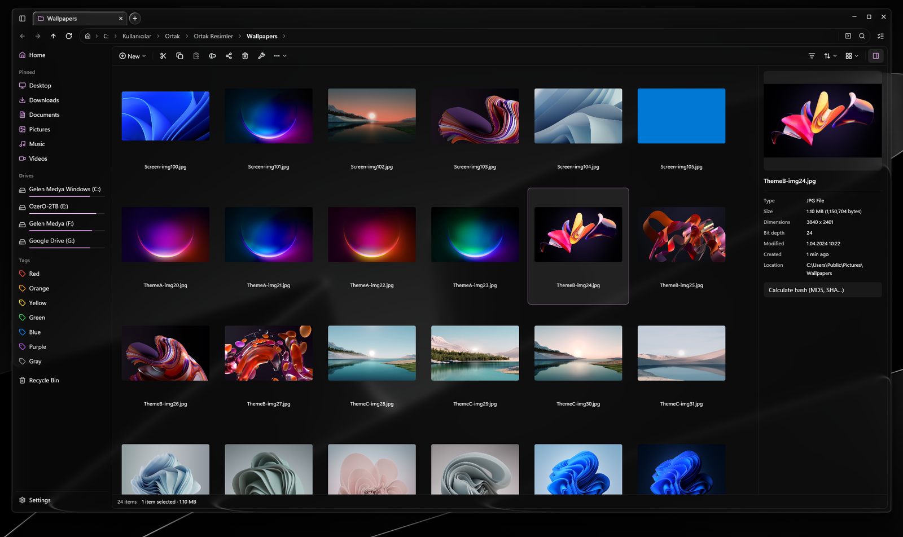

<p align="center">
  <b>Deutsch</b> ·
  <a href="README.zh-CN.md">简体中文</a> ·
  <a href="README.zh-TW.md">繁體中文</a> ·
  <a href="README.ja.md">日本語</a> ·
  <a href="README.md">English</a> ·
  <a href="README.es.md">Español</a> ·
  <a href="README.pt-BR.md">Português (Brasil)</a> ·
  <a href="README.ru.md">Русский</a> ·
  <a href="README.tr.md">Türkçe</a>
</p>

<p align="center"><sub>Dies ist eine Übersetzung; maßgeblich ist die englische <a href="README.md">README</a>.</sub></p>


<p align="center">
  <a href="https://github.com/gelenmedya/rustyfiles/releases/latest"></a>
  
  <a href="LICENSE"></a>
</p>

rustyfiles ist ein Datei-Manager für Windows, von Grund auf in Rust geschrieben. Er soll für die
tägliche Arbeit den Datei-Explorer ersetzen: Tabs, Doppelbereiche, Archive, die du wie Ordner öffnest,
und einen Vorschauer im Quick-Look-Stil namens DirectLook.

Das Fenster wartet nie auf die Festplatte. Auflisten, Symbole, Vorschaubilder, das Kontextmenü und
jede Dateioperation laufen außerhalb des UI-Threads, sodass eine langsame Netzwerkfreigabe oder ein
Ordner mit 100.000 Dateien es nicht einfrieren lassen kann.

<p align="center">
  <a href="https://github.com/gelenmedya/rustyfiles/releases/latest/download/rustyfiles-win-Setup.exe"></a>
  <a href="https://rustyfiles.com"></a>
  <a href="https://discord.gg/K2banZ36zJ"></a>
</p>

<p align="center">
  <a href="https://www.buymeacoffee.com/ozerguzel"></a>
</p>

<p align="center">
  <a href="https://alternativeto.net/software/rustyfiles/about/?utm_source=badge&utm_medium=referral">
    <picture>
      <source media="(prefers-color-scheme: dark)" srcset="https://alternativeto.net/static/badges/badge-compact-dark.svg">
      
    </picture>
  </a>
</p>

Kostenlos, ohne Konto, ohne Werbung. Herunterladen, doppelklicken, fertig: siehe [Installation](#installation).

<picture>
  <source media="(prefers-color-scheme: dark)" srcset="docs/readme/projects-dark.png">
  
</picture>

<sub>Die Bilder zeigen den experimentellen HyperGlass-Hintergrund (Einstellungen › Darstellung). Der Standardhintergrund ist Mica, wie im Explorer.</sub>

## Wie schnell


### Ordner öffnen

Zeit vom Start der App, bis die Liste des Ordners stillsteht, in einem neuen Fenster, wenn der Ordner
bereits im Dateicache des Betriebssystems liegt. Median aus drei Durchläufen nach einem Aufwärmlauf,
gemessen mit dem Geschwindigkeitstest, der in rustyfiles eingebaut ist (Einstellungen › Geschwindigkeitstest):
jeder kann ihn auf dem eigenen Rechner ausführen.

| Ordner | rustyfiles | Datei-Explorer | [Files](https://files.community) |
|---|--:|--:|--:|
| Leerer Ordner | 281 ms | 1.006 ms | 813 ms |
| 1.000 Dateien | 284 ms | 2.214 ms | 1.893 ms |
| 10.000 Dateien | 286 ms | 2.221 ms | 1.053 ms |
| 100.000 Dateien | 281 ms | 2.318 ms | 4.069 ms |
| 2.000 Bilder (Vorschaubilder) | 278 ms | 2.177 ms | 1.075 ms |
| Speicher nach dem Auflisten von 10.000 Dateien | 39 MB | 69 MB | 204 MB |

Gemessen auf einem Rechner (Ryzen 7 9800X3D, NVMe-SSD, Windows 11) am 2026-11-16, mit rustyfiles
0.8.6 und Files 4.3 (0.8.5 brauchte im selben Test etwa 540 ms: sein erster Tab spielte eine
Öffnungsanimation ab, die 0.8.6 beim Start nicht mehr abspielt). rustyfiles und der Explorer
starteten jeweils einen neuen Prozess. Files lief bereits im Hintergrund, daher sind seine Zeiten
keine Kaltstart-Zeiten; es füllt seine Liste außerdem in Schritten, und die Zeit zählt, bis sich das
Bild nicht mehr ändert. Der Speicher ist der private Arbeitssatz, also der Wert, den der
Task-Manager anzeigt; bei Files ist es der Wert seines laufenden Prozesses.

Ist „im Hintergrund weiterlaufen“ eingeschaltet, startet ein neues rustyfiles-Fenster keinen Prozess:
in einer früheren Messung (2026-11-06, eine ältere Version) zeigte es einen aufgelisteten Ordner in
93–168 ms.

### Ein Ordner mit 100.000 Dateien, der sich laufend ändert

Der Ordner ist geöffnet, eine Datei ist ausgewählt, dann werden im Hintergrund etwa 1.000 Dateien pro
Sekunde 5 Sekunden lang umbenannt:

| | |
|---|--:|
| Start bis zum aufgelisteten Ordner (100.001 Dateien) | 315 ms |
| Die Liste folgt den Änderungen | alle ~750 ms |
| Erneutes Einlesen des Ordners (Hintergrund-Thread) | ~70 ms |
| Arbeit im UI-Thread pro Aktualisierung | 7–8 ms |
| Auswahl und Cursor | bleiben auf der ausgewählten Datei |

Das Fenster wartet nie auf den Ordner: Das erneute Einlesen läuft außerhalb des UI-Threads, und die
Aktualisierung selbst kostet weniger als einen Frame bei 120 Hz. Miss es selbst nach mit
`RUSTYFILES_TRACE_LIVE=1` und `RUST_LOG=warn,rf_app=info`.

Frame-Zeiten währenddessen: Derselbe Ordner wird 7,7 s lang mit dem Mausrad nach unten und wieder
nach oben gescrollt, die Auswahl (und damit der Vorschaubereich) wandert alle halbe Sekunde weiter,
während im Hintergrund etwa 680 Dateien pro Sekunde umbenannt werden. Anzeige mit 200 Hz.

| | Median | p95 | p99 | schlechtester |
|---|--:|--:|--:|--:|
| Kosten pro Frame im UI-Thread | 2,1 ms | 4,6 ms | 7,9 ms | 16,8 ms |
| Zeit zwischen den Frames | 3,3 ms | 5,3 ms | 9,9 ms | 17,3 ms |

2.182 Frames in 7,7 s; eine Lücke, die länger ist als ein Frame bei 60 Hz (16,7 ms). Protokolliere
deine eigenen mit `GPUI_FRAME_LOG=frames.tsv` (eine Zeile pro Frame: sein Beginn und seine Kosten, in ms).

### Neuer Tab in einem offenen Fenster

| Ordner | Zeit bis zur fertigen Liste |
|---|--:|
| 1.000 Dateien | ~48 ms |
| 10.000 Dateien | ~46 ms |
| 100.000 Dateien | ~129 ms |

Jeder zusätzliche Tab kostet etwa 3 MB Speicher (1 Tab: ~32 MB, 25 Tabs: ~103 MB).

### Suche nach Dateinamen

rustyfiles legt einen Namensindex der lokalen Laufwerke an und beantwortet Suchen daraus. Gesucht
wurde in allen Unterordnern eines Benutzerordners mit 3,6 Millionen Dateien und Ordnern nach „rapor“,
gemessen bis sich die Ergebnisse auf dem Bildschirm nicht mehr änderten:

| | Zeit |
|---|--:|
| rustyfiles 0.4 | **0,38 s** |
| Datei-Explorer | 1,8 s (sein schnellster von 4 Durchläufen; die anderen dauerten 11–32 s) |

Der Index speichert jeden verschiedenen Namen nur einmal: ein Laufwerk mit 4,8 Millionen Einträgen,
aber 490 Tausend verschiedenen Namen, belegt 61 MB. Ein Ordner-Überwacher hält ihn aktuell, solange
rustyfiles läuft. Zwischen den Läufen sagt das Änderungsjournal von NTFS (ohne Administratorrechte
gelesen), welche Ordner sich geändert haben, sodass ein Start nur diese neu auflistet, statt die
Laufwerke zu durchlaufen: hier 0,2 s für C:, wo ein Durchlauf 30 s braucht. App-Daten, Caches sowie
`node_modules`- und `.git`-Ordner sind vom Index ausgenommen; eine Suche, die in einem solchen Ordner
startet, durchsucht die Festplatte:

`*.dll` unter `C:\Windows`: 342.492 Elemente in 116.851 Ordnern, Dateicache warm.

| Methode | Zeit |
|---|--:|
| rustyfiles | **7,8 s** |
| `dir /s /b` | 53 s |
| PowerShell `Get-ChildItem -Recurse` | 105 s |

rustyfiles sucht auf sechs Threads mit Hintergrundpriorität, damit der Rest des Rechners reaktionsschnell
bleibt. Es folgt keinen Junctions, deshalb findet es 454 Duplikate weniger.

### Vorschau mit Leertaste (DirectLook)

Zeit vom Tastendruck, bis der Inhalt auf dem Bildschirm steht, die App läuft bereits:

| Datei | Inhalt bereit |
|---|--:|
| JPEG, 3840 × 2160 | 24–86 ms |
| Quellcode, mit Syntaxhervorhebung | 23–44 ms |
| 7z-Archiv (Inhalt aufgelistet) | 19–31 ms |
| MP3 (Tags, Songtext) | 27–32 ms |
| H.264-Video, 1080p | erster Frame in 146–185 ms |

### Archive

RAR-Lesen mit [rarchive](https://github.com/gelenmedya/rarchive), unserer eigenen Engine, im Vergleich
zum offiziellen UnRAR (dekodieren und jede CRC prüfen, Archive im Dateicache):

| Archiv | UnRAR | rarchive |
|---|--:|--:|
| 1,3 GB, 32 MB Wörterbuch, 195 Dateien | 2,79 s | **0,28 s** (10×) |
| 400 MB solid | 0,95 s | **0,21 s** (4,5×) |
| 400 MB, 520 Dateien | 1,03 s | **0,063 s** (16×) |

### Kopieren und Entpacken

Derselbe Geschwindigkeitstest, unsere eigenen Engines gegen die von Windows (rustyfiles 0.8.6, 2026-11-16):

| | Windows | rustyfiles |
|---|--:|--:|
| Kopieren von 10.000 kleinen Dateien in 100 Ordnern (41 MB) | 25,6 s | **1,8 s** (14×) |
| Kopieren einer 1-GB-Datei | 0,61 s | 0,44 s |
| Entpacken eines ZIPs mit 10.000 Dateien | 32,4 s | **3,6 s** (9×) |

Das Kopieren nutzt eine eigene parallele Engine, die kleine Dateien auf mehrere Ordner verteilt, weil
Threads, die in denselben Ordner schreiben, aufeinander warten. Eine einzelne große Datei ist durch
die Festplatte begrenzt, nicht durch die Engine (bei einem früheren Lauf war Windows bei beiden um
wenige ms schneller). Die Suche nach Namen in den Testordnern (123.000 Einträge) dauerte 55 ms.

Außerdem löst es Namenskonflikte selbst (ersetzen, überspringen oder beide behalten, für alle oder pro
Datei), hält an und setzt fort, kann jede Kopie Byte für Byte prüfen und seine Geschwindigkeit begrenzen.

Alle Zahlen: ein Rechner (Ryzen 7 9800X3D, NVMe-SSD, Windows 11), November 2026. Ordner öffnen, Kopieren
und Entpacken stammen aus dem eingebauten Geschwindigkeitstest (Einstellungen › Geschwindigkeitstest);
die anderen Testskripte liegen im Repository (`crates/rf-win/examples/copybench.rs` für das Kopieren).

## Was es kann

**Navigation.** Tabs, die du zum Umsortieren ziehen oder in ein neues Fenster herausziehen kannst.
Speichere die Tabs eines Fensters, einschließlich geteilter Bereiche, als benannte Sitzung und öffne
sie später wieder; ihr Name steht neben den Tabs. Ein neuer Tab öffnet die Startseite oder den Ordner,
in dem du gerade bist (Einstellungen › Allgemein). Doppelbereich. Ansichten als Details, Raster, Liste
und Spalten (die Liste kann wie im Explorer spaltenweise gefüllt werden), Gruppierung, Vorschaubereich,
Suche, Farbmarkierungen, die Ablage, Bibliotheken, Netzwerkfreigaben und FTP. Eine Spalte für den
Git-Status. Ordnergrößen auf Abruf: Klicke auf „Größe berechnen“; sie werden über Neustarts hinweg
gemerkt und können die Größe auf dem Datenträger zeigen. „Speicherbelegung anzeigen“ auf einem Ordner
oder Laufwerk listet, was den Platz belegt, das Größte zuerst, neben einer Treemap, in die du hineinklicken
kannst (C:\Windows, 341 Tausend Einträge: 26 MB belegt). Virtuelle Ordner wie Bibliotheken und Galerie
öffnen sich in rustyfiles, und Geräte, die Windows unter Dieser PC auflistet (Telefone per USB oder
Phone Link), erscheinen auf der Startseite unter Geräte; dieser Teil wurde mit einem echten Telefon
noch nicht getestet.

**Dateien.** Rückgängig und Wiederholen für Umbenennen, Kopieren, Verschieben, Löschen in den Papierkorb
und das Auflösen von Ordnern. Massenumbenennung. Duplizieren, in den anderen Bereich kopieren oder
verschieben, und kopierten Text oder ein Bild als neue Datei einfügen. Das vollständige Kontextmenü des
Explorers mit „Senden an“, Drag & Drop mit dem Explorer, dem Desktop, Browsern und Outlook, sowie
Ablageziele auf Tabs, angehefteten Ordnern, Ordnern und Programmen. Sende Dateien an deine anderen
Computer mit [Ferry](#ferry) und lade mit [HyperDownload](#hyperdownload) herunter.

**Archive.** ZIP, 7z, RAR, die tar-Familie und ISO öffnen sich wie Ordner, auch passwortgeschützte
ZIP-, 7z- und RAR-Dateien. Hinzufügen, Löschen und Umbenennen innerhalb von ZIP, 7z und tar. ZIP, 7z und
tar.zst erstellen, mit allen Prozessorkernen. Das Lesen übernimmt [rarchive](https://github.com/gelenmedya/rarchive),
unsere eigene reine Rust-Engine (auch [auf crates.io](https://crates.io/crates/rarchive) für andere
Rust-Projekte): sie dekodiert ein 1,3 GB großes WinRAR-Archiv zehnmal schneller als UnRAR.

**Windows.** Optional der Standard-Dateimanager: Ordner, <kbd>Win</kbd>+<kbd>E</kbd>, Dieser PC und der
Papierkorb öffnen sich in rustyfiles. Optional öffnen sich auch die Dialoge „Öffnen“, „Speichern“ und
„Ordner auswählen“ anderer Apps in rustyfiles (Einstellungen › Erweitert), und eine Anheften-Schaltfläche
dort merkt sich pro App einen Startordner. Bilder und Videos, die in Fotos oder einer anderen Store-App
geöffnet werden, kommen mit ihrem Ordner, sodass Zurück und Weiter funktionieren. Die Pfade `/select,`
und `shell:` des Explorers funktionieren. Mica, dunkler Modus und die Systemakzentfarbe. Wenn ein Spiel
oder ein Rendering die GPU auslastet, wechselt das Zeichnen ohne Flackern auf die CPU und wieder zurück.

**Befehle in der Adressleiste.** Wie im Explorer: Drücke <kbd>Strg</kbd>+<kbd>L</kbd>, tippe `cmd`,
`powershell`, `wt` oder `code .` und drücke <kbd>Eingabe</kbd>. Der Text wird zuerst als Ort gelesen
(ein Pfad, ein Laufwerk, `%VAR%`, `shell:`); ein Ordner oder eine Datei mit diesem Namen im geöffneten
Ordner hat immer Vorrang. Nur wenn es keinen solchen Ort gibt, wird das erste Wort wie im Ausführen-Dialog
als Programm gesucht und im geöffneten Ordner gestartet, der Rest sind seine Argumente. Aus einer
Vervollständigung heraus wird nichts gestartet, und es werden keine Administratorrechte angefordert.
Ein Schalter unter Einstellungen › Dateien und Ordner › Verhalten schaltet es ab.

**Ordnen.** Regeln für einen Ordner: Bedingungen nach Name, Erweiterung, Art, Größe und Alter sowie eine
Aktion (verschieben, in einen aus einer Vorlage gebauten Ordner verschieben, umbenennen oder in den
Papierkorb). Ein manueller Lauf zeigt jeden Schritt in einer Vorschau und verschiebt vor „Anwenden“ nichts,
und ein Lauf lässt sich rückgängig machen. Nichts wird endgültig gelöscht und nichts überschrieben.
Regeln, die von selbst laufen, sind standardmäßig aus.

**Suche.** Die Schnellsuche (<kbd>Alt</kbd>+<kbd>Leertaste</kbd>) findet Apps, Dateien und Ordner,
Browser-Lesezeichen und die Einstellungsseiten von Windows. Was du oft öffnest, steht zuerst, und was du
bei denselben Buchstaben zuvor gewählt hast, steht in der ersten Zeile.

**Sprachen.** 49 Sprachen, abhängig von der Anzeigesprache von Windows (oder wähle eine unter
Einstellungen › Allgemein). Die Oberfläche ist auf Türkisch und Englisch geschrieben; die übrigen Sprachen
gehen von den Formulierungen der Files-Community aus und sind von dort maschinell übersetzt. Arabisch,
Hebräisch und Persisch sind übersetzt, und Namen und Texte von rechts nach links werden von rechts nach
links gelesen (danke an @ialhabbal); die Oberfläche selbst ist noch nicht gespiegelt. Korrekturen sind
willkommen: jede Sprache ist eine JSON-Datei in `crates/rf-app/locales/`.



## DirectLook

Wähle eine Datei aus und drücke <kbd>Leertaste</kbd>. DirectLook öffnet ein Vorschaufenster: Video und
Audio (mit eigenem Player), Bilder, Text und Code, den Inhalt von Archiven und für alles andere eine
Detailkarte. Mit den Pfeiltasten wechselst du durch den Ordner, während das Fenster offen bleibt.

Es läuft als eigenes Programm, `directlook.exe`, damit ein schweres Video den Datei-Manager nie belastet
und keines der beiden das andere mitreißen kann. Es funktioniert in rustyfiles und, wenn du es einschaltest,
auch im Explorer und auf dem Desktop. Die Einstellungen findest du unter Einstellungen › DirectLook.

## Ferry

Sende Dateien und Ordner an rustyfiles auf deinen anderen Computern im selben Netzwerk, ähnlich wie
AirDrop: Rechtsklick › **Mit Ferry senden**.


<sub>Eine Zeichnung von Einstellungen › Ferry mit erfundenen Geräten, in den Worten und dem Layout der App.</sub>

- Ende-zu-Ende verschlüsselt (QUIC mit TLS 1.3), direkt von Gerät zu Gerät: kein Server, kein Konto,
  nichts verlässt dein Netzwerk.
- Koppel deine Geräte so, wie du Bluetooth-Geräte koppelst: Beide zeigen denselben sechsstelligen Code.
  Dateien eines gekoppelten Geräts können ohne Nachfrage ankommen; alles andere wird zuerst in einer
  Benachrichtigung abgefragt.
- Du entscheidest, wer deinen PC sehen kann: niemand, deine gekoppelten Geräte (der Standard) oder alle
  für zehn Minuten. Solange Einstellungen › Ferry geöffnet ist, sieht ihn jeder, damit ein neues Gerät
  ihn finden kann.
- Eine abgebrochene Übertragung wird dort fortgesetzt, wo sie stehen blieb, und jede Datei wird geprüft,
  bevor sie ihren Namen bekommt. Empfangene Dateien werden als heruntergeladen markiert, sodass
  SmartScreen nachfragt, bevor ein darin enthaltenes Programm läuft.
- Jedes Gerät zeigt eine geschätzte Geschwindigkeit, und **Geschwindigkeit testen** misst sie in wenigen
  Sekunden in beide Richtungen.
- Die macOS-App, bald verfügbar, spricht dasselbe Protokoll, das in
  [docs/nearby-protocol.md](docs/nearby-protocol.md) beschrieben ist.

Ferry ist aus, bis du es unter Einstellungen › Ferry einschaltest. Die Windows-Firewall fragt unter
Umständen danach: Erlaube es für private Netzwerke.

## Experimentell: HyperGlass, das Dock und der Desktop

Das ist standardmäßig aus und noch früh. Es wurde auf einem PC mit zwei Monitoren gebaut und ausprobiert,
und manche Teile wurden kaum genutzt. Rechne mit Ecken und Kanten und melde bitte, was dir auffällt.


<sub>Start, HyperSearch und das Kontrollzentrum, aus drei Screenshots desselben Desktops zusammengesetzt (sie öffnen sich nicht alle gleichzeitig).</sub>

- **HyperGlass** (Einstellungen › Darstellung) ist ein fünfter Hintergrund: Der Fensterhintergrund ist
  Glas, das das Dahinterliegende verzerrt und mattiert.
- **Das Dock** (Einstellungen › Dock, ein Schalter) setzt anstelle der Windows-Taskleiste drei Glasinseln
  an den unteren Rand jedes Monitors: ein eigenes Startfeld und eine Suche, die laufenden und angehefteten
  Apps mit Fenstervorschauen, die Symbole des Infobereichs, ein Kontrollzentrum und einen
  Benachrichtigungsbereich. Solange es an ist, ist die Windows-Taskleiste ausgeblendet; ein Tippen auf die
  Windows-Taste öffnet das Startfeld des Docks, und <kbd>Alt</kbd>+<kbd>Tab</kbd> öffnet dessen Umschalter.
  Schaltest du das Dock aus, kommen Windows' eigene zurück.
- **Der Desktop**, den rustyfiles zeichnet, kommt mit dem Dock: dein Hintergrundbild und deine Symbole,
  mit einer Option für abgerundete Ecken.

Der Explorer läuft unter all dem weiter; nichts von Windows wird auf der Festplatte entfernt oder ersetzt.

### Helligkeit für jeden Monitor

Windows hat einen Helligkeitsregler nur für das eigene Display eines Laptops. Das Kontrollzentrum des
Docks hat einen für **jeden Monitor**: Schalte Einstellungen › Dock ein und klicke dann rechts im Dock
auf das Netzwerk- oder Lautstärke-Symbol. Externe Monitore werden über **DDC/CI** eingestellt, den
Standard, über den fast jeder Desktop-Monitor der letzten fünfzehn Jahre über DisplayPort, HDMI und DVI
spricht. Hat ein Monitor keinen Regler, prüfe, ob DDC/CI im Menü des Monitors eingeschaltet ist; manche
Docks, KVM-Umschalter und Adapter leiten es nicht durch. Das eigene Display eines Laptops wird so
eingestellt, wie es Windows' eigener Regler tut (auf einem Laptop noch nicht getestet).

## HyperDownload

Der eigene Download-Manager von rustyfiles, ein Add-on: Einstellungen › Add-ons › HyperDownload › **Installieren**.
Es ist ein eigenes Programm ([Quellcode](https://github.com/gelenmedya/hyperdownload), MIT), wird nur
heruntergeladen, wenn du auf Installieren klickst, vorher mit seiner SHA-256-Prüfsumme geprüft, und kann
jederzeit entfernt werden.

- **Download von einem Link** im Rechtsklickmenü eines Ordners: eine Datei über viele Verbindungen
  gleichzeitig, angehalten und dort fortgesetzt, wo sie stehen blieb, auch nach einem Neustart. Füge einen
  Link in einen Ordner ein, und rustyfiles bietet an, ihn dort herunterzuladen.
- **Torrents und Magnet-Links**, mit einem Dialog, in dem du die Dateien eines Torrents auswählst. Eine
  `.torrent`-Datei lädt über ihr eigenes Menü herunter.
- **Eine Seite „Downloads“** mit allen Downloads, ihren Teilen und ihrem Fortschritt sowie den
  abgeschlossenen; der Fortschritt erscheint auch in der Statuszentrale.
- **Ansehen während des Downloads:** Ein Video läuft in DirectLook, bevor es fertig ist.

## Installation

Die Installation dauert drei Klicks und braucht kein technisches Wissen:

1. **[rustyfiles-win-Setup.exe herunterladen](https://github.com/gelenmedya/rustyfiles/releases/latest/download/rustyfiles-win-Setup.exe)** (etwa 50 MB).
2. Öffne sie. Zeigt Windows „Windows hat Ihren PC geschützt“, klicke auf **Weitere Informationen** und dann auf **Trotzdem ausführen**.
   (Das Installationsprogramm ist noch nicht code-signiert; nur deshalb erscheint die Warnung. Die Installer
   jeder Version werden auf [VirusTotal](https://www.virustotal.com) geprüft: Die Links zu den Berichten
   stehen am Ende der Versionshinweise.)
3. Das war's. rustyfiles öffnet sich von selbst und steht in deinem Startmenü.

Kein Administratorkennwort, nichts einzurichten. Updates werden im Hintergrund still heruntergeladen und
beim nächsten Öffnen von rustyfiles installiert.

**Mit [Scoop](https://scoop.sh):**

```powershell
scoop bucket add rustyfiles https://github.com/gelenmedya/scoop-rustyfiles
scoop install rustyfiles/rustyfiles
```

**Sollen Ordner und <kbd>Win</kbd>+<kbd>E</kbd> in rustyfiles öffnen?** Schalte unter Einstellungen ›
Erweitert › Als Standard-Dateimanager festlegen ein. Ausschalten kannst du es jederzeit.

**Deinstallation** wie bei jeder App über Windows-Einstellungen › Apps. Alles, was rustyfiles geändert
hat, geht zurück an den Datei-Explorer.

**Öffnen-/Speichern-Dialoge in anderen Apps schlagen fehl oder stürzen ab**, nachdem rustyfiles' Dateien
ohne Deinstallation entfernt wurden (ein Virenscanner, ein kaputtes Update)? Ein erneuter Start von
rustyfiles behebt das. Startet rustyfiles nicht mehr, gibt dieser PowerShell-Befehl allen Apps den
Windows-eigenen Dialog zurück:

```powershell
Remove-Item -Recurse "HKCU:\Software\Classes\CLSID\{DC1C5A9C-E88A-4dde-A5A1-60F82A20AEF7}", "HKCU:\Software\Classes\CLSID\{C0B4E2F3-BA21-4773-8DBA-335EC946EB8B}"
```

Lieber ohne Installer? Auf der [Releases](https://github.com/gelenmedya/rustyfiles/releases)-Seite gibt es
ein portables ZIP und ebenso einen ARM64-Installer (`rustyfiles-win-arm64-Setup.exe`). Benötigt Windows 11
(Windows 10 ist nicht getestet). Eine macOS-Version kommt bald, Linux ist geplant.

**Fragen oder Ideen?** Schau auf dem [Discord](https://discord.gg/K2banZ36zJ) vorbei oder besuche
[rustyfiles.com](https://rustyfiles.com).

### Aus dem Quellcode bauen

Du brauchst [Rust](https://rustup.rs) ab Version 1.95 und die Visual Studio Build Tools mit der
Arbeitslast „Desktopentwicklung mit C++“ (eine Abhängigkeit, zstd, kompiliert C-Code).

```powershell
git clone https://github.com/gelenmedya/rustyfiles
cd rustyfiles
.\scripts\install.ps1            # builds, then installs for your user
.\scripts\install.ps1 -Default   # also makes it the default file manager
.\scripts\install.ps1 -Uninstall
```

Mit `cargo run --release -p rf-app` startest du es, ohne zu installieren.

## Tastatur

| Tasten | Aktion |
|---|---|
| <kbd>Strg</kbd>+<kbd>T</kbd> / <kbd>Strg</kbd>+<kbd>W</kbd> / <kbd>Strg</kbd>+<kbd>Umschalt</kbd>+<kbd>T</kbd> | Neuer Tab, Tab schließen, geschlossenen Tab wieder öffnen |
| <kbd>Strg</kbd>+<kbd>L</kbd> oder <kbd>Alt</kbd>+<kbd>D</kbd> | Adressleiste |
| <kbd>Strg</kbd>+<kbd>F</kbd> | Suche (<kbd>Eingabe</kbd> durchsucht auch Unterordner) |
| <kbd>Strg</kbd>+<kbd>Umschalt</kbd>+<kbd>P</kbd> oder <kbd>F1</kbd> | Befehlspalette |
| <kbd>Strg</kbd>+<kbd>P</kbd> / <kbd>Strg</kbd>+<kbd>Umschalt</kbd>+<kbd>A</kbd> | Einen besuchten Ordner finden, einen Tab finden |
| <kbd>Strg</kbd>+<kbd>Umschalt</kbd>+<kbd>1</kbd> … <kbd>5</kbd> | Details, Raster, Spalten, Karten, Liste |
| <kbd>Strg</kbd>+<kbd>Umschalt</kbd>+<kbd>D</kbd>, <kbd>F6</kbd> | Doppelbereich, Bereich wechseln |
| <kbd>Umschalt</kbd>+<kbd>F5</kbd> / <kbd>Umschalt</kbd>+<kbd>F6</kbd> | Kopieren, in den anderen Bereich verschieben |
| <kbd>Strg</kbd>+<kbd>Alt</kbd>+<kbd>D</kbd> | Duplizieren |
| <kbd>Alt</kbd>+<kbd>P</kbd>, <kbd>Strg</kbd>+<kbd>B</kbd> | Vorschaubereich, Seitenleiste |
| <kbd>Leertaste</kbd> | DirectLook |
| <kbd>F2</kbd> | Umbenennen (Massenumbenennung bei mehreren ausgewählten Elementen) |
| <kbd>Strg</kbd>+<kbd>Z</kbd> / <kbd>Strg</kbd>+<kbd>Y</kbd> | Rückgängig, wiederholen |
| <kbd>Strg</kbd>+<kbd>H</kbd> | Versteckte Elemente anzeigen |

Jede Tastenkombination lässt sich unter Einstellungen › Aktionen ändern: Klicke auf einen Befehl und
drücke dann die neuen Tasten.

## Projektaufbau

| Crate | Inhalt |
|---|---|
| `crates/rf-app` | Die Oberfläche und die beiden Programme: `rustyfiles` und `directlook` (`src/look/`) |
| `crates/rf-win` | Windows- und Shell-Integration, die Engine für Dateioperationen |
| `crates/rf-core` | Das Modell: Orte, Verlauf, Einträge |
| `crates/rf-archive` | Archivoperationen: durchsuchen, entpacken, erstellen, bearbeiten |
| `crates/rf-player` | Video- und Audioplayer von DirectLook |
| `crates/rustdecoder` | Unsere eigene Video-Engine, in Arbeit: MP4/MOV (auch fragmentiert) und MKV/WebM; H.264, HEVC, VP9 und AV1 werden über D3D11 Video auf der Grafikkarte dekodiert, in den Tests bitgenau mit ffmpeg / dav1d; ProRes und DNxHR werden auf der CPU dekodiert; Farbkonvertierung, Audio (PCM, AAC, FLAC, Opus, MP3) und A/V-Synchronisation. Sie wird die Videowiedergabe von DirectLook übernehmen ([Entwurf](docs/design/rustdecoder.md)) |

Die Oberfläche ist mit [GPUI](https://gpui.rs) gebaut, dem Framework hinter dem Zed-Editor. Seine
Windows-Schicht ist ein Fork, der die Umschaltung zwischen GPU und CPU ergänzt:
[gelenmedya/gpui-pre-windows](https://github.com/gelenmedya/gpui-pre-windows).

<details>
<summary>Umgebungsvariablen</summary>

| Variable | Wirkung |
|---|---|
| `RUSTYFILES_RENDERER` = `gpu`, `cpu` oder `auto` | Festlegen, wo das Fenster gezeichnet wird |
| `RUSTYFILES_CONFIG_DIR` = Ordner | Einstellungen in einem anderen Ordner speichern (portable Nutzung) |
| `RUSTYFILES_MULTI_INSTANCE=1` | Mehrere Kopien gleichzeitig erlauben (Tests) |
| `RUSTYFILES_FRAME_LOG=1` | Frame-Zeiten protokollieren |
| `RUSTYFILES_LOOK_TRACE=1` | DirectLooks Zeitmessungen nach stderr protokollieren |
| `RUSTYFILES_MUTE=1` | DirectLook spielt ohne Ton ab (Tests) |

Die Einstellungen liegen in `%APPDATA%\rustyfiles\settings.toml`, die von DirectLook daneben in `directlook.toml`.

</details>

## Wie es entsteht

rustyfiles wird mit KI-Programmierwerkzeugen geschrieben, und das ist kein Geheimnis. Eine Person
entscheidet, was gebaut wird und wie es sich verhalten soll, testet jede Änderung auf einem echten PC
(zwei Monitore, Alltagsarbeit) und verwirft, was nicht taugt. Die KI schreibt einen großen Teil des Codes;
sie entscheidet nicht, was ausgeliefert wird.

Was dafür sorgt, dass das ehrlich bleibt:

- **Tests.** Mehr als 3.000 automatisierte Tests laufen, bevor jede Änderung hochgeladen wird.
- **Messungen.** Die Geschwindigkeitswerte oben stammen aus einem Test, der in die App eingebaut ist
  (Einstellungen › Geschwindigkeitstest), sodass jeder sie auf dem eigenen Rechner nachprüfen kann.
- **Berichte.** Fehler kommen von den Menschen, die es nutzen. Jede Meldung bekommt eine Antwort, die
  Korrektur entsteht öffentlich, und die meldende Person wird gebeten, sie zu testen, bevor das Ticket
  geschlossen wird.
- **Der Code.** Alles liegt hier unter der MIT-Lizenz, zum Lesen und zum Beurteilen.

Warum Rust: Ein Datei-Manager muss auch mit 100.000 Dateien in einem Ordner schnell bleiben und darf nie
die Daten von jemandem verlieren. Rust bietet Geschwindigkeit ohne Garbage Collector und schließt ganze
Klassen von Abstürzen aus, bevor sie ausgeliefert werden. Und rustyfiles ist eine neue, von Grund auf
geschriebene App, kein Umbau des Explorers; sie läuft neben dem Explorer und verändert nichts an Windows
auf der Festplatte.

## Status

rustyfiles ist noch jung, und sein Autor nutzt es jeden Tag anstelle des Explorers. Eine Roadmap und
Testberichte folgen in `docs/`. Die macOS-Version ist auf dem Weg und baut auf demselben Kern auf; Linux
kommt danach.

Fehlerberichte und Pull Requests sind willkommen.

## Gelistet auf

- [AlternativeTo](https://alternativeto.net/software/rustyfiles/about/), als Alternative zum Datei-Explorer
- [Scoop](https://scoop.sh), aus einem eigenen Bucket (siehe [Installation](#installation))

## Danksagung

rustyfiles baut auf der Arbeit anderer auf und hat unterwegs viele Ideen übernommen.

[Files](https://github.com/files-community/Files) hat gezeigt, wie ein moderner Datei-Manager für Windows
aussehen kann. Sein Funktionsumfang war unsere Checkliste, seine Einstellungen und sein Aufbau haben unsere
geprägt, und sein Weg, den Explorer als Standard-Dateimanager zu ersetzen, hat unseren geleitet. Danke an
die Files-Community.

[GPUI](https://gpui.rs), das UI-Framework des [Zed](https://github.com/zed-industries/zed)-Editors, zeichnet
jeden Pixel von rustyfiles auf der GPU und macht ein so schnelles Fenster möglich. Danke an das Zed-Team,
dass es gebaut und geteilt wurde, und an [Longbridge](https://github.com/longbridge/gpui-kit) für gpui-kit,
die Komponenten, auf denen wir aufbauen.

DirectLook folgt der Idee von macOS Quick Look und von [QuickLook](https://github.com/QL-Win/QuickLook)
von Paddy Xu, das sie zuerst unter Windows gebracht hat. rarchive hat das RAR-Format aus dem UnRAR-Quellcode
von Alexander Roshal gelernt.

Gebaut mit [windows-rs](https://github.com/microsoft/windows-rs),
[Velopack](https://velopack.io) (Installation und Updates), [Lucide](https://lucide.dev)-Icons,
[zip](https://github.com/zip-rs/zip2), [sevenz-rust2](https://github.com/hasenbanck/sevenz-rust),
[tar](https://github.com/alexcrichton/tar-rs), [notify](https://github.com/notify-rs/notify)
und vielen weiteren Crates. Die Bilder verwenden [Bricolage Grotesque](https://github.com/ateliertriay/bricolage)
von Atelier Triay, [Instrument Sans](https://fonts.google.com/specimen/Instrument+Sans) und
[Doto](https://fonts.google.com/specimen/Doto).

## Lizenz

MIT, siehe [LICENSE](LICENSE). Der GPUI-Fork behält Zeds Apache-2.0-Lizenz in seinem eigenen Repository.
