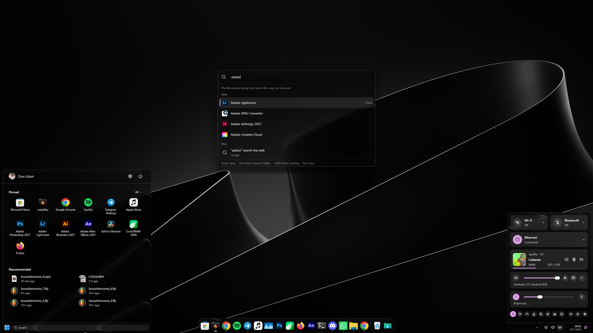

<p align="center">
  <b>日本語</b> ·
  <a href="README.zh-CN.md">简体中文</a> ·
  <a href="README.zh-TW.md">繁體中文</a> ·
  <a href="README.md">English</a> ·
  <a href="README.de.md">Deutsch</a> ·
  <a href="README.es.md">Español</a> ·
  <a href="README.pt-BR.md">Português (Brasil)</a> ·
  <a href="README.ru.md">Русский</a> ·
  <a href="README.tr.md">Türkçe</a>
</p>

<p align="center"><sub>これは翻訳です。正確な内容は英語版の <a href="README.md">README</a> を参照してください。</sub></p>


<p align="center">
  <a href="https://github.com/gelenmedya/rustyfiles/releases/latest"></a>
  <a href="https://github.com/gelenmedya/rustyfiles/releases"></a>
  
  <a href="LICENSE"></a>
</p>

rustyfiles は、Rust で一から書いた Windows 用のファイルマネージャーです。日常の作業でエクスプローラーの代わりに使えるよう作られています。タブ、デュアルペイン、フォルダーのように開けるアーカイブ、そして Quick Look 風のプレビュー機能 DirectLook を備えています。

ウィンドウがディスクを待つことはありません。一覧表示、アイコン、サムネイル、コンテキストメニュー、そしてすべてのファイル操作は UI スレッドの外で実行されるため、遅いネットワーク共有や 10 万ファイルのフォルダーでも、ウィンドウが固まることはありません。

<p align="center">
  <a href="https://github.com/gelenmedya/rustyfiles/releases/latest/download/rustyfiles-win-Setup.exe"></a>
  <a href="https://rustyfiles.com"></a>
  <a href="https://discord.gg/K2banZ36zJ"></a>
</p>

<p align="center">
  <a href="https://www.buymeacoffee.com/ozerguzel"></a>
</p>

<p align="center">
  <a href="https://alternativeto.net/software/rustyfiles/about/?utm_source=badge&utm_medium=referral">
    <picture>
      <source media="(prefers-color-scheme: dark)" srcset="https://alternativeto.net/static/badges/badge-compact-dark.svg">
      
    </picture>
  </a>
</p>

無料、アカウント不要、広告なし。ダウンロードしてダブルクリックするだけで使えます。手順は [インストール](#インストール) を参照してください。

<picture>
  <source media="(prefers-color-scheme: dark)" srcset="docs/readme/projects-dark.png">
  
</picture>

<sub>写真は実験的な HyperGlass の背景 (設定 › 外観) で撮影しています。既定の背景は、エクスプローラーと同じ Mica です。</sub>

## どれくらい速いか


### フォルダーを開く

アプリを起動してから、新しいウィンドウでフォルダーの一覧が動かなくなるまでの時間です。フォルダーは OS のファイルキャッシュに入っている状態で測定しています。ウォームアップ後に 3 回実行した中央値で、rustyfiles に組み込まれた速度テスト (設定 › 速度テスト) で測定しています。誰でも自分の PC で実行できます。

| フォルダー | rustyfiles | エクスプローラー | [Files](https://files.community) |
|---|--:|--:|--:|
| 空のフォルダー | 281 ms | 1,006 ms | 813 ms |
| 1,000 ファイル | 284 ms | 2,214 ms | 1,893 ms |
| 10,000 ファイル | 286 ms | 2,221 ms | 1,053 ms |
| 100,000 ファイル | 281 ms | 2,318 ms | 4,069 ms |
| 2,000 枚の写真 (サムネイル) | 278 ms | 2,177 ms | 1,075 ms |
| 10,000 ファイルを一覧した後のメモリ | 39 MB | 69 MB | 204 MB |

測定は 1 台のマシン (Ryzen 7 9800X3D、NVMe SSD、Windows 11) で、2026-11-16 に行いました。rustyfiles は 0.8.6、Files は 4.3 です (同じテストで 0.8.5 は約 540 ms でした。その最初のタブは開くアニメーションを再生していましたが、0.8.6 では起動時にそのアニメーションを再生しなくなりました)。rustyfiles とエクスプローラーは、それぞれ新しいプロセスを起動しました。Files はバックグラウンドで既に動いていたため、その時間はコールドスタートの時間ではありません。また Files は一覧を段階的に埋めるため、時間は画面の表示が変わらなくなるまで数えています。メモリは作業セットのプライベート部分で、タスクマネージャーに表示される値です。Files の場合は、動いているプロセスの値です。

「バックグラウンドで実行を続ける」をオンにしている場合、新しい rustyfiles ウィンドウはプロセスを新たに起動しません。以前の測定 (2026-11-06、古いバージョン) では、一覧表示されたフォルダーが 93〜168 ms で表示されました。

### 変化し続ける 10 万ファイルのフォルダー

フォルダーを開き、1 つのファイルを選択した状態で、バックグラウンドで 5 秒間、毎秒約 1,000 個のファイル名を変更しました。

| | |
|---|--:|
| 起動から一覧表示まで (100,001 ファイル) | 315 ms |
| 一覧は変更に追従 | 約 750 ms ごと |
| フォルダーの再読み込み (バックグラウンドスレッド) | 約 70 ms |
| 更新 1 回あたりの UI スレッドの処理 | 7〜8 ms |
| 選択とカーソル | 選択したファイルに留まる |

ウィンドウがフォルダーを待つことはありません。再読み込みは UI スレッドの外で行われ、更新自体は 120 Hz で 1 フレームより短い時間しかかかりません。`RUSTYFILES_TRACE_LIVE=1` と `RUST_LOG=warn,rf_app=info` で自分で測定できます。

その間のフレーム時間です。同じフォルダーをマウスホイールで 7.7 秒間、上下にスクロールし、選択 (つまりプレビューペイン) を半秒ごとに動かしました。その間バックグラウンドでは、毎秒約 680 個のファイル名を変更しています。200 Hz のディスプレイです。

| | 中央値 | p95 | p99 | 最悪 |
|---|--:|--:|--:|--:|
| UI スレッドのフレーム処理時間 | 2.1 ms | 4.6 ms | 7.9 ms | 16.8 ms |
| フレーム間の時間 | 3.3 ms | 5.3 ms | 9.9 ms | 17.3 ms |

7.7 秒で 2,182 フレーム。60 Hz の 1 フレーム (16.7 ms) より長い間隔は 1 回でした。`GPUI_FRAME_LOG=frames.tsv` で自分のログを取れます (1 フレームにつき 1 行。開始時刻と処理時間 (ms))。

### 開いているウィンドウで新しいタブ

| フォルダー | 一覧が落ち着くまでの時間 |
|---|--:|
| 1,000 ファイル | 約 48 ms |
| 10,000 ファイル | 約 46 ms |
| 100,000 ファイル | 約 129 ms |

タブを 1 つ増やすごとに、メモリが約 3 MB かかります (1 タブ: 約 32 MB、25 タブ: 約 103 MB)。

### ファイル名で検索

rustyfiles はローカルドライブの名前インデックスを保持し、検索にはそれで答えます。ユーザーフォルダーの下のすべてのサブフォルダーを、360 万のファイルとフォルダーの中から「rapor」で検索しました。検索結果の画面表示が変わらなくなるまでの時間を測定しています。

| | 時間 |
|---|--:|
| rustyfiles 0.4 | **0.38 s** |
| エクスプローラー | 1.8 s (4 回の実行で最速。ほかは 11〜32 秒) |

インデックスは、異なる名前をそれぞれ 1 回だけ保存します。480 万件のエントリーがあっても異なる名前が 49 万個しかないドライブは、インデックスが 61 MB です。rustyfiles の実行中は、フォルダー監視機能がインデックスを最新に保ちます。実行の合間は、NTFS の変更ジャーナル (管理者権限なしで読み取る) が変更されたフォルダーを教えてくれるので、起動時にはそれらのフォルダーだけを再度一覧します。ドライブ全体を歩いて回る必要はありません。ここでは C: で 0.2 s、歩いて回る場合は 30 s でした。アプリのデータ、キャッシュ、`node_modules`、`.git` フォルダーはインデックスから除外されます。その中で始めた検索は、ディスクを歩いて検索します。

`*.dll` を `C:\Windows` の下で検索: 342,492 項目、116,851 フォルダー。ファイルキャッシュは温まった状態です。

| 方法 | 時間 |
|---|--:|
| rustyfiles | **7.8 s** |
| `dir /s /b` | 53 s |
| PowerShell `Get-ChildItem -Recurse` | 105 s |

rustyfiles は背景優先度の 6 本のスレッドで検索するため、PC の他の部分は応答を保ちます。ジャンクションはたどらないため、そのため重複を 454 件少なく見つけます。

### Space でプレビュー (DirectLook)

キーを押してから、アプリがすでに起動している状態で内容が画面に表示されるまでの時間です。

| ファイル | 内容の準備完了 |
|---|--:|
| JPEG, 3840 × 2160 | 24–86 ms |
| ソースコード (構文ハイライト付き) | 23–44 ms |
| 7z アーカイブ (内容を一覧表示) | 19–31 ms |
| MP3 (タグ、歌詞) | 27–32 ms |
| H.264 動画、1080p | 最初のフレームまで 146–185 ms |

### アーカイブ

当社独自のエンジン [rarchive](https://github.com/gelenmedya/rarchive) で RAR を読み込み、公式の UnRAR と比較しました (すべての CRC をデコードして検証し、アーカイブはファイルキャッシュにある状態):

| アーカイブ | UnRAR | rarchive |
|---|--:|--:|
| 1.3 GB、辞書 32 MB、195 ファイル | 2.79 s | **0.28 s** (10×) |
| 400 MB のソリッド | 0.95 s | **0.21 s** (4.5×) |
| 400 MB、520 ファイル | 1.03 s | **0.063 s** (16×) |

### コピーと展開

同じ速度テストで、当社のエンジンと Windows のエンジンを比較しました (rustyfiles 0.8.6、2026-11-16):

| | Windows | rustyfiles |
|---|--:|--:|
| 100 個のフォルダーに分けた 1 万個の小さいファイルのコピー (41 MB) | 25.6 s | **1.8 s** (14×) |
| 1 GB のファイル 1 個のコピー | 0.61 s | 0.44 s |
| 1 万ファイルの ZIP の展開 | 32.4 s | **3.6 s** (9×) |

コピーは独自の並列エンジンを使います。小さいファイルを複数のフォルダーに振り分けます。1 つのフォルダーに書き込むスレッドは、互いに待ち合うためです。大きな 1 つのファイルは、エンジンではなくディスクの速度に制限されます (以前の実行では、Windows が数ミリ秒だけ速かったこともあります)。テストフォルダーを名前で検索した (12 万 3 千項目) のは 55 ms でした。

名前の衝突も自分で処理します (置き換え、スキップ、両方を残す。すべてに適用するか、ファイルごとか)。一時停止と再開ができ、すべてのコピーをバイト単位で検証でき、速度の上限も設定できます。

すべての数値は、1 台のマシン (Ryzen 7 9800X3D、NVMe SSD、Windows 11)、2026 年 11 月のものです。フォルダーを開く、コピー、展開の数値は、組み込みの速度テスト (設定 › 速度テスト) から得ています。ほかのテストスクリプトはリポジトリにあります (コピーは `crates/rf-win/examples/copybench.rs`)。

## 機能

**閲覧。** タブはドラッグで並べ替えたり、新しいウィンドウに切り出したりできます。ウィンドウのタブを、分割ペインを含めて名前付きセッションとして保存し、後で開き直せます。その名前はタブの横に表示されます。新しいタブは、ホームまたは今いるフォルダーを開きます (設定 › 全般)。デュアルペイン。詳細、グリッド、リスト、列表示 (リストはエクスプローラーと同じように、列ごとに埋めることができます)、グループ化、プレビューペイン、検索、色タグ、Shelf、ライブラリ、ネットワーク共有、FTP。Git ステータスの列。フォルダーのサイズは必要なときに取得します。「サイズを計算」をクリックしてください。サイズは再起動後も記憶され、ディスク上のサイズを表示することもできます。フォルダーまたはドライブの「ディスク使用量を表示」は、場所を取っているものを大きい順に一覧し、その横にクリックして移動できるツリーマップを表示します (C:\Windows、34 万 1 千項目: 26 MB を保持)。ライブラリーやギャラリーなどの仮想フォルダーは rustyfiles で開きます。また、「この PC」の下に Windows が表示するデバイス (USB 接続の電話や Phone Link 経由の電話) は、ホームページの「デバイス」の下に表示されます。その部分は、まだ実機の電話では試していません。

**ファイル。** 名前の変更、コピー、移動、ごみ箱への削除、フォルダーの平坦化の元に戻す/やり直し。一括名前変更。もう一方のペインに複製、コピー、移動し、コピーしたテキストや画像を新しいファイルとして貼り付けられます。「送る」を含むエクスプローラーの完全なコンテキストメニュー、エクスプローラー、デスクトップ、ブラウザー、Outlook とのドラッグ & ドロップ、タブ、ピン留めしたフォルダー、フォルダー、プログラムへのドロップ先。他のコンピューターへのファイル送信は [Ferry](#ferry) で、ダウンロードは [HyperDownload](#hyperdownload) で行えます。

**アーカイブ。** ZIP、7z、RAR、tar ファミリー、ISO をフォルダーのように開けます。パスワード付きの ZIP、7z、RAR も含みます。ZIP、7z、tar の中で追加、削除、名前の変更ができます。すべてのコアで ZIP、7z、tar.zst を作成できます。読み込みは、当社独自の純 Rust エンジン [rarchive](https://github.com/gelenmedya/rarchive) が行います (ほかの Rust プロジェクト向けに [crates.io](https://crates.io/crates/rarchive) でも公開しています)。1.3 GB の WinRAR アーカイブを、UnRAR より 10 倍速くデコードします。

**Windows。** 任意で既定のファイルマネージャーにできます。フォルダー、<kbd>Win</kbd>+<kbd>E</kbd>、この PC、ごみ箱が rustyfiles で開きます。任意で、他のアプリの「開く」「保存」「フォルダーの選択」ダイアログも rustyfiles で開くようにできます (設定 › 詳細設定)。そのダイアログのピンボタンで、アプリごとに開始フォルダーを保持できます。フォト などのストアアプリで開いた写真やビデオは、そのフォルダーも一緒に来るので、前へ・次へが機能します。エクスプローラーの `/select,` と `shell:` のパスも動きます。Mica、ダークモード、システムのアクセントカラー。ゲームやレンダリングで GPU が飽和したとき、描画はちらつきなしで CPU に移り、また戻ります。

**アドレスバーのコマンド。** エクスプローラーと同じく、<kbd>Ctrl</kbd>+<kbd>L</kbd> を押して `cmd`、`powershell`、`wt`、`code .` のいずれかを入力し、<kbd>Enter</kbd> を押します。入力は、まず場所 (パス、ドライブ、`%VAR%`、`shell:`) として解釈されます。開いているフォルダーに同じ名前のフォルダーやファイルがあれば、常にそちらが優先されます。そのような場所がない場合にのみ、最初の単語が「ファイル名を指定して実行」と同じようにプログラムとして探され、残りを引数として、開いているフォルダーで起動されます。補完候補からは何も起動せず、管理者権限も求めません。設定 › ファイルとフォルダー › 動作 のスイッチでオフにできます。

**整理。** フォルダーごとのルール。名前、拡張子、種類、サイズ、経過日数の条件と、1 つの操作 (移動、テンプレートから作ったフォルダーへの移動、名前の変更、ごみ箱) を指定できます。手動の実行は、すべての手順をプレビューに表示し、「適用」を押すまで何も移動しません。実行は元に戻せます。完全に削除されることもなく、上書きされることもありません。自動で動くルールは、既定でオフです。

**検索。** クイック検索 (<kbd>Alt</kbd>+<kbd>Space</kbd>) は、アプリ、ファイル、フォルダー、ブラウザーのブックマーク、Windows の設定ページを検索します。よく開くものが先に表示され、同じ文字で以前に選んだものが一番上の行になります。

**言語。** 49 言語に対応し、Windows の表示言語に従います (または 設定 › 全般 で選べます)。インターフェースはトルコ語と英語で書かれています。ほかの言語は Files コミュニティの文言から始まり、そこから機械翻訳されています。アラビア語、ヘブライ語、ペルシア語は翻訳済みで、右から左へ書く名前とテキストは右から左に表示されます (@ialhabbal に感謝します)。インターフェース自体はまだ左右反転されていません。修正は歓迎します。各言語は `crates/rf-app/locales/` の中の JSON ファイル 1 つです。


## DirectLook

ファイルを選択して <kbd>Space</kbd> を押します。DirectLook がプレビューウィンドウを開きます。ビデオと音声 (専用のプレーヤー付き)、画像、テキストとコード、アーカイブの内容、そのほかのものは詳細カードを表示します。矢印キーで、ウィンドウを開いたままフォルダー内を移動できます。

独立したプログラム `directlook.exe` として動くため、重いビデオがファイルマネージャーの負担になることはなく、また、どちらかがもう一方を道連れに落ちることもありません。rustyfiles で動くほか、オンにすればエクスプローラーとデスクトップでも動きます。設定は 設定 › DirectLook にあります。

## Ferry

同じネットワーク上の、ほかのコンピューターの rustyfiles へファイルとフォルダーを送ります。AirDrop のように、右クリック › **Ferry で送る** で送れます。


<sub>架空のデバイスを使った 設定 › Ferry の図で、アプリ自身の言葉とレイアウトで描いています。</sub>

- エンドツーエンドで暗号化 (TLS 1.3 付きの QUIC)、デバイスからデバイスへ直接送信します。サーバーもアカウントもなく、ネットワークの外へ何も出ません。
- Bluetooth のペアリングと同じように、デバイスをペアリングします。両方に同じ 6 桁のコードが表示されます。ペアリング済みのデバイスからのファイルは、確認なしで届くことがあります。それ以外は、まず通知で確認されます。
- PC を誰に見せるか選べます: 誰にも見せない、ペアリング済みのデバイス (既定)、または 10 分間すべての人。設定 › Ferry を開いている間は、誰でもそれを見られるため、新しいデバイスが見つけられます。
- 途中で止まった転送は、止まったところから再開し、すべてのファイルは名前が付けられる前に検査されます。受信したファイルは「ダウンロード済み」とマークされるため、その中のプログラムを実行するとき SmartScreen が確認します。
- 各デバイスには推定速度が表示され、**速度をテスト** を押すと、数秒で両方向を測定します。
- 近日公開の macOS アプリは同じプロトコルを話します。プロトコルは [docs/nearby-protocol.md](docs/nearby-protocol.md) に書かれています。

Ferry は、設定 › Ferry でオンにするまでオフです。Windows ファイアウォールが確認を求めることがあります。その場合は、プライベートネットワークで許可してください。

## 実験的機能: HyperGlass、Dock、デスクトップ

これらは既定でオフで、まだ初期段階です。2 台のモニターを持つ 1 台の PC で作って試したもので、一部の機能はほとんど使われていません。粗い部分があることを想定し、見つけたことを報告してください。



<sub>スタート、HyperSearch、コントロールセンターは、同じデスクトップの 3 枚のスクリーンショットを組み合わせたものです (同時には開きません)。</sub>

- **HyperGlass** (設定 › 外観) は 5 つ目の背景です。ウィンドウの背景がガラスになり、後ろにあるものを屈折させて曇らせます。
- **Dock** (設定 › Dock、スイッチ 1 つ) は、各モニターの下部に 3 つのガラスのアイランドを置き、Windows のタスクバーの代わりにします。独自のスタートパネルと検索、ウィンドウプレビュー付きの実行中・ピン留めアプリ、トレイアイコン、コントロールセンター、通知パネルです。オンの間は、Windows のタスクバーは隠され、Windows キーを 1 回押すと Dock のスタートが開き、<kbd>Alt</kbd>+<kbd>Tab</kbd> で Dock の切り替えが開きます。Dock をオフにすると、Windows の標準のものが戻ります。
- **デスクトップ**は、rustyfiles が描画するもので、Dock と一緒に提供されます。壁紙とアイコンを表示し、角を丸くするオプションがあります。

エクスプローラーはこれらすべての下で動き続けます。ディスク上の Windows の何も削除も置き換えもされません。

### すべてのモニターの明るさ

Windows の明るさスライダーは、ノートパソコン自身の画面にしか付いていません。Dock のコントロールセンターには **モニターごと** のスライダーがあります。設定 › Dock をオンにして、Dock の右側のネットワークまたは音量のアイコンをクリックしてください。外部モニターは **DDC/CI** で設定します。これは、過去 15 年に出たほとんどのデスクトップ用モニターが、DisplayPort、HDMI、DVI で話す標準規格です。スライダーが出ないモニターは、モニター本体のメニューで DDC/CI がオンになっているか確認してください。一部のドック、KVM スイッチ、アダプターは、これを通過させません。ノートパソコン自身の画面は、Windows 標準のスライダーと同じ方法で設定します (ノートパソコンでは未確認です)。

## HyperDownload

rustyfiles 独自のダウンロードマネージャーで、アドオンです: 設定 › アドオン › HyperDownload › **インストール**。別のプログラムです ([ソース](https://github.com/gelenmedya/hyperdownload)、MIT)。インストールをクリックしたときだけダウンロードされ、ダウンロードの前に SHA-256 で検証されます。いつでも削除できます。

- **リンクからダウンロード**: フォルダーの右クリックメニューから。1 つのファイルを複数の接続で同時に取得します。一時停止して、止まったところから再開でき、再起動後も同じです。フォルダーにリンクを貼り付けると、rustyfiles がそのフォルダーへのダウンロードを提案します。
- **トレントとマグネットリンク**。トレントのどのファイルを取得するか選べるダイアログがあります。`.torrent` ファイルは、その独自のメニューからダウンロードできます。
- **ダウンロードページ**: すべてのダウンロードと、そのピース、進捗、完了したもの。進捗はステータスセンターにも表示されます。
- **ダウンロード中の視聴**: ビデオは完了する前に DirectLook で再生できます。

## インストール

インストールは 3 回のクリックで済み、技術的な知識は不要です。

1. **[rustyfiles-win-Setup.exe をダウンロード](https://github.com/gelenmedya/rustyfiles/releases/latest/download/rustyfiles-win-Setup.exe)** (約 50 MB)。
2. 開きます。「Windows によって PC が保護されました」と表示されたら、**詳細情報** をクリックし、次に **実行** をクリックします。(インストーラーにはまだコード署名がされていないため、これが警告の唯一の理由です。各リリースのインストーラーは [VirusTotal](https://www.virustotal.com) でスキャンされています。レポートへのリンクは、リリースノートの最後にあります。)
3. 以上です。rustyfiles は自動で開き、スタート メニューに入ります。

管理者パスワードは不要で、設定するものもありません。更新は、バックグラウンドで静かにダウンロードされ、次に rustyfiles を開いたときに適用されます。

**[Scoop](https://scoop.sh) を使う場合:**

```powershell
scoop bucket add rustyfiles https://github.com/gelenmedya/scoop-rustyfiles
scoop install rustyfiles/rustyfiles
```

**フォルダーと <kbd>Win</kbd>+<kbd>E</kbd> を rustyfiles で開きたいですか？** 設定 › 詳細設定 › 既定のファイルマネージャーに設定 をオンにしてください。いつでもオフにできます。

**アンインストール** は、ほかのアプリと同じように Windows の設定 › アプリ から行います。rustyfiles が変更したものはすべて、エクスプローラーに戻ります。

rustyfiles のファイルがアンインストールされずに削除された後 (ウイルス対策ソフトや壊れた更新などによる)、**他のアプリの「開く」「保存」ダイアログが失敗またはクラッシュする**ことはありますか？ rustyfiles を再度起動すると直ります。rustyfiles が起動しなくなった場合は、次の PowerShell コマンドで、すべてのアプリに Windows 標準のダイアログを戻せます:

```powershell
Remove-Item -Recurse "HKCU:\Software\Classes\CLSID\{DC1C5A9C-E88A-4dde-A5A1-60F82A20AEF7}", "HKCU:\Software\Classes\CLSID\{C0B4E2F3-BA21-4773-8DBA-335EC946EB8B}"
```

インストーラーを使いたくない場合は、[リリース](https://github.com/gelenmedya/rustyfiles/releases) ページにポータブル版の zip があります。ARM64 版のインストーラー (`rustyfiles-win-arm64-Setup.exe`) もあります。Windows 11 が必要です (Windows 10 は未検証です)。macOS 版は近日公開予定で、Linux も予定されています。

**ご質問やご提案は？** [Discord](https://discord.gg/K2banZ36zJ) で挨拶してください。または [rustyfiles.com](https://rustyfiles.com) をご覧ください。

### ソースからビルド

[Rust](https://rustup.rs) 1.95 以降と、「C++ によるデスクトップ開発」ワークロードを含む Visual Studio Build Tools が必要です (依存関係の 1 つである zstd は、C のコードをコンパイルします)。

```powershell
git clone https://github.com/gelenmedya/rustyfiles
cd rustyfiles
.\scripts\install.ps1            # ビルドしてから、ユーザー向けにインストールします
.\scripts\install.ps1 -Default   # 既定のファイルマネージャーにも設定します
.\scripts\install.ps1 -Uninstall
```

`cargo run --release -p rf-app` は、インストールせずに起動します。

## キーボード

| キー | 操作 |
|---|---|
| <kbd>Ctrl</kbd>+<kbd>T</kbd> / <kbd>Ctrl</kbd>+<kbd>W</kbd> / <kbd>Ctrl</kbd>+<kbd>Shift</kbd>+<kbd>T</kbd> | 新しいタブ、タブを閉じる、閉じたタブを開き直す |
| <kbd>Ctrl</kbd>+<kbd>L</kbd> または <kbd>Alt</kbd>+<kbd>D</kbd> | アドレスバー |
| <kbd>Ctrl</kbd>+<kbd>F</kbd> | 検索 (<kbd>Enter</kbd> でサブフォルダーも検索) |
| <kbd>Ctrl</kbd>+<kbd>Shift</kbd>+<kbd>P</kbd> または <kbd>F1</kbd> | コマンドパレット |
| <kbd>Ctrl</kbd>+<kbd>P</kbd> / <kbd>Ctrl</kbd>+<kbd>Shift</kbd>+<kbd>A</kbd> | 訪れたフォルダーを探す、タブを探す |
| <kbd>Ctrl</kbd>+<kbd>Shift</kbd>+<kbd>1</kbd> … <kbd>5</kbd> | 詳細、グリッド、列、カード、リスト |
| <kbd>Ctrl</kbd>+<kbd>Shift</kbd>+<kbd>D</kbd>、<kbd>F6</kbd> | デュアルペイン、ペインを切り替え |
| <kbd>Shift</kbd>+<kbd>F5</kbd> / <kbd>Shift</kbd>+<kbd>F6</kbd> | もう一方のペインへコピー、移動 |
| <kbd>Ctrl</kbd>+<kbd>Alt</kbd>+<kbd>D</kbd> | 複製 |
| <kbd>Alt</kbd>+<kbd>P</kbd>、<kbd>Ctrl</kbd>+<kbd>B</kbd> | プレビューペイン、サイドバー |
| <kbd>Space</kbd> | DirectLook |
| <kbd>F2</kbd> | 名前の変更 (複数選択時は一括名前変更) |
| <kbd>Ctrl</kbd>+<kbd>Z</kbd> / <kbd>Ctrl</kbd>+<kbd>Y</kbd> | 元に戻す、やり直し |
| <kbd>Ctrl</kbd>+<kbd>H</kbd> | 隠しアイテムを表示 |

各ショートカットは 設定 › 操作 で変更できます。コマンドをクリックしてから、新しいキーを押してください。

## プロジェクトの構成

| クレート | 内容 |
|---|---|
| `crates/rf-app` | インターフェースと、2 つのプログラム: `rustyfiles` と `directlook` (`src/look/`) |
| `crates/rf-win` | Windows とシェル連携、ファイル操作エンジン |
| `crates/rf-core` | モデル: 場所、履歴、エントリー |
| `crates/rf-archive` | アーカイブ操作: 閲覧、展開、作成、編集 |
| `crates/rf-player` | DirectLook のビデオと音声のプレーヤー |
| `crates/rustdecoder` | 当社独自のビデオエンジン、作業中: MP4/MOV (フラグメント化されたものも含む) と MKV/WebM。H.264、HEVC、VP9、AV1 は D3D11 Video を通じてグラフィックスカードでデコードされ、テストでは ffmpeg / dav1d とビット単位で一致します。ProRes と DNxHR は CPU でデコードします。色変換、音声 (PCM、AAC、FLAC、Opus、MP3)、A/V 同期。DirectLook のビデオ再生を引き継ぐ予定です ([設計](docs/design/rustdecoder.md)) |

インターフェースは [GPUI](https://gpui.rs) で作られています。これは Zed エディターの基盤となるフレームワークです。その Windows 層は、GPU/CPU 切り替えを追加したフォークです: [gelenmedya/gpui-pre-windows](https://github.com/gelenmedya/gpui-pre-windows)。

<details>
<summary>環境変数</summary>

| 変数 | 効果 |
|---|---|
| `RUSTYFILES_RENDERER` = `gpu`、`cpu`、`auto` | ウィンドウをどこで描画するかを強制する |
| `RUSTYFILES_CONFIG_DIR` = フォルダー | 設定を別のフォルダーに保存する (ポータブル利用) |
| `RUSTYFILES_MULTI_INSTANCE=1` | 同時に複数起動を許可する (テスト用) |
| `RUSTYFILES_FRAME_LOG=1` | フレーム時間を記録する |
| `RUSTYFILES_LOOK_TRACE=1` | DirectLook のタイミングを標準エラー出力に記録する |
| `RUSTYFILES_MUTE=1` | DirectLook を音なしで再生する (テスト用) |

設定は `%APPDATA%\rustyfiles\settings.toml` に保存され、DirectLook の設定はその隣の `directlook.toml` に保存されます。

</details>

## 作り方

rustyfiles は AI のコーディングツールを使って書かれています。それは秘密ではありません。開発者は 1 人で、何を作り、どう振る舞うべきかを決め、変更を 1 つずつ実際の PC (2 台のモニター、日常の作業) で試し、うまくいかないものは取り下げます。コードの多くは AI が書きますが、何を出荷するかは AI が決めません。

その誠実さを保つもの:

- **テスト。** 変更をプッシュする前に、3,000 を超える自動テストが実行されます。
- **測定。** 上の速度の数値は、アプリに組み込まれたテスト (設定 › 速度テスト) から得られたものなので、誰でも自分の PC で確認できます。
- **報告。** バグは、それを使う人から届きます。すべての issue には回答があり、修正は公開された場で行われ、報告者には、閉じる前に試してもらうよう依頼します。
- **コード。** すべて MIT ライセンスの下でここにあり、読んで評価できます。

なぜ Rust か: ファイルマネージャーは、1 つのフォルダーに 10 万ファイルがあっても速さを保ち、誰のデータも決して失ってはなりません。Rust はガベージコレクターなしで速さを与え、出荷前に一群のクラッシュを排除します。そして rustyfiles はエクスプローラーの書き直しではなく、一から書かれた新しいアプリです。エクスプローラーの隣で動き、ディスク上の Windows は何も変更しません。

## 現状

rustyfiles はまだ若く、作者は毎日エクスプローラーの代わりに使っています。ロードマップとテストレポートは `docs/` に追加される予定です。macOS 版は同じコアの上に作られており、準備が進んでいます。Linux はその後です。

バグ報告とプルリクエストを歓迎します。

## 掲載先

- [AlternativeTo](https://alternativeto.net/software/rustyfiles/about/)：エクスプローラーの代替として
- [Awesome Rust](https://github.com/rust-unofficial/awesome-rust#file-manager)：「File manager」の項
- [Scoop](https://scoop.sh)：専用の bucket から（[インストール](#インストール) を参照）

## 謝辞

rustyfiles は他の人々の仕事の上に成り立っており、道中で多くのアイデアを借りました。

[Files](https://github.com/files-community/Files) は、Windows 向けの現代的なファイルマネージャーがどうあり得るかを示しました。その機能一覧は私たちのチェックリストになり、その設定と配置は私たちのものを形作り、エクスプローラーを既定のファイルマネージャーとして置き換えるというアプローチは私たちを導きました。Files コミュニティに感謝します。

[GPUI](https://gpui.rs) は、[Zed](https://github.com/zed-industries/zed) エディターの UI フレームワークで、rustyfiles のすべてのピクセルを GPU で描画し、このように速いウィンドウを可能にしています。作って共有してくれた Zed チームに、また私たちが使っている部品である gpui-kit を提供してくれた [Longbridge](https://github.com/longbridge/gpui-kit) に感謝します。

DirectLook は macOS の Quick Look の考え方に従っています。また、Windows に最初に持ち込んだのは Paddy Xu の [QuickLook](https://github.com/QL-Win/QuickLook) です。rarchive は、Alexander Roshal の UnRAR のソースから RAR 形式を学びました。

[windows-rs](https://github.com/microsoft/windows-rs)、[Velopack](https://velopack.io) (インストールと更新)、[Lucide](https://lucide.dev) アイコン、[zip](https://github.com/zip-rs/zip2)、[sevenz-rust2](https://github.com/hasenbanck/sevenz-rust)、[tar](https://github.com/alexcrichton/tar-rs)、[notify](https://github.com/notify-rs/notify) などの多くのクレートで作られています。画像には、Atelier Triay の [Bricolage Grotesque](https://github.com/ateliertriay/bricolage)、[Instrument Sans](https://fonts.google.com/specimen/Instrument+Sans)、[Doto](https://fonts.google.com/specimen/Doto) を使っています。

## ライセンス

MIT ライセンスです。[LICENSE](LICENSE) を参照してください。GPUI のフォークは、Zed の Apache-2.0 ライセンスを、その独自のリポジトリで維持しています。
