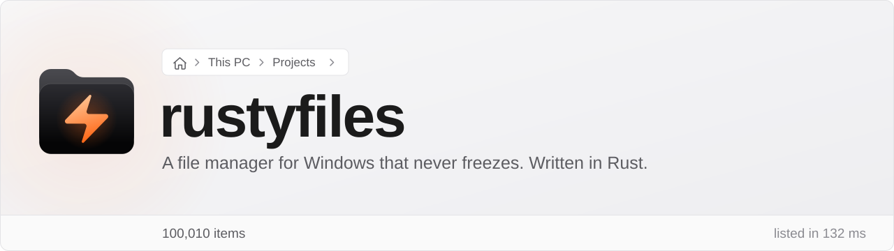
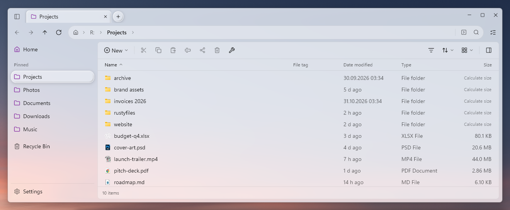
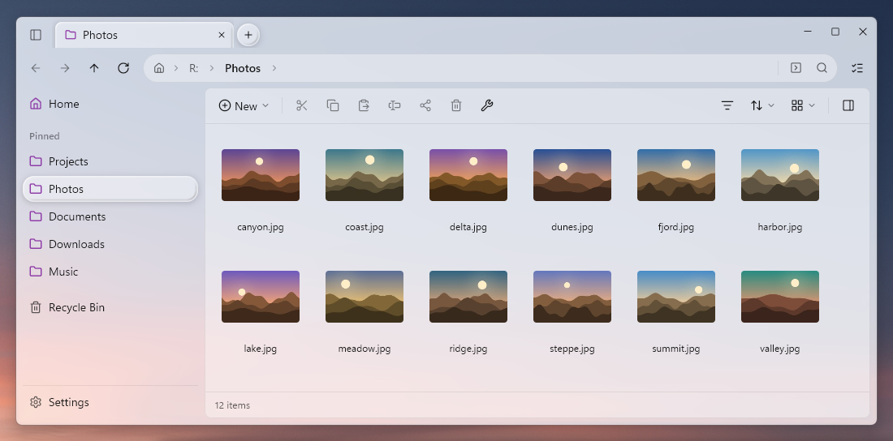
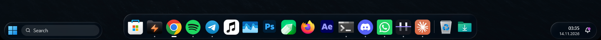

<picture>
  <source media="(prefers-color-scheme: dark)" srcset="docs/readme/banner-dark.svg">
  
</picture>

rustyfiles is a file manager for Windows, written from scratch in Rust. It is meant to replace
File Explorer for everyday work: tabs, dual panes, archives you open like folders, and a
Quick Look–style previewer called DirectLook.

The window never waits on the disk. Listing, icons, thumbnails, the context menu and every file
operation run off the UI thread, so a slow network share or a folder with 100,000 files can't
freeze it.

<p align="center">
  <a href="https://github.com/gelenmedya/rustyfiles/releases/latest/download/rustyfiles-win-Setup.exe"></a>
  <a href="https://rustyfiles.com"></a>
  <a href="https://discord.gg/K2banZ36zJ"></a>
</p>

<p align="center">
  <a href="https://www.buymeacoffee.com/ozerguzel"></a>
</p>

<p align="center">
  <a href="https://alternativeto.net/software/rustyfiles/about/?utm_source=badge&utm_medium=referral">
    <picture>
      <source media="(prefers-color-scheme: dark)" srcset="https://alternativeto.net/static/badges/badge-compact-dark.svg">
      
    </picture>
  </a>
</p>

Free, no account, no ads. Download, double-click, done: see [Install](#install).

<picture>
  <source media="(prefers-color-scheme: dark)" srcset="docs/readme/projects-dark.png">
  
</picture>

<sub>The pictures show the experimental HyperGlass backdrop (Settings › Appearance). The default backdrop is Mica, as in Explorer.</sub>

## How fast

### Opening a folder

Time from launching the app to the folder list settling, in a new window, with the folder
already in the OS file cache. Median of five runs.

| Folder | rustyfiles | File Explorer | [Files](https://files.community) |
|---|--:|--:|--:|
| 1,000 files | 93 ms | 1,113 ms | 2,640 ms |
| 10,000 files | 110 ms | 1,065 ms | 3,053 ms |
| 100,000 files | 168 ms | 1,186 ms | 11,342 ms |
| Memory after listing 10,000 files | ~40 MB | ~70 MB | ~250 MB |

Measured on one machine (Ryzen 7 9800X3D, NVMe SSD, Windows 11) on 2026-11-06. rustyfiles was
already running in the background; Explorer and Files each started a new process, and Files
loads its list incrementally, so its numbers are an upper bound. Starting rustyfiles cold
takes 350–480 ms.

### A 100,000-file folder that keeps changing

The folder open, one file selected, then about 1,000 files renamed per second in the background
for 5 seconds:

| | |
|---|--:|
| Launch to a listed folder (100,001 files) | 315 ms |
| The list follows the changes | every ~750 ms |
| Re-reading the folder (background thread) | ~70 ms |
| Work on the UI thread per update | 7–8 ms |
| Selection and cursor | stay on the selected file |

The window never waits for the folder: re-reading happens off the UI thread, and the update
itself costs less than one frame at 120 Hz. Measure it yourself with
`RUSTYFILES_TRACE_LIVE=1` and `RUST_LOG=warn,rf_app=info`.

Frame times while it happens: the same folder scrolled down and back up with the mouse wheel for
7.7 s, the selection (and so the preview pane) moving every half second, while about 680 files a
second are renamed in the background. 200 Hz display.

| | median | p95 | p99 | worst |
|---|--:|--:|--:|--:|
| Frame cost on the UI thread | 2.1 ms | 4.6 ms | 7.9 ms | 16.8 ms |
| Time between frames | 3.3 ms | 5.3 ms | 9.9 ms | 17.3 ms |

2,182 frames in 7.7 s; one gap longer than a 60 Hz frame (16.7 ms). Log your own with
`GPUI_FRAME_LOG=frames.tsv` (one line per frame: its start and its cost, in ms).

### New tab in an open window

| Folder | Time to a settled list |
|---|--:|
| 1,000 files | ~48 ms |
| 10,000 files | ~46 ms |
| 100,000 files | ~129 ms |

Each extra tab costs about 3 MB of memory (1 tab: ~32 MB, 25 tabs: ~103 MB).

### Search by file name

rustyfiles keeps a name index of the local drives and answers searches from it. Searching every
subfolder of a user folder with 3.6 million files and folders for "rapor", timed until the
results on screen stopped changing:

| | Time |
|---|--:|
| rustyfiles 0.4 | **0.38 s** |
| File Explorer | 1.8 s (its fastest of 4 runs; the others took 11–32 s) |

The index stores each different name once: a drive with 4.8 million entries but 490 thousand
different names takes 61 MB. A folder watcher keeps it current while rustyfiles runs. Between
runs, NTFS's change journal (read without administrator rights) says which folders changed, so a
start lists only those again instead of walking the drives: 0.2 s for C: here, where a walk takes
30 s. App data, caches, `node_modules` and `.git` folders are left out of the index; a search
started inside one walks the disk:

`*.dll` under `C:\Windows`: 342,492 items in 116,851 folders, file cache warm.

| Method | Time |
|---|--:|
| rustyfiles | **7.8 s** |
| `dir /s /b` | 53 s |
| PowerShell `Get-ChildItem -Recurse` | 105 s |

rustyfiles searches on six background-priority threads, so the rest of the machine stays
responsive. It doesn't follow junctions, which is why it finds 454 fewer duplicates.

### Preview with Space (DirectLook)

Time from the key press to the content on screen, app already running:

| File | Content ready |
|---|--:|
| JPEG, 3840 × 2160 | 24–86 ms |
| Source code, syntax-highlighted | 23–44 ms |
| 7z archive (contents listed) | 19–31 ms |
| MP3 (tags, lyrics) | 27–32 ms |
| H.264 video, 1080p | first frame in 146–185 ms |

### Archives

Reading RAR with [rarchive](https://github.com/gelenmedya/rarchive), our own engine, against
the official UnRAR (decode and check every CRC, archives in the file cache):

| Archive | UnRAR | rarchive |
|---|--:|--:|
| 1.3 GB, 32 MB dictionary, 195 files | 2.79 s | **0.28 s** (10×) |
| 400 MB solid | 0.95 s | **0.21 s** (4.5×) |
| 400 MB, 520 files | 1.03 s | **0.063 s** (16×) |

### Copying

Copying uses its own parallel engine: 16 times faster than Explorer's on 520 files (381 MB),
about 30 times on 20,000 small files. The next engine (in the coming release) spreads small
files across folders, because threads writing into one folder wait on each other:

| 20,000 files of 4 KB in 200 folders, plus 20 files of 50 MB | Time |
|---|--:|
| Current engine | 6.8 s |
| Next engine | **3.6 s** |

It also handles name conflicts itself (replace, skip or keep both, for all or per file),
pauses and resumes, can verify every copy byte by byte, and can cap its speed.

All numbers: one machine (Ryzen 7 9800X3D, NVMe SSD, Windows 11), November 2026. The test
scripts are in the repository (`crates/rf-win/examples/copybench.rs` for copying).

## What it does

**Browsing.** Tabs you can drag to reorder or pull out into a new window. Dual pane. Details,
grid and column views, grouping, a preview pane, search, colour tags, the Shelf, libraries,
network shares and FTP. A Git status column. Folder sizes on demand: click "Calculate size";
they are remembered across restarts and can show size on disk. "Show disk usage" on a folder or
drive lists what takes the space, biggest first, next to a treemap you can click through
(C:\Windows, 341 thousand entries: 26 MB held). Virtual folders such as Libraries
and Gallery open in rustyfiles, and devices Windows lists under This PC (phones over USB or Phone
Link) appear under Devices on the Home page; that part hasn't been tried with a real phone yet.

**Files.** Undo and redo for renames, copies, moves, deleting to the Recycle Bin and folder
flattening. Bulk rename.
The full Explorer context menu, drag and drop with Explorer and the desktop, and drop targets
on tabs and pinned folders.

**Archives.** ZIP, 7z, RAR, the tar family and ISO open like folders, password-protected
ZIP, 7z and RAR included. Add, delete and rename inside ZIP, 7z and tar. Create ZIP, 7z and tar.zst on every core. Reading is
done by [rarchive](https://github.com/gelenmedya/rarchive), our own pure-Rust engine (also [on crates.io](https://crates.io/crates/rarchive) for other Rust projects): it
decodes a 1.3 GB WinRAR archive ten times faster than UnRAR.

**Windows.** Optionally the default file manager: folders, <kbd>Win</kbd>+<kbd>E</kbd>, This PC
and the Recycle Bin open in rustyfiles. Optionally, other apps' Open, Save and Select folder
dialogs open in rustyfiles too (Settings › Advanced). Explorer's `/select,` and `shell:` paths
work. Mica,
dark mode and the system accent colour. When a game or a render saturates the GPU, drawing
moves to the CPU and back again without a flicker.

**Commands in the address bar.** As in Explorer: press <kbd>Ctrl</kbd>+<kbd>L</kbd>, type `cmd`,
`powershell`, `wt` or `code .` and press <kbd>Enter</kbd>. The text is first taken as a place (a
path, a drive, `%VAR%`, `shell:`); a folder or file of that name in the open folder always wins.
Only when there is no such place is the first word looked up as a program, the way the Run box
does, and started in the open folder with the rest as its arguments. Nothing is started from a
completion, and no administrator rights are asked for. A switch under Settings › Files and folders
› Behaviors turns it off.

**Organizing.** Rules for a folder: conditions on name, extension, kind, size and age, and one
action (move, move into a folder built from a template, rename, or the Recycle Bin). A run by hand
shows every step in a preview and moves nothing before Apply, and a run can be undone. Nothing is
deleted for good and nothing is overwritten. Rules that run by themselves are off by default.

**Search.** Quick search (<kbd>Alt</kbd>+<kbd>Space</kbd>) finds apps, files and folders, browser
bookmarks and Windows' settings pages. What you open often comes first, and what you chose for the
same letters before is the first row.

**Languages.** 49 of them, following the Windows display language (or pick one in Settings ›
General). The interface is written in Turkish and English; the other languages started from the
Files community's wording and are machine-translated from there on. Arabic, Hebrew and Persian
are translated but wait for right-to-left text in GPUI. Corrections are welcome: each language is
one JSON file in `crates/rf-app/locales/`.

<picture>
  <source media="(prefers-color-scheme: dark)" srcset="docs/readme/photos-dark.png">
  
</picture>

## DirectLook

Select a file and press <kbd>Space</kbd>. DirectLook opens a preview window: video and audio
(with its own player), images, text and code, the contents of archives, and a details card
for everything else. Arrow keys move through the folder while it stays open.

It runs as its own program, `directlook.exe`, so a heavy video never weighs on the file
manager and neither can take the other down. It works in rustyfiles, and if you turn it on,
in Explorer and on the desktop too. Settings live under Settings › DirectLook.

## Experimental: HyperGlass, the Dock and the desktop

These are off by default and early. They were built and tried on one PC with two monitors, and
some parts have had very little use. Expect rough edges, and please report what you find.



- **HyperGlass** (Settings › Appearance) is a fifth backdrop: the window's background is glass that
  bends and frosts what is behind it.
- **The Dock** (Settings › Dock, one switch) puts three glass islands at the bottom of each monitor
  in place of Windows' taskbar: a Start panel and search of its own, the running and pinned apps
  with window previews, the tray icons, a control centre and a notification panel. While it is on,
  Windows' taskbar is hidden, a tap of the Windows key opens the Dock's Start and
  <kbd>Alt</kbd>+<kbd>Tab</kbd> opens its switcher. Switch the Dock off and Windows' own are back.
- **The desktop** drawn by rustyfiles comes with the Dock: your wallpaper and icons, with an option
  for rounded corners.

Explorer keeps running underneath all of this; nothing of Windows is removed or replaced on disk.

## Install

Installing takes three clicks and no technical knowledge:

1. **[Download rustyfiles-win-Setup.exe](https://github.com/gelenmedya/rustyfiles/releases/latest/download/rustyfiles-win-Setup.exe)** (about 35 MB).
2. Open it. If Windows shows "Windows protected your PC", click **More info**, then **Run anyway**.
   (The installer isn't code-signed yet; that's the only reason for the warning.)
3. That's it. rustyfiles opens by itself and is in your Start menu.

No administrator password, nothing to configure. Updates download quietly in the background and
apply the next time you open rustyfiles.

**Want folders and <kbd>Win</kbd>+<kbd>E</kbd> to open in rustyfiles?** Turn on
Settings › Advanced › Set as default file manager. You can turn it off any time.

**Uninstall** like any app, from Windows Settings › Apps. Everything rustyfiles changed goes
back to File Explorer.

Prefer no installer? A portable zip is on the [Releases](https://github.com/gelenmedya/rustyfiles/releases)
page. Requires Windows 11 on x64 (Windows 10 is untested).

**Questions or ideas?** Come say hi on [Discord](https://discord.gg/K2banZ36zJ), or visit
[rustyfiles.com](https://rustyfiles.com).

### Build from source

You need [Rust](https://rustup.rs) 1.95 or newer and the Visual Studio Build Tools with the
"Desktop development with C++" workload (one dependency, zstd, compiles C code).

```powershell
git clone https://github.com/gelenmedya/rustyfiles
cd rustyfiles
.\scripts\install.ps1            # builds, then installs for your user
.\scripts\install.ps1 -Default   # also makes it the default file manager
.\scripts\install.ps1 -Uninstall
```

`cargo run --release -p rf-app` starts it without installing.

## Keyboard

| Keys | Action |
|---|---|
| <kbd>Ctrl</kbd>+<kbd>T</kbd> / <kbd>Ctrl</kbd>+<kbd>W</kbd> / <kbd>Ctrl</kbd>+<kbd>Shift</kbd>+<kbd>T</kbd> | New tab, close tab, reopen closed tab |
| <kbd>Ctrl</kbd>+<kbd>L</kbd> or <kbd>Alt</kbd>+<kbd>D</kbd> | Address bar |
| <kbd>Ctrl</kbd>+<kbd>F</kbd> | Search (<kbd>Enter</kbd> searches subfolders too) |
| <kbd>Ctrl</kbd>+<kbd>Shift</kbd>+<kbd>P</kbd> or <kbd>F1</kbd> | Command palette |
| <kbd>Ctrl</kbd>+<kbd>Shift</kbd>+<kbd>1</kbd> / <kbd>2</kbd> / <kbd>3</kbd> | Details, grid, columns |
| <kbd>Ctrl</kbd>+<kbd>Shift</kbd>+<kbd>D</kbd>, <kbd>F6</kbd> | Dual pane, switch pane |
| <kbd>Alt</kbd>+<kbd>P</kbd>, <kbd>Ctrl</kbd>+<kbd>B</kbd> | Preview pane, sidebar |
| <kbd>Space</kbd> | DirectLook |
| <kbd>F2</kbd> | Rename (bulk rename with several items selected) |
| <kbd>Ctrl</kbd>+<kbd>Z</kbd> / <kbd>Ctrl</kbd>+<kbd>Y</kbd> | Undo, redo |
| <kbd>Ctrl</kbd>+<kbd>H</kbd> | Show hidden items |

Every shortcut can be changed in Settings › Keyboard shortcuts: click a command, then press
the new keys.

## Project layout

| Crate | What it holds |
|---|---|
| `crates/rf-app` | The interface, and the two programs: `rustyfiles` and `directlook` (`src/look/`) |
| `crates/rf-win` | Windows and shell integration, the file operation engine |
| `crates/rf-core` | The model: locations, history, entries |
| `crates/rf-archive` | Archive operations: browse, extract, create, edit |
| `crates/rf-player` | DirectLook's video and audio player |
| `crates/rustdecoder` | Our own video engine, work in progress: MP4/MOV (fragmented too) and MKV/WebM; H.264, HEVC, VP9 and AV1 decoded on the graphics card through D3D11 Video, bit-exact with ffmpeg / dav1d in its tests; ProRes and DNxHR decoded on the CPU; colour conversion, audio (PCM, AAC, FLAC, Opus, MP3) and A/V sync. It will take over DirectLook's video playback ([design](docs/design/rustdecoder.md)) |

The interface is built with [GPUI](https://gpui.rs), the framework behind the Zed editor. Its
Windows layer is a fork that adds the GPU/CPU switch:
[gelenmedya/gpui-pre-windows](https://github.com/gelenmedya/gpui-pre-windows).

<details>
<summary>Environment variables</summary>

| Variable | Effect |
|---|---|
| `RUSTYFILES_RENDERER` = `gpu`, `cpu` or `auto` | Force where the window is drawn |
| `RUSTYFILES_CONFIG_DIR` = folder | Keep settings in another folder (portable use) |
| `RUSTYFILES_MULTI_INSTANCE=1` | Allow several copies at once (tests) |
| `RUSTYFILES_FRAME_LOG=1` | Log frame times |
| `RUSTYFILES_LOOK_TRACE=1` | Log DirectLook's timings to stderr |
| `RUSTYFILES_MUTE=1` | DirectLook plays without sound (tests) |

Settings are stored in `%APPDATA%\rustyfiles\settings.toml`, DirectLook's in
`directlook.toml` next to it.

</details>

## Status

rustyfiles is young, and its author uses it every day in place of Explorer. A roadmap and
test reports will follow in `docs/`.

Bug reports and pull requests are welcome.

## Thanks

rustyfiles stands on other people's work, and borrowed a lot of ideas along the way.

[Files](https://github.com/files-community/Files) showed what a modern file manager for
Windows can be. Its feature set was our checklist, its settings and layout shaped ours, and its
approach to replacing Explorer as the default file manager guided ours. Thank you to the Files
community.

[GPUI](https://gpui.rs), the UI framework of the [Zed](https://github.com/zed-industries/zed)
editor, draws every pixel of rustyfiles on the GPU and makes a window this fast possible.
Thank you to the Zed team for building it and sharing it, and to
[Longbridge](https://github.com/longbridge/gpui-kit) for gpui-kit, the components we build on.

DirectLook follows the idea of macOS Quick Look, and
[QuickLook](https://github.com/QL-Win/QuickLook) by Paddy Xu, which brought it to Windows first.
rarchive learned the RAR format from the UnRAR source by Alexander Roshal.

Built with [windows-rs](https://github.com/microsoft/windows-rs),
[Velopack](https://velopack.io) (install and updates), [Lucide](https://lucide.dev) icons,
[zip](https://github.com/zip-rs/zip2), [sevenz-rust2](https://github.com/hasenbanck/sevenz-rust),
[tar](https://github.com/alexcrichton/tar-rs), [notify](https://github.com/notify-rs/notify)
and many more crates. The banner uses
[Bricolage Grotesque](https://github.com/ateliertriay/bricolage) by Atelier Triay.

## License

MIT, see [LICENSE](LICENSE). The GPUI fork keeps Zed's Apache-2.0 license in its own
repository.
