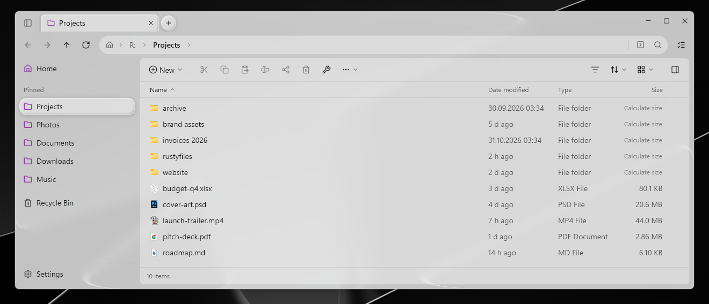

<p align="center">
  <a href="README.md">English</a> ·
  <a href="README.zh-CN.md">简体中文</a> ·
  <a href="README.zh-TW.md">繁體中文</a> ·
  <a href="README.ja.md">日本語</a> ·
  <a href="README.de.md">Deutsch</a> ·
  <a href="README.es.md">Español</a> ·
  <a href="README.pt-BR.md">Português (Brasil)</a> ·
  <a href="README.ru.md">Русский</a> ·
  <b>Türkçe</b>
</p>
<p align="center"><sub>Bu bir çeviridir; esas alınan metin İngilizce <a href="README.md">README</a>'dir.</sub></p>


<p align="center">
  <a href="https://github.com/gelenmedya/rustyfiles/releases/latest"></a>
  <a href="https://github.com/gelenmedya/rustyfiles/releases"></a>
  
  <a href="LICENSE"></a>
</p>

rustyfiles, Rust ile sıfırdan yazılmış, Windows için bir dosya yöneticisidir. Günlük iş için
Dosya Gezgini'nin yerini almak üzere tasarlandı: sekmeler, çift panel, klasör gibi açtığın
arşivler ve DirectLook adlı, Quick Look benzeri bir önizleyici.

Pencere hiçbir zaman diski beklemez. Listeleme, simgeler, küçük resimler, bağlam menüsü ve her
dosya işlemi arayüz iş parçacığının dışında çalışır; bu yüzden yavaş bir ağ paylaşımı ya da
100.000 dosyalı bir klasör pencereyi donduramaz.

<p align="center">
  <a href="https://github.com/gelenmedya/rustyfiles/releases/latest/download/rustyfiles-win-Setup.exe"></a>
  <a href="https://rustyfiles.com"></a>
  <a href="https://discord.gg/K2banZ36zJ"></a>
</p>

<p align="center">
  <a href="https://www.buymeacoffee.com/ozerguzel"></a>
</p>

<p align="center">
  <a href="https://alternativeto.net/software/rustyfiles/about/?utm_source=badge&utm_medium=referral">
    <picture>
      <source media="(prefers-color-scheme: dark)" srcset="https://alternativeto.net/static/badges/badge-compact-dark.svg">
      
    </picture>
  </a>
</p>

Ücretsiz, hesap gerektirmez, reklam yok. İndir, çift tıkla, tamam: bkz. [Kurulum](#kurulum).

<picture>
  <source media="(prefers-color-scheme: dark)" srcset="docs/readme/projects-dark.png">
  
</picture>

<sub>Resimlerde deneysel HyperGlass arka planı gösteriliyor (Ayarlar › Görünüm). Varsayılan arka plan, Dosya Gezgini'ndeki gibi Mica'dır.</sub>

## Ne kadar hızlı


### Bir klasörü açmak

Uygulamanın başlatılmasından klasörün listesinin durup durmadığı ana kadar geçen süre; yeni bir
pencerede, klasör işletim sistemi dosya önbelleğinde zaten varken ölçülür. Isınma turundan sonra
üç çalıştırmanın ortancası, rustyfiles'a dahil olan hız testiyle ölçülür (Ayarlar › Hız testi):
herkes bunu kendi makinesinde çalıştırabilir.

| Klasör | rustyfiles | Dosya Gezgini | [Files](https://files.community) |
|---|--:|--:|--:|
| Boş klasör | 281 ms | 1.006 ms | 813 ms |
| 1.000 dosya | 284 ms | 2.214 ms | 1.893 ms |
| 10.000 dosya | 286 ms | 2.221 ms | 1.053 ms |
| 100.000 dosya | 281 ms | 2.318 ms | 4.069 ms |
| 2.000 resim (küçük resimler) | 278 ms | 2.177 ms | 1.075 ms |
| 10.000 dosya listelendikten sonra bellek | 39 MB | 69 MB | 204 MB |

Bu, 2026-11-16 tarihinde tek bir makinede (Ryzen 7 9800X3D, NVMe SSD, Windows 11) ölçüldü;
rustyfiles 0.8.6 ve Files 4.3 kullanıldı (0.8.5 aynı testte yaklaşık 540 ms sürdü: ilk sekmesi bir
açılış animasyonu oynatıyordu, 0.8.6 ise başlangıçta bunu oynatmıyor). rustyfiles ile Dosya Gezgini
her biri yeni bir süreç başlattı. Files arka planda zaten çalışıyordu, bu yüzden süreleri soğuk
başlangıca ait değil; ayrıca listesini adım adım doldurur ve süre, görüntü değişmeyi bıraktığında
sayılır. Bellek, Görev Yöneticisi'nin gösterdiği özel çalışma kümesidir; Files için çalışan
sürecinin belleği.

"Arka planda çalışmaya devam et" açıkken yeni bir rustyfiles penceresi yeni bir süreç başlatmaz:
daha önceki bir ölçümde (2026-11-06, eski bir sürüm) listelenmiş bir klasörü 93–168 ms'de gösterdi.

### Sürekli değişen 100.000 dosyalık bir klasör

Klasör açık, bir dosya seçili, arka planda 5 saniye boyunca saniyede yaklaşık 1.000 dosya
yeniden adlandırılırken:

| | |
|---|--:|
| Başlatmadan listelenmiş klasöre (100.001 dosya) | 315 ms |
| Liste değişikliklerin ardından gelir | her ~750 ms |
| Klasörü yeniden okuma (arka plan iş parçacığı) | ~70 ms |
| Güncelleme başına UI iş parçacığındaki iş | 7–8 ms |
| Seçim ve imleç | seçili dosyada kalır |

Pencere klasörü beklemez: yeniden okuma arayüz iş parçacığının dışında yapılır, güncellemenin
kendisi 120 Hz'de bir kareden daha az maliyet getirir. Bunu kendin ölçmek için
`RUSTYFILES_TRACE_LIVE=1` ve `RUST_LOG=warn,rf_app=info` ile dene.

Bu olurken kare süreleri: aynı klasör fareyle 7,7 sn boyunca aşağı ve yukarı kaydırıldı, seçim
(ve dolayısıyla önizleme bölmesi) yarım saniyede bir değişirken, arka planda saniyede yaklaşık 680
dosya yeniden adlandırıldı. 200 Hz ekran.

| | ortanca | p95 | p99 | en kötü |
|---|--:|--:|--:|--:|
| UI iş parçacığında kare maliyeti | 2,1 ms | 4,6 ms | 7,9 ms | 16,8 ms |
| Kareler arası süre | 3,3 ms | 5,3 ms | 9,9 ms | 17,3 ms |

2.182 kare, 7,7 sn içinde; 60 Hz kareden (16,7 ms) uzun tek bir aralık oldu. Kendi kayıtlarını
`GPUI_FRAME_LOG=frames.tsv` ile tutabilirsin (her satır bir kare: başlangıcı ve maliyeti, ms olarak).

### Açık pencerede yeni sekme

| Klasör | Yerleşmiş listeye kadar süre |
|---|--:|
| 1.000 dosya | ~48 ms |
| 10.000 dosya | ~46 ms |
| 100.000 dosya | ~129 ms |

Her ek sekme yaklaşık 3 MB bellek tutar (1 sekme: ~32 MB, 25 sekme: ~103 MB).

### Dosya adına göre arama

rustyfiles, yerel sürücülerin bir ad dizinini tutar ve aramaları ondan yanıtlar. 3,6 milyon dosya
ve klasör içeren bir kullanıcı klasörünün altındaki her alt klasörde "rapor" araması yapıldı;
ekrandaki sonuçlar değişmeyi bırakana kadar süre ölçüldü:

| | Süre |
|---|--:|
| rustyfiles 0.4 | **0,38 sn** |
| Dosya Gezgini | 1,8 sn (4 çalıştırmanın en hızlısı; diğerleri 11–32 sn sürdü) |

Dizin her farklı adı bir kez saklar: 4,8 milyon girdisi olan ama 490 bin farklı adı bulunan bir
sürücü 61 MB tutar. rustyfiles çalışırken bir klasör izleyici dizini güncel tutar. Çalıştırmalar
arasında NTFS'in değişiklik günlüğü (yönetici hakları olmadan okunur) hangi klasörlerin değiştiğini
söyler; böylece başlatma sürücüleri taramak yerine yalnızca bu klasörleri yeniden listeler:
buradaki C: için 0,2 sn, tarama ise 30 sn sürüyor. Uygulama verileri, önbellekler, `node_modules`
ve `.git` klasörleri dizinin dışında bırakılır; bunların içinde başlatılan bir arama diski tarar:

`C:\Windows` altında `*.dll`: 116.851 klasörde 342.492 öğe, dosya önbelleği sıcak.

| Yöntem | Süre |
|---|--:|
| rustyfiles | **7,8 sn** |
| `dir /s /b` | 53 sn |
| PowerShell `Get-ChildItem -Recurse` | 105 sn |

rustyfiles aramaları altı arka plan öncelikli iş parçacığında yapar, böylece makinenin geri kalanı
duyarlı kalır. Bağlantı noktalarını (junction) takip etmez; bu yüzden 454 yinelenen dosyayı daha
az bulur.

### Boşluk tuşuyla önizleme (DirectLook)

Tuşa basmakla içeriğin ekranda görünmesi arasındaki süre; uygulama zaten çalışıyorken:

| Dosya | İçerik hazır |
|---|--:|
| JPEG, 3840 × 2160 | 24–86 ms |
| Kaynak kodu, sözdizimi renklendirmeli | 23–44 ms |
| 7z arşivi (içeriği listelendi) | 19–31 ms |
| MP3 (etiketler, şarkı sözleri) | 27–32 ms |
| H.264 video, 1080p | ilk kare 146–185 ms'de |

### Arşivler

[rarchive](https://github.com/gelenmedya/rarchive) ile RAR okuma, kendi motorumuz; resmi UnRAR'a
karşı (her CRC'yi çözer ve denetler; arşivler dosya önbelleğinde):

| Arşiv | UnRAR | rarchive |
|---|--:|--:|
| 1,3 GB, 32 MB sözlük, 195 dosya | 2,79 sn | **0,28 sn** (10×) |
| 400 MB, solid | 0,95 sn | **0,21 sn** (4,5×) |
| 400 MB, 520 dosya | 1,03 sn | **0,063 sn** (16×) |

### Kopyalama ve çıkarma

Aynı hız testi, kendi motorlarımız Windows'unkilere karşı (rustyfiles 0.8.6, 2026-11-16):

| | Windows | rustyfiles |
|---|--:|--:|
| 100 klasörde 10.000 küçük dosya kopyalama (41 MB) | 25,6 sn | **1,8 sn** (14×) |
| Tek 1 GB dosya kopyalama | 0,61 sn | 0,44 sn |
| 10.000 dosyalık ZIP çıkarma | 32,4 sn | **3,6 sn** (9×) |

Kopyalama kendi paralel motorunu kullanır; küçük dosyaları klasörlere dağıtır, çünkü tek bir
klasöre yazan iş parçacıkları birbirini bekler. Tek ve büyük bir dosyada hız diskle sınırlıdır,
motorla değil (önceki bir çalıştırmada Windows birkaç ms farkla daha hızlıydı). Test klasörlerinde
ada göre arama (123.000 girdi) 55 ms sürdü.

Ad çakışmalarını da kendisi çözer (değiştir, atla ya da ikisini de tut; hepsi için ya da dosya
dosya), duraklatıp devam ettirebilir, her kopyayı bayt bayt doğrulayabilir ve hızını sınırlayabilir.

Tüm sayılar: tek bir makine (Ryzen 7 9800X3D, NVMe SSD, Windows 11), Kasım 2026. Klasör açma,
kopyalama ve çıkarma sayıları uygulamaya dahil hız testinden gelir (Ayarlar › Hız testi); diğer test
betikleri depoda: kopyalama için `crates/rf-win/examples/copybench.rs`.

## Neler yapar

**Gezinme.** Sıralamak için sürükleyebileceğin ya da yeni bir pencereye çıkarabileceğin sekmeler.
Bir pencerenin sekmelerini, bölünmüş bölmeler dahil, adlandırılmış bir oturum olarak kaydet ve
sonra yeniden aç; adı sekmelerin yanında durur. Yeni sekme Giriş sayfasını ya da bulunduğun klasörü
açar (Ayarlar › Genel). Çift panel. Ayrıntılar, ızgara, liste ve sütun görünümleri (liste, Dosya
Gezgini'nin yaptığı gibi sütun sütun dolabilir), gruplama, bir önizleme bölmesi, arama, renk
etiketleri, Shelf, kitaplıklar, ağ paylaşımları ve FTP. Bir Git durum sütunu. Klasör boyutları
isteğe bağlı: "Boyutu hesapla"ya tıkla; yeniden başlatmalar arasında hatırlanır ve diskteki boyutu
gösterebilir. Bir klasör ya da sürücüde "Disk kullanımını göster", yer kaplayanları en büyükten
başlayarak, tıklanabilir bir ağaç haritasının (treemap) yanında listeler (C:\Windows, 341 bin girdi:
26 MB tutulur). Kitaplıklar ve Galeri gibi sanal klasörler rustyfiles'ta açılır; Bu Bilgisayar
altında Windows'un listelediği aygıtlar (USB üzerinden telefonlar ya da Telefon Bağlantısı) Giriş
sayfasında Aygıtlar altında görünür; bu kısım gerçek bir telefonla henüz denenmedi.

**Dosyalar.** Yeniden adlandırma, kopyalama, taşıma, Geri Dönüşüm Kutusu'na silme ve klasör
düzleştirme için geri al ve yinele. Toplu yeniden adlandırma. Diğer bölmeye çoğalt, kopyala ya da
taşı; kopyalanan metni ya da resmi yeni bir dosya olarak yapıştır. Gönder (Send to) ile tam Dosya
Gezgini bağlam menüsü, Dosya Gezgini, masaüstü, tarayıcılar ve Outlook ile sürükle bırak; sekmeler,
sabitlenmiş klasörler, klasörler ve programlarda bırakma hedefleri. Dosyalarını
[Ferry](#ferry) ile diğer bilgisayarlarına gönder, [HyperDownload](#hyperdownload) ile indir.

**Arşivler.** ZIP, 7z, RAR, tar ailesi ve ISO klasör gibi açılır; parola korumalı ZIP, 7z ve RAR
dahil. ZIP, 7z ve tar içinde ekleme, silme ve yeniden adlandırma. Tüm çekirdekleri kullanarak ZIP,
7z ve tar.zst oluşturma. Okuma, kendi tamamen Rust ile yazılmış motorumuz
[rarchive](https://github.com/gelenmedya/rarchive) ile yapılır (diğer Rust projeleri için
[crates.io'da](https://crates.io/crates/rarchive) da var): 1,3 GB'lık bir WinRAR arşivini
UnRAR'dan on kat hızlı çözer.

**Windows.** İstersen varsayılan dosya yöneticisi: klasörler, <kbd>Win</kbd>+<kbd>E</kbd>, Bu
Bilgisayar ve Geri Dönüşüm Kutusu rustyfiles'ta açılır. İstersen diğer uygulamaların Aç, Kaydet ve
Klasör seç pencereleri de rustyfiles'ta açılır (Ayarlar › Gelişmiş); oradaki bir pin düğmesi her
uygulama için bir başlangıç klasörünü tutar. Photos ya da başka bir Store uygulamasında açılan
resimler ve videolar klasörleriyle birlikte gelir; böylece Önceki ve Sonraki çalışır. Explorer'ın
`/select,` ve `shell:` yolları çalışır. Mica, koyu mod ve sistem vurgu rengi. Bir oyun ya da bir
render GPU'yu doyurduğunda, çizim titremeden CPU'ya geçer ve geri döner.

**Adres çubuğunda komutlar.** Explorer'da olduğu gibi: <kbd>Ctrl</kbd>+<kbd>L</kbd>'ye bas, `cmd`,
`powershell`, `wt` ya da `code .` yaz ve <kbd>Enter</kbd>'a bas. Metin önce bir yer olarak alınır
(yol, sürücü, `%VAR%`, `shell:`); açık klasörde aynı adda bir klasör ya da dosya her zaman önceliklidir.
Yalnızca böyle bir yer yoksa ilk kelime, Çalıştır kutusunun yaptığı gibi bir program olarak aranır
ve açık klasörde, geri kalanı bağımsız değişken olarak başlatılır. Bir tamamlamadan hiçbir şey
başlatılmaz ve yönetici hakları istenmez. Ayarlar › Dosyalar ve klasörler › Davranışlar altındaki
bir anahtar bunu kapatır.

**Düzenleme.** Bir klasör için kurallar: ad, uzantı, tür, boyut ve yaş üzerinde koşullar ve tek bir
eylem (taşı, bir şablondan oluşturulan klasöre taşı, yeniden adlandır ya da Geri Dönüşüm Kutusu).
Elle çalıştırma her adımı bir önizlemede gösterir ve Uygula'dan önce hiçbir şeyi taşımaz; bir
çalıştırma geri alınabilir. Hiçbir şey kalıcı olarak silinmez ve hiçbir şeyin üzerine yazılmaz.
Kendi kendine çalışan kurallar varsayılan olarak kapalıdır.

**Arama.** Hızlı arama (<kbd>Alt</kbd>+<kbd>Space</kbd>) uygulamaları, dosyaları ve klasörleri,
tarayıcı yer imlerini ve Windows'un ayar sayfalarını bulur. Sık açtıkların öne çıkar; aynı harfler
için daha önce seçtiğin ilk satırdır.

**Diller.** 49 dil; Windows'un görüntü diline uyar (ya da Ayarlar › Genel'den birini seç). Arayüz
Türkçe ve İngilizce yazılmıştır; diğer diller Files topluluğunun çevirilerinden başladı ve oradan
makine çevirisiyle devam eder. Arapça, İbranice ve Farsça çevrilmiştir; sağdan sola okunan adlar ve
metinler sağdan sola okunur (@ialhabbal'a teşekkürler); arayüzün kendisi henüz aynalanmadı.
Düzeltmeler memnuniyetle karşılanır: her dil `crates/rf-app/locales/` içinde tek bir JSON dosyasıdır.


## DirectLook

Bir dosya seç ve <kbd>Space</kbd>'e bas. DirectLook bir önizleme penceresi açar: video ve ses
(kendi oynatıcısıyla), resimler, metin ve kod, arşivlerin içeriği ve diğer her şey için bir ayrıntı
kartı. Klasör açıkken ok tuşlarıyla klasörde gezinebilirsin.

DirectLook kendi programı olarak, `directlook.exe` olarak çalışır; bu yüzden ağır bir video dosya
yöneticisini yavaşlatmaz ve ikisi birbirini düşüremez. rustyfiles'ta çalışır; istersen Dosya
Gezgini'nde ve masaüstünde de çalışır. Ayarları Ayarlar › DirectLook altındadır.

## Ferry

Aynı ağdaki diğer bilgisayarlarındaki rustyfiles'a dosya ve klasör gönder; AirDrop gibi: sağ tık
› **Ferry ile gönder**.


<sub>Uygulamanın kendi sözleri ve yerleşimiyle, uydurma aygıtlarla bir Ayarlar › Ferry çizimi.</sub>

- Uçtan uca şifreli (TLS 1.3 ile QUIC), doğrudan aygıttan aygıta: sunucu yok, hesap yok, ağın
  dışına hiçbir şey çıkmaz.
- Aygıtlarını Bluetooth eşleştirir gibi eşleştir: ikisi de aynı altı haneli kodu gösterir. Eşleşmiş
  bir aygıtın dosyaları sormadan gelebilir; diğerlerinde önce bir bildirimle sorulur.
- Bilgisayarını kimin görebileceğini sen seçersin: kimse, eşleşmiş aygıtların (varsayılan) ya da on
  dakika boyunca herkes. Ayarlar › Ferry açıkken herkes onu görebilir; böylece yeni bir aygıt onu bulabilir.
- Yarıda kalan bir aktarım kaldığı yerden devam eder ve her dosya adını almadan önce doğrulanır.
  Alınan dosyalar indirilmiş olarak işaretlenir; böylece aralarındaki bir program çalışmadan önce
  SmartScreen sorar.
- Her aygıt tahmini bir hız gösterir; **Hız testi** her iki yönü birkaç saniyede ölçer.
- Yakında gelecek olan macOS uygulaması aynı protokolü konuşur; protokol
  [docs/nearby-protocol.md](docs/nearby-protocol.md) dosyasında yazılı.

Ferry, Ayarlar › Ferry'de açana kadar kapalıdır. Windows Güvenlik Duvarı sorabilir: özel ağlar için izin ver.

## Deneysel: HyperGlass, Dock ve masaüstü

Bunlar varsayılan olarak kapalı ve erken aşamada. İki monitörlü tek bir bilgisayarda geliştirilip
denendi; bazı parçalar çok az kullanıldı. Pürüzler bekle ve bulduklarını bildir lütfen.


<sub>Başlat, HyperSearch ve denetim merkezi; aynı masaüstünün üç ekran görüntüsünden bir araya getirildi (hepsi aynı anda açılmaz).</sub>

- **HyperGlass** (Ayarlar › Görünüm) beşinci bir arka plandır: pencerenin arka planı, arkasındakini
  büken ve buzlandıran bir camdır.
- **Dock** (Ayarlar › Dock, tek anahtar), her monitörün altına Windows'un görev çubuğu yerine üç cam
  ada koyar: kendi Başlat paneli ve aramasıyla, pencere önizlemeli çalışan ve sabitlenmiş uygulamalar,
  tepsi simgeleri, bir denetim merkezi ve bir bildirim paneli. Açıkken Windows'un görev çubuğu
  gizlenir; Windows tuşuna bir kez basmak Dock'un Başlat'ını, <kbd>Alt</kbd>+<kbd>Tab</kbd> ise
  Dock'un geçiş aracını açar. Dock'u kapatırsan Windows'un kendi çubuğu geri gelir.
- **Masaüstü**, rustyfiles tarafından çizilir ve Dock ile birlikte gelir: duvar kağıdın ve
  simgelerin, isteğe bağlı yuvarlatılmış köşelerle.

Explorer tüm bunların altında çalışmaya devam eder; diskte Windows'tan hiçbir şey kaldırılmaz ya da
değiştirilmez.

### Her monitör için parlaklık

Windows'un parlaklık kaydırıcısı yalnızca dizüstü bilgisayarın kendi ekranı için vardır. Dock'un
denetim merkezinde **her monitör için** bir tane var: Ayarlar › Dock'u aç, sonra Dock'un sağındaki
ağ ya da ses simgesine tıkla. Harici monitörler **DDC/CI** üzerinden ayarlanır; son on beş yılın
neredeyse her masaüstü monitörünün DisplayPort, HDMI ve DVI üzerinden konuştuğu standart budur. Bir
monitörde kaydırıcı yoksa monitörün kendi menüsünde DDC/CI'nin açık olduğunu kontrol et; bazı
dock'lar, KVM anahtarları ve adaptörler bunu iletmez. Dizüstü bilgisayarın kendi ekranı, Windows'un
kendi kaydırıcısının yaptığı şekilde ayarlanır (henüz bir dizüstü bilgisayarda denenmedi).

## HyperDownload

rustyfiles'ın kendi indirme yöneticisi, bir eklenti: Ayarlar › Eklentiler › HyperDownload › **Yükle**.
Ayrı bir programdır ([kaynak](https://github.com/gelenmedya/hyperdownload), MIT); yalnızca sen Yükle'ye
tıklayınca indirilir ve indirilmeden önce SHA-256 değeri denetlenir; istediğin zaman kaldırılabilir.

- **Bağlantıdan indir**, bir klasörün sağ tık menüsünde: tek bir dosya birçok bağlantıyla aynı anda,
  duraklatılıp kaldığı yerden devam eder; yeniden başlatmadan sonra da. Bir klasöre bir bağlantı
  yapıştırırsan rustyfiles orada indirmeyi önerir.
- **Torrent'ler ve magnet bağlantıları**, bir torrent'in hangi dosyalarını istediğini seçtiğin bir
  iletişim kutusuyla. Bir `.torrent` dosyası kendi menüsünden iner.
- **Downloads sayfası**: her indirme, parçaları, ilerlemesi ve tamamlananlar; ilerleme Durum
  Merkezi'nde de görünür.
- **İndirirken izle:** bir video, indirme bitmeden DirectLook'ta oynatılır.

## Kurulum

Kurulum üç tıklama sürer ve teknik bilgi gerektirmez:

1. **[rustyfiles-win-Setup.exe dosyasını indir](https://github.com/gelenmedya/rustyfiles/releases/latest/download/rustyfiles-win-Setup.exe)** (yaklaşık 50 MB).
2. Aç. Windows "Windows bilgisayarınızı korudu" derse **Ek bilgi**'ye, sonra **Yine de çalıştır**'a tıkla.
   (Yükleyici henüz kod imzalı değil; uyarının tek nedeni bu. Her sürümün yükleyicileri
   [VirusTotal](https://www.virustotal.com) üzerinde taranır: raporların bağlantıları sürüm notlarının sonundadır.)
3. Hepsi bu. rustyfiles kendiliğinden açılır ve Başlat menüsündedir.

Yönetici şifresi yok, yapılandırılacak bir şey yok. Güncellemeler arka planda sessizce iner ve
rustyfiles'ı bir sonraki açışında uygulanır.

**[Scoop](https://scoop.sh) ile:**

```powershell
scoop bucket add rustyfiles https://github.com/gelenmedya/scoop-rustyfiles
scoop install rustyfiles/rustyfiles
```

**rustyfiles'ta klasörlerin ve <kbd>Win</kbd>+<kbd>E</kbd>'nin açılmasını mı istiyorsun?** Ayarlar ›
Gelişmiş › Varsayılan dosya yöneticisi olarak ayarla'yı aç. İstediğin zaman kapatabilirsin.

**Kaldırmak** için diğer uygulamalar gibi, Windows Ayarlar › Uygulamalar'dan. rustyfiles'ın
değiştirdiği her şey Dosya Gezgini'ne geri döner.

**Diğer uygulamalardaki Aç/Kaydet pencereleri hata veriyor ya da çöküyor** (kaldırma yapılmadan
rustyfiles'ın dosyaları silindiyse: bir virüs tarayıcısı ya da bozuk bir güncelleme)? rustyfiles'ı
yeniden başlatmak bunu düzeltir. rustyfiles artık başlamıyorsa, bu PowerShell komutu her uygulamaya
Windows'un kendi iletişim kutusunu geri verir:

```powershell
Remove-Item -Recurse "HKCU:\Software\Classes\CLSID\{DC1C5A9C-E88A-4dde-A5A1-60F82A20AEF7}", "HKCU:\Software\Classes\CLSID\{C0B4E2F3-BA21-4773-8DBA-335EC946EB8B}"
```

Yükleyici istemiyor musun? [Sürümler](https://github.com/gelenmedya/rustyfiles/releases) sayfasında
taşınabilir bir zip var; ARM64 yükleyici (`rustyfiles-win-arm64-Setup.exe`) de var. Windows 11 gerekir
(Windows 10 denenmedi). Bir macOS sürümü yakında geliyor, Linux da planlanıyor.

**Soru ya da fikirlerin mi var?** [Discord](https://discord.gg/K2banZ36zJ)'da merhaba de ya da
[rustyfiles.com](https://rustyfiles.com) adresini ziyaret et.

### Kaynak koddan derleme

[Rust](https://rustup.rs) 1.95 veya daha yeni bir sürüme ve "C++ ile masaüstü geliştirme" (Desktop
development with C++) iş yüküyle Visual Studio Build Tools'a ihtiyacın var (tek bir bağımlılık,
zstd, C kodu derler).

```powershell
git clone https://github.com/gelenmedya/rustyfiles
cd rustyfiles
.\scripts\install.ps1            # builds, then installs for your user
.\scripts\install.ps1 -Default   # also makes it the default file manager
.\scripts\install.ps1 -Uninstall
```

`cargo run --release -p rf-app` kurmadan başlatır.

## Klavye

| Tuşlar | Eylem |
|---|---|
| <kbd>Ctrl</kbd>+<kbd>T</kbd> / <kbd>Ctrl</kbd>+<kbd>W</kbd> / <kbd>Ctrl</kbd>+<kbd>Shift</kbd>+<kbd>T</kbd> | Yeni sekme, sekmeyi kapat, kapatılan sekmeyi yeniden aç |
| <kbd>Ctrl</kbd>+<kbd>L</kbd> veya <kbd>Alt</kbd>+<kbd>D</kbd> | Adres çubuğu |
| <kbd>Ctrl</kbd>+<kbd>F</kbd> | Ara (<kbd>Enter</kbd> alt klasörlerde de arar) |
| <kbd>Ctrl</kbd>+<kbd>Shift</kbd>+<kbd>P</kbd> veya <kbd>F1</kbd> | Komut paleti |
| <kbd>Ctrl</kbd>+<kbd>P</kbd> / <kbd>Ctrl</kbd>+<kbd>Shift</kbd>+<kbd>A</kbd> | Ziyaret ettiğin bir klasörü bul, bir sekme bul |
| <kbd>Ctrl</kbd>+<kbd>Shift</kbd>+<kbd>1</kbd> … <kbd>5</kbd> | Ayrıntılar, ızgara, sütunlar, kartlar, liste |
| <kbd>Ctrl</kbd>+<kbd>Shift</kbd>+<kbd>D</kbd>, <kbd>F6</kbd> | Çift panel, bölme değiştir |
| <kbd>Shift</kbd>+<kbd>F5</kbd> / <kbd>Shift</kbd>+<kbd>F6</kbd> | Diğer bölmeye kopyala, taşı |
| <kbd>Ctrl</kbd>+<kbd>Alt</kbd>+<kbd>D</kbd> | Çoğalt |
| <kbd>Alt</kbd>+<kbd>P</kbd>, <kbd>Ctrl</kbd>+<kbd>B</kbd> | Önizleme bölmesi, kenar çubuğu |
| <kbd>Space</kbd> | DirectLook |
| <kbd>F2</kbd> | Yeniden adlandır (birden çok öğe seçiliyken toplu yeniden adlandırma) |
| <kbd>Ctrl</kbd>+<kbd>Z</kbd> / <kbd>Ctrl</kbd>+<kbd>Y</kbd> | Geri al, yinele |
| <kbd>Ctrl</kbd>+<kbd>H</kbd> | Gizli öğeleri göster |

Her kısayol Ayarlar › Eylemler'den değiştirilebilir: bir komuta tıkla, sonra yeni tuşlara bas.

## Proje yapısı

| Crate | İçeriği |
|---|---|
| `crates/rf-app` | Arayüz ve iki program: `rustyfiles` ve `directlook` (`src/look/`) |
| `crates/rf-win` | Windows ve kabuk entegrasyonu, dosya işlemi motoru |
| `crates/rf-core` | Model: konumlar, geçmiş, girdiler |
| `crates/rf-archive` | Arşiv işlemleri: göz atma, çıkarma, oluşturma, düzenleme |
| `crates/rf-player` | DirectLook'un video ve ses oynatıcısı |
| `crates/rustdecoder` | Kendi video motorumuz, üzerinde çalışılıyor: MP4/MOV (parçalı olanlar dahil) ve MKV/WebM; H.264, HEVC, VP9 ve AV1 grafik kartında D3D11 Video ile çözülür, testlerinde ffmpeg / dav1d ile bit bit aynı; ProRes ve DNxHR CPU'da çözülür; renk dönüşümü, ses (PCM, AAC, FLAC, Opus, MP3) ve A/V senkronu. DirectLook'un video oynatmasını devralacak ([tasarım](docs/design/rustdecoder.md)) |

Arayüz, Zed editörünün arkasındaki çatı olan [GPUI](https://gpui.rs) ile yapıldı. Windows katmanı,
GPU/CPU geçişini ekleyen bir çatallamadır:
[gelenmedya/gpui-pre-windows](https://github.com/gelenmedya/gpui-pre-windows).

<details>
<summary>Ortam değişkenleri</summary>

| Değişken | Etkisi |
|---|---|
| `RUSTYFILES_RENDERER` = `gpu`, `cpu` veya `auto` | Pencerenin nerede çizileceğini zorla |
| `RUSTYFILES_CONFIG_DIR` = klasör | Ayarları başka bir klasörde tut (taşınabilir kullanım) |
| `RUSTYFILES_MULTI_INSTANCE=1` | Aynı anda birden çok kopyaya izin ver (testler) |
| `RUSTYFILES_FRAME_LOG=1` | Kare sürelerini kaydet |
| `RUSTYFILES_LOOK_TRACE=1` | DirectLook'un zamanlamalarını stderr'e kaydet |
| `RUSTYFILES_MUTE=1` | DirectLook sessiz oynatır (testler) |

Ayarlar `%APPDATA%\rustyfiles\settings.toml` dosyasında, DirectLook'un ayarları yanındaki
`directlook.toml` dosyasında tutulur.

</details>

## Nasıl yapıldı

rustyfiles yapay zekâ kodlama araçlarıyla yazıldı; bu bir sır değil. Tek bir geliştirici neyin
yapılacağına ve nasıl davranacağına karar verir, her değişikliği gerçek bir bilgisayarda dener (iki
monitör, günlük iş) ve tutmayanları geri çevirir. Kodun büyük kısmını yapay zekâ yazar; neyin
yayınlanacağına o karar vermez.

Bunu dürüst tutan şeyler:

- **Testler.** Her değişiklik gönderilmeden önce 3.000'den fazla otomatik test çalışır.
- **Ölçümler.** Yukarıdaki hız sayıları uygulamanın içine dahil bir testten gelir (Ayarlar ›
  Hız testi); herkes bunları kendi makinesinde kontrol edebilir.
- **Raporlar.** Hatalar onu kullanan insanlardan gelir. Her sorunun bir yanıtı olur, düzeltme açıkta
  yapılır ve bildiren kişiden kapatılmadan önce denemesi istenir.
- **Kod.** Tamamı burada, MIT lisansı altında; okumak ve değerlendirmek için.

Neden Rust: bir dosya yöneticisi 100.000 dosyalık bir klasörde hızlı kalmak zorunda ve kimsenin
verisini asla kaybetmemeli. Rust, çöp toplayıcı olmadan hız verir ve yayınlanmadan önce çökmelerin
bütün sınıflarını ortadan kaldırır. Ayrıca rustyfiles, Explorer'ın yeniden yazımı değil; sıfırdan
yazılmış yeni bir uygulama; Explorer'ın yanında çalışır ve diskteki Windows'ta hiçbir şeyi değiştirmez.

## Durum

rustyfiles genç bir proje ve yazarı onu her gün Explorer yerine kullanıyor. Bir yol haritası ve test
raporları `docs/` içinde yer alacak. macOS sürümü yolda, aynı çekirdek üzerine kurulu; Linux ondan
sonra geliyor.

Hata raporları ve pull request'ler memnuniyetle karşılanır.

## Listelendiği yerler

- [AlternativeTo](https://alternativeto.net/software/rustyfiles/about/), Dosya Gezgini'ne alternatif olarak
- [Scoop](https://scoop.sh), kendi bucket'ından ([Kurulum](#kurulum) bölümüne bak)

## Teşekkürler

rustyfiles başkalarının çalışması üzerine duruyor ve yol boyunca birçok fikri ödünç aldı.

[Files](https://github.com/files-community/Files), Windows için modern bir dosya yöneticisinin ne
olabileceğini gösterdi. Özellik kümesi bizim kontrol listemizdi, ayarları ve yerleşimi bizimkini
şekillendirdi, Explorer'ın yerine varsayılan dosya yöneticisi olarak geçme yaklaşımı da bizimkine yol
gösterdi. Files topluluğuna teşekkürler.

[GPUI](https://gpui.rs), [Zed](https://github.com/zed-industries/zed) editörünün arayüz çatısı,
rustyfiles'ın her pikselini GPU'da çizer ve bu kadar hızlı bir pencereyi mümkün kılar. Onu inşa edip
paylaştıkları için Zed ekibine, kullandığımız bileşenler için de
[Longbridge](https://github.com/longbridge/gpui-kit)'in gpui-kit'ine teşekkürler.

DirectLook, macOS Quick Look'un fikrini izler; Windows'a ilk onu getiren, Paddy Xu'nun
[QuickLook](https://github.com/QL-Win/QuickLook) projesidir. rarchive, RAR biçimini Alexander
Roshal'ın UnRAR kaynağından öğrendi.

[windows-rs](https://github.com/microsoft/windows-rs), [Velopack](https://velopack.io) (kurulum ve
güncellemeler), [Lucide](https://lucide.dev) simgeleri,
[zip](https://github.com/zip-rs/zip2), [sevenz-rust2](https://github.com/hasenbanck/sevenz-rust),
[tar](https://github.com/alexcrichton/tar-rs), [notify](https://github.com/notify-rs/notify) ve daha
birçok crate ile yapıldı. Resimlerde Atelier Triay'ın
[Bricolage Grotesque](https://github.com/ateliertriay/bricolage) yazı tipi,
[Instrument Sans](https://fonts.google.com/specimen/Instrument+Sans) ve
[Doto](https://fonts.google.com/specimen/Doto) kullanılmıştır.

## Lisans

MIT, bkz. [LICENSE](LICENSE). GPUI çatallaması, Zed'in Apache-2.0 lisansını kendi deposunda tutar.
