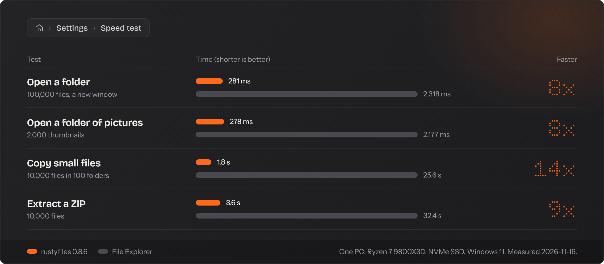

<p align="center">
  <a href="README.md">English</a> ·
  <a href="README.zh-CN.md">简体中文</a> ·
  <a href="README.zh-TW.md">繁體中文</a> ·
  <a href="README.ja.md">日本語</a> ·
  <a href="README.de.md">Deutsch</a> ·
  <a href="README.es.md">Español</a> ·
  <a href="README.pt-BR.md">Português (Brasil)</a> ·
  <a href="README.ru.md">Русский</a> ·
  <b>Türkçe</b>
</p>
<p align="center"><sub>Bu bir çeviridir; esas alınan metin İngilizce <a href="README.md">README</a>'dir.</sub></p>


<p align="center">
  <b>Diski asla beklemeyen bir dosya yöneticisi.</b><br>
  Sekmeler, çift bölme, klasör gibi açılan arşivler ve <kbd>Space</kbd> ile önizleme.<br>
  Sıfırdan Rust ile yazıldı; Windows için ve şimdi macOS için.
</p>

<p align="center">
  <a href="https://github.com/gelenmedya/rustyfiles/releases/latest"></a>
  <a href="https://github.com/gelenmedya/rustyfiles/releases"></a>
  
  
  <a href="https://github.com/gelenmedya/rustyfiles/releases/latest"></a>
  <a href="LICENSE"></a>
</p>

<p align="center">
  <a href="https://github.com/gelenmedya/rustyfiles/releases/latest/download/rustyfiles-win-Setup.exe"></a>
  <a href="https://github.com/gelenmedya/rustyfiles/releases/latest/download/rustyfiles-mac.dmg"></a>
  <br>
  <a href="https://rustyfiles.com"></a>
  <a href="https://discord.gg/K2banZ36zJ"></a>
  <a href="https://www.buymeacoffee.com/ozerguzel"></a>
</p>

<table>
  <tr>
    <td width="33%" valign="top">
      <b>Diski asla beklemez</b><br>
      Listeleme, simgeler, küçük resimler, bağlam menüsü ve her kopyalama, pencerenin iş parçacığı dışında çalışır.
      Yavaş bir ağ paylaşımı ya da 100.000 dosyalık bir klasör onu donduramaz.
    </td>
    <td width="33%" valign="top">
      <b>Explorer'ın işi, daha hızlı yapılmış</b><br>
      Sekmeler, çift bölme, klasör olarak arşivler, anında arama için bir ad dizini, toplu yeniden adlandırma, geri alma
      ve kendi kopyalama motoru: küçük dosyalarda 14 kat daha hızlı.
    </td>
    <td width="33%" valign="top">
      <b>Ücretsiz ve sizin</b><br>
      Hesap yok, reklam yok, hiçbir yere bir şey gönderilmez. MIT lisanslı; her satırı okunabilir.
      Güncellemeler arka planda sessizce kurulur.
    </td>
  </tr>
</table>

<picture>
  <source media="(prefers-color-scheme: dark)" srcset="docs/readme/projects-dark.png">
  
</picture>

<sub>Windows, deneysel HyperGlass arka planıyla (Ayarlar › Appearance). Varsayılan, Explorer'da olduğu gibi Mica'dır.</sub>

## Ne kadar hızlı



100,000 dosyalık bir klasör 281 ms'de açılır (File Explorer: 2.3 s). Sayılar, uygulamaya yerleşik hız testinden gelir
(Ayarlar › Speed test); böylece bunları kendi bilgisayarınızda kontrol edebilirsiniz.

<details>
<summary><b>Her ölçüm ve nasıl alındığı</b></summary>

#### Bir klasörü açmak

Uygulamanın başlatılmasından, klasörün listesinin yeni bir pencerede durağanlaşmasına kadar geçen süre; klasör
zaten işletim sisteminin dosya önbelleğindeyken. Bir ısındırma turundan sonra üç çalıştırmanın medyanı.

| Klasör | rustyfiles | File Explorer | [Files](https://files.community) |
|---|--:|--:|--:|
| Boş klasör | 281 ms | 1,006 ms | 813 ms |
| 1,000 dosya | 284 ms | 2,214 ms | 1,893 ms |
| 10,000 dosya | 286 ms | 2,221 ms | 1,053 ms |
| 100,000 dosya | 281 ms | 2,318 ms | 4,069 ms |
| 2,000 resim (küçük resimler) | 278 ms | 2,177 ms | 1,075 ms |
| 10,000 dosya listelendikten sonraki bellek | 39 MB | 69 MB | 204 MB |

Ryzen 7 9800X3D, NVMe SSD ve Windows 11 olan tek bir makinede, 2026-11-16 tarihinde, rustyfiles 0.8.6 ve Files 4.3
ile ölçüldü. rustyfiles ve Explorer her biri yeni bir süreç başlattı. Files arka planda zaten çalışıyordu, bu yüzden
süreleri soğuk başlatma değildir; listesini adım adım da doldurur, süre resim değişmeyi bırakana kadar sayılır.
Bellek, Görev Yöneticisi'nin gösterdiği rakam olan özel çalışma kümesidir (private working set). "arka planda çalışmaya
devam et" açıkken yeni bir rustyfiles penceresi hiç süreç başlatmaz ve listelenmiş bir klasörü 93–168 ms'de gösterdi
(2026-11-06, daha eski bir sürüm).

#### Değişmeye devam eden 100.000 dosyalık klasör

Klasör açık, bir dosya seçili; arka planda 5 saniye boyunca saniyede yaklaşık 1,000 dosya yeniden adlandırılıyor:

| | |
|---|--:|
| Başlatmadan listelenmiş klasöre (100,001 dosya) | 315 ms |
| Liste değişiklikleri izler | her ~750 ms'de bir |
| Klasörü yeniden okuma (arka plan iş parçacığı) | ~70 ms |
| Güncelleme başına arayüz iş parçacığındaki iş | 7–8 ms |
| Seçim ve imleç | seçili dosyada kalır |

Aynı klasör 7.7 s boyunca aşağı ve yukarı kaydırılırken kare süreleri; seçim (ve dolayısıyla önizleme bölmesi) her yarım
saniyede bir değişiyor, arka planda saniyede yaklaşık 680 dosya yeniden adlandırılıyor, 200 Hz ekranda:

| | medyan | p95 | p99 | en kötü |
|---|--:|--:|--:|--:|
| Arayüz iş parçacığında kare maliyeti | 2.1 ms | 4.6 ms | 7.9 ms | 16.8 ms |
| Kareler arasındaki süre | 3.3 ms | 5.3 ms | 9.9 ms | 17.3 ms |

7.7 s içinde 2,182 kare; 60 Hz karesinden uzun bir boşluk. Bunu kendiniz `RUSTYFILES_TRACE_LIVE=1` ve
`RUST_LOG=warn,rf_app=info` ile ölçün; kareleri `GPUI_FRAME_LOG=frames.tsv` ile günlüğe yazın.

#### Açık pencerede yeni sekme

| Klasör | Liste oturana kadar geçen süre |
|---|--:|
| 1,000 dosya | ~48 ms |
| 10,000 dosya | ~46 ms |
| 100,000 dosya | ~129 ms |

Her ek sekme yaklaşık 3 MB bellek harcar (1 sekme: ~32 MB, 25 sekme: ~103 MB).

#### Dosya adına göre arama

rustyfiles, yerel sürücülerin bir ad dizinini tutar ve aramaları ondan yanıtlar. 3.6 milyon dosya ve klasörü olan bir
kullanıcı klasörünün tüm alt klasörlerinde "rapor" aranarak ölçüldü; süre, sonuçlar ekranda değişmeyi bırakana kadar
ölçüldü:

| | Süre |
|---|--:|
| rustyfiles 0.4 | **0.38 s** |
| File Explorer | 1.8 s (dört çalıştırmanın en hızlısı; diğerleri 11–32 s sürdü) |

Ad dizini her farklı adı bir kez saklar: 4.8 milyon girdisi olan ama 490 bin farklı adı bulunan bir sürücü 61 MB tutar.
Bir klasör izleyici, rustyfiles çalışırken dizini güncel tutar; çalıştırmalar arasında NTFS'in değişiklik günlüğü
(yönetici hakları olmadan okunur) hangi klasörlerin değiştiğini söyler, böylece başlatmada yalnızca onlar yeniden
listelenir: burada C: için 0.2 s, oysa tam tarama 30 s sürer. Uygulama verileri, önbellekler, `node_modules` ve `.git`
dışarıda bırakılır; bunların içinde başlatılan bir arama diski tarar:

| `C:\Windows` altındaki `*.dll` (342,492 öğe, 116,851 klasör, önbellek ısınmış) | Süre |
|---|--:|
| rustyfiles | **7.8 s** |
| `dir /s /b` | 53 s |
| PowerShell `Get-ChildItem -Recurse` | 105 s |

Arama altı arka plan öncelikli iş parçacığında çalışır, böylece makinenin geri kalanı duyarlı kalır; bağlantı
noktalarını (junction) izlemez, bu yüzden 454 yinelenen daha az bulur.

#### Space ile önizleme (DirectLook)

| Dosya | Tuşa basıldıktan sonra içerik hazır |
|---|--:|
| JPEG, 3840 × 2160 | 24–86 ms |
| Kaynak kodu, sözdizimi renkli | 23–44 ms |
| 7z arşivi (içerik listelenir) | 19–31 ms |
| MP3 (etiketler, şarkı sözleri) | 27–32 ms |
| H.264 video, 1080p | ilk kare 146–185 ms'de |

#### Arşivler

RAR okuma: [rarchive](https://github.com/gelenmedya/rarchive), kendi motorumuz, resmi UnRAR'a karşı (her CRC'yi çöz ve
denetle, arşivler dosya önbelleğinde):

| Arşiv | UnRAR | rarchive |
|---|--:|--:|
| 1.3 GB, 32 MB sözlük, 195 dosya | 2.79 s | **0.28 s** (10×) |
| 400 MB solid | 0.95 s | **0.21 s** (4.5×) |
| 400 MB, 520 dosya | 1.03 s | **0.063 s** (16×) |

#### Kopyalama ve çıkarma

Kendi motorlarımız, Windows'unkine karşı (rustyfiles 0.8.6, 2026-11-16):

| | Windows | rustyfiles |
|---|--:|--:|
| 100 klasördeki 10,000 küçük dosyanın kopyalanması (41 MB) | 25.6 s | **1.8 s** (14×) |
| Tek bir 1 GB dosyanın kopyalanması | 0.61 s | 0.44 s |
| 10,000 dosyalık bir ZIP'in çıkarılması | 32.4 s | **3.6 s** (9×) |

Kopyalama, küçük dosyaları klasörler arasına yayar; çünkü tek bir klasöre yazan iş parçacıkları birbirini bekler. Tek bir
büyük dosyada hız motorla değil diskle sınırlıdır. Ad çakışmalarını kendisi yönetir (değiştir, atla ya da ikisini de
tut), duraklatıp sürdürebilir, her kopyayı bayt bayt doğrulayabilir ve hızını sınırlayabilir. Kopya test betiği
`crates/rf-win/examples/copybench.rs` dosyasıdır.

Tüm sayılar: tek bir makineden (Ryzen 7 9800X3D, NVMe SSD, Windows 11), Kasım 2026.

</details>

## Neler yapar

- **Gezinme.** Bir pencereye sürükleyerek ayırabileceğiniz sekmeler, kaydedilmiş oturumlar, çift bölme, Details, ızgara,
  liste ve sütun görünümleri, gruplama, bir önizleme bölmesi, renk etiketleri, Shelf, ağ paylaşımları ve FTP.
- **Dosyalar.** Geri al ve yinele, toplu yeniden adlandırma, istek üzerine klasör boyutları, ağaç haritalı (treemap) disk
  kullanımı, tam Explorer bağlam menüsü, diğer tüm uygulamalarla sürükle bırak.
- **Arşivler.** ZIP, 7z, RAR, tar ve ISO klasör gibi açılır; ZIP, 7z ve tar içinde düzenlenebilir.
- **Arama.** Sürücülerinizin bir ad dizini ve uygulamalar, dosyalar, yer imleri ile Windows ayarları için hızlı arama
  (<kbd>Alt</kbd>+<kbd>Space</kbd>).
- **Windows.** İsteğe bağlı olarak varsayılan dosya yöneticisi; <kbd>Win</kbd>+<kbd>E</kbd> ve diğer uygulamaların
  Aç ve Kaydet pencereleri dahil.
- **49 dil**, sistem diline göre.

<details>
<summary><b>Her özelliğin ayrıntısı</b></summary>

**Gezinme.** Sekmeleri yeniden sıralamak için sürükleyin ya da yeni bir pencereye çekip ayırın. Bir pencerenin
sekmelerini, bölünmüş bölmeler dahil, adlandırılmış bir oturum olarak kaydedip sonra yeniden açın. Yeni bir sekme Ana
sayfayı ya da içinde bulunduğunuz klasörü açar (Ayarlar › General). Çift bölme. Ayrıntılar, ızgara, liste ve sütun
görünümleri (liste, Explorer'ınki gibi sütun sütun dolabilir), Explorer'ın kompakt görünümü gibi kompakt öğeler,
gruplama, bir önizleme bölmesi, arama, renk etiketleri, Shelf, kitaplıklar, ağ paylaşımları ve FTP. Bir Git durumu
sütunu. İstek üzerine klasör boyutları: "Calculate size" düğmesine tıklayın; yeniden başlatmalar arasında hatırlanır ve
diskteki boyutu gösterebilir. Bir klasör ya da sürücüde "Show disk usage", en çok yer kaplayanı en başta listeler; yanında
tıklayarak gezilebilen bir ağaç haritası vardır. Kitaplıklar ve Galeri gibi sanal klasörler rustyfiles'ta açılır; Windows'un
Bu Bilgisayar altında listelediği aygıtlar (USB üzerinden telefonlar ya da Phone Link) Başlangıç sayfasında Devices altında
görünür. Windows'un bildiği bulut klasörleri (OneDrive, Proton Drive, Dropbox, MEGA ve diğerleri) kenar çubuğundadır.

**Dosyalar.** Yeniden adlandırmalar, kopyalar, taşımalar, Geri Dönüşüm Kutusu'na silme ve klasör düzleştirme için geri al
ve yinele. Toplu yeniden adlandırma. Diğer bölmeye çoğaltın, kopyalayın ya da taşıyın; kopyalanan metni ya da resmi yeni
bir dosya olarak yapıştırın. Send to dahil tam Explorer bağlam menüsü; Explorer, masaüstü, tarayıcılar ve Outlook ile
sürükle bırak; sekmeler, sabitlenmiş klasörler, klasörler ve programlar üzerinde bırakma hedefleri. Dosyaları diğer
bilgisayarlarınıza [Ferry](#ferry) ile gönderin, [HyperDownload](#hyperdownload) ile indirin.

**Arşivler.** ZIP, 7z, RAR, tar ailesi ve ISO klasör gibi açılır; parola korumalı ZIP, 7z ve RAR dahil. ZIP, 7z ve tar
içinde ekleme, silme ve yeniden adlandırma yapılabilir. Her çekirdekte ZIP, 7z ve tar.zst oluşturulabilir. Okuma, kendi saf
Rust motorumuz [rarchive](https://github.com/gelenmedya/rarchive) ile yapılır (ayrıca
[crates.io üzerinde](https://crates.io/crates/rarchive)): 1.3 GB'lık bir WinRAR arşivini UnRAR'dan on kat hızlı çözer.

**Windows.** İsteğe bağlı olarak varsayılan dosya yöneticisi: klasörler, <kbd>Win</kbd>+<kbd>E</kbd>, Bu Bilgisayar ve
Geri Dönüşüm Kutusu rustyfiles'ta açılır. İsteğe bağlı olarak diğer uygulamaların Aç, Kaydet ve Klasör seç pencereleri de
rustyfiles'ta açılır (Ayarlar › Advanced); oradaki bir sabitleme düğmesi her uygulama için bir başlangıç klasörü tutar.
Photos ya da başka bir Store uygulamasında açılan resimler ve videolar kendi klasörleriyle gelir; böylece Önceki ve Sonraki
çalışır. Explorer'ın `/select,` ve `shell:` yolları çalışır. Mica, koyu mod ve sistem vurgu rengi. Bir oyun ya da render
GPU'yu doyurduğunda, çizim titreşim olmadan CPU'ya geçer ve geri döner.

**Adres çubuğundaki komutlar.** Explorer'daki gibi: <kbd>Ctrl</kbd>+<kbd>L</kbd>'ye basın, `cmd`, `powershell`, `wt` ya da
`code .` yazın ve <kbd>Enter</kbd>'a basın. Metin önce bir yer olarak alınır (yol, sürücü, `%VAR%`, `shell:`); açık
klasördeki aynı adlı bir klasör ya da dosya her zaman önceliklidir. Yalnızca böyle bir yer yoksa ilk kelime Çalıştır
kutusundaki gibi bir program olarak aranır ve açık klasörde başlatılır. Bir tamamlamadan hiçbir şey başlatılmaz ve yönetici
hakları istenmez. Settings › Files and folders › Behaviors altındaki bir anahtar bunu kapatır.

**Düzenleme.** Bir klasör için kurallar: ad, uzantı, tür, boyut ve yaş üzerinde koşullar ve tek bir eylem (taşı, şablondan
oluşturulan bir klasöre taşı, yeniden adlandır ya da Geri Dönüşüm Kutusu). Elle çalıştırma her adımı bir önizlemede gösterir
ve Apply'a basılana kadar hiçbir şey taşımaz; bir çalıştırma geri alınabilir. Hiçbir şey kalıcı olarak silinmez ve hiçbirinin
üzerine yazılmaz. Kendiliğinden çalışan kurallar varsayılan olarak kapalıdır.

**Arama.** Hızlı arama (<kbd>Alt</kbd>+<kbd>Space</kbd>) uygulamaları, dosyaları ve klasörleri, tarayıcı yer imlerini ve
Windows'un ayar sayfalarını bulur. Sık açtıklarınız önce gelir; aynı harfler için daha önce seçtiğiniz, ilk satırdır.

**Diller.** Sistemin görüntüleme diline göre 49 dil (ya da Settings › General'dan birini seçin). Arayüz Türkçe ve
İngilizce yazılmıştır; diğer diller Files topluluğunun ifadelerinden başlamış ve oradan makine çevirisiyle üretilmiştir.
Sağdan sola yazılan adlar ve metinler sağdan sola okunur (teşekkürler @ialhabbal); arayüzün kendisi henüz aynalanmıyor.
Düzeltmeler memnuniyetle karşılanır: her dil `crates/rf-app/locales/` içinde tek bir JSON dosyasıdır.

</details>


## DirectLook

Bir dosya seçip <kbd>Space</kbd>'e basın: kendi oynatıcısıyla video ve ses, resimler, metin ve kod, arşivlerin içeriği ve
diğer her şey için bir ayrıntı kartı. Klasör açıkken ok tuşlarıyla klasörde gezinilir. Kendi programı olarak çalışır; böylece
ağır bir video dosya yöneticisini asla yavaşlatmaz; açarsanız Explorer'da ve masaüstünde de çalışır (Ayarlar › DirectLook).

## Ferry

AirDrop gibi, aynı ağdaki diğer bilgisayarlarınızdaki rustyfiles'a dosya ve klasör gönderin: sağ tık › **Send with Ferry**.
Ayarlar › Ferry'de açana kadar kapalıdır.


<sub>Uydurma cihazlarla, uygulamanın kendi sözleri ve düzeniyle Ayarlar › Ferry çizimi.</sub>

<details>
<summary><b>Ferry nasıl çalışır</b></summary>

- Uçtan uca şifreli (TLS 1.3 ile QUIC), doğrudan cihazdan cihaza: sunucu yok, hesap yok, ağınızdan hiçbir şey çıkmaz.
- Cihazlarınızı Bluetooth eşleştirir gibi eşleştirin: ikisi de aynı altı haneli kodu gösterir. Eşleşmiş bir cihazın dosyaları
  sormadan gelebilir; diğer her şey önce bir bildirimle sorulur.
- Bilgisayarınızı kimlerin görebileceğini siz seçersiniz: hiç kimse, eşleşmiş cihazlarınız (varsayılan) ya da on dakika boyunca
  herkes. Ayarlar › Ferry açıkken herkes onu görebilir; böylece yeni bir cihaz onu bulabilir.
- Yarıda kesilen bir aktarım kaldığı yerden devam eder ve her dosya adını almadan önce denetlenir. Alınan dosyalar indirilmiş
  olarak işaretlenir; böylece aralarındaki bir program çalışmadan önce SmartScreen sorar.
- Her cihaz tahmini bir hız gösterir; **Test speed** her iki yönde birkaç saniye içinde ölçer.
- macOS uygulaması aynı protokolü konuşur; [docs/nearby-protocol.md](docs/nearby-protocol.md) dosyasında yazılıdır.
  Windows Güvenlik Duvarı Ferry için sorabilir: özel ağlar için izin verin.

</details>

## HyperDownload

rustyfiles'ın kendi indirme yöneticisi, bir eklenti: Ayarlar › Add-ons › HyperDownload › **Install**. Tek bir dosyayı aynı
anda birçok bağlantıyla indirir, duraklatılıp kaldığı yerden sürdürülür, torrent ve magnet bağlantılarını, bir Downloads
sayfasını ve bitmeden DirectLook'ta oynayan videoları destekler. Ayrı bir programdır
([kaynak](https://github.com/gelenmedya/hyperdownload), MIT); yalnızca **Install**'a tıkladığınızda indirilir, önce
SHA-256 değeriyle denetlenir ve istediğiniz zaman kaldırılabilir.

## Windows'ta deneysel: HyperGlass, Dock ve masaüstü

Varsayılan olarak kapalı ve erken aşamada: tek bir bilgisayarda, iki monitörle yapılıp denendi. Pürüzler bekleyin ve
bulduklarınızı bildirin. Explorer arka planda çalışmaya devam eder; diskte Windows'tan hiçbir şey kaldırılmaz ya da
değiştirilmez.


<sub>Başlat, HyperSearch ve denetim merkezi; aynı masaüstünün üç ekran görüntüsünden bir araya getirildi (hepsi birden açılmazlar).</sub>

<details>
<summary><b>Her parça ne yapar</b></summary>

- **HyperGlass** (Ayarlar › Appearance) beşinci bir arka plandır: pencerenin arka planı, arkasındakini büken ve buzlandıran
  camdır.
- **Dock** (Ayarlar › Dock, tek anahtar) her monitörün altına, Windows'un görev çubuğu yerine üç cam ada koyar: kendi Başlat
  paneli ve aramasıyla, pencere önizlemeli çalışan ve sabitlenmiş uygulamalar, tepsi simgeleri, bir denetim merkezi ve bir
  bildirim paneli. Açıkken Windows tuşuna dokunmak Dock'un Başlat'ını açar, <kbd>Alt</kbd>+<kbd>Tab</kbd> ise geçiş aracını
  açar. Dock'u kapatırsanız Windows'unkiler geri gelir.
- **Masaüstü**, rustyfiles tarafından çizilir ve Dock ile gelir: duvar kâğıdınız ve simgeleriniz; köşeleri yuvarlama
  seçeneğiyle.
- **Her monitör için parlaklık.** Windows yalnızca dizüstü bilgisayarın kendi ekranında kaydırıcı sunar; Dock'un denetim
  merkezinde her monitör için bir tane vardır. Harici monitörler, son on beş yılın hemen hemen her masaüstü monitörünün
  DisplayPort, HDMI ve DVI üzerinden konuştuğu DDC/CI ile ayarlanır. Bir monitörde kaydırıcı yoksa, DDC/CI'nin monitörün kendi
  menüsünde açık olduğunu kontrol edin; bazı dock'lar, KVM anahtarları ve adaptörler bunu iletmez.

</details>

## macOS (beta sürüm)

Aynı dosya yöneticisi; Rust çekirdeği üzerinde AppKit ve Liquid Glass ile yerel olarak çizilmiş: sekmeler, çift bölme, her
görünüm, <kbd>Space</kbd> ile Quick Look, klasör gibi arşivler, toplu yeniden adlandırma, disk kullanımı, Shelf, renk
etiketleri, Git durumu, Connect to Server, Ferry ve aynı 49 dil. Dock, masaüstü, HyperSearch ve DirectLook şimdilik
Windows'ta kalır; HyperDownload'ın Mac sürümü kendi sürümünde gelir. Apple silicon ve Intel Mac'ler, macOS 26 (Tahoe). Windows uygulaması
gibi kendini günceller.

## Kurulum

**Windows.** [rustyfiles-win-Setup.exe dosyasını indirin](https://github.com/gelenmedya/rustyfiles/releases/latest/download/rustyfiles-win-Setup.exe)
(yaklaşık 50 MB) ve açın. Windows, PC'nizi koruduğunu bildiren bir uyarı verirse **Ek bilgi**'ye, sonra **Yine de çalıştır**'a
tıklayın: kurulum programı henüz kod imzalı değil ve her sürüm [VirusTotal](https://www.virustotal.com) üzerinde taranır
(raporlar sürüm notlarının sonunda bağlantılıdır). rustyfiles kendiliğinden açılır ve Başlat menünüzde bulunur. Yönetici
parolası gerekmez; güncellemeler arka planda sessizce kurulur.

**macOS (beta).** [rustyfiles-mac.dmg dosyasını indirin](https://github.com/gelenmedya/rustyfiles/releases/latest/download/rustyfiles-mac.dmg),
açın ve rustyfiles'ı Applications'a sürükleyin. Apple tarafından imzalanmış ve notarize edilmiştir; bu yüzden diğer Mac
uygulamaları gibi açılır.

<details>
<summary><b>Scoop, taşınabilir sürüm, ARM64, varsayılan dosya yöneticisi, kaldırma</b></summary>

**[Scoop](https://scoop.sh) ile:**

```powershell
scoop bucket add rustyfiles https://github.com/gelenmedya/scoop-rustyfiles
scoop install rustyfiles/rustyfiles
```

**Taşınabilir veya ARM64:** taşınabilir bir zip ve bir ARM64 kurulum programı (`rustyfiles-win-arm64-Setup.exe`)
[Releases](https://github.com/gelenmedya/rustyfiles/releases) sayfasındadır. Windows 11 gereklidir (Windows 10 denenmedi).
Linux planlanıyor.

**rustyfiles'ta klasörler ve <kbd>Win</kbd>+<kbd>E</kbd>:** Settings › Advanced › Set as default file manager seçeneğini
açın. İstediğiniz zaman kapatabilirsiniz.

**Kaldırma:** diğer uygulamalar gibi, Windows Ayarlar › Uygulamalar'dan. rustyfiles'ın değiştirdiği her şey File Explorer'a
geri döner.

rustyfiles'ın dosyaları kaldırma yapılmadan silindikten sonra (bir virüs tarayıcısı, bozuk bir güncelleme) **diğer
uygulamalarda Aç/Kaydet pencereleri başarısız oluyor ya da çöküyor** mu? rustyfiles'ı yeniden başlatmak bunu düzeltir.
Hâlâ başlamıyorsa, bu PowerShell komutu her uygulamaya Windows'un kendi pencerelerini geri verir:

```powershell
Remove-Item -Recurse "HKCU:\Software\Classes\CLSID\{DC1C5A9C-E88A-4dde-A5A1-60F82A20AEF7}", "HKCU:\Software\Classes\CLSID\{C0B4E2F3-BA21-4773-8DBA-335EC946EB8B}"
```

</details>

<details>
<summary><b>Kaynaktan derleme</b></summary>

Gereken şeyler: [Rust](https://rustup.rs) 1.95 veya daha yeni bir sürüm ve "Desktop development with C++" iş yükü içeren
Visual Studio Build Tools (bir bağımlılık, zstd, C kodu derler).

```powershell
git clone https://github.com/gelenmedya/rustyfiles
cd rustyfiles
.\scripts\install.ps1            # builds, then installs for your user
.\scripts\install.ps1 -Default   # also makes it the default file manager
.\scripts\install.ps1 -Uninstall
```

`cargo run --release -p rf-app` yüklemeden başlatır. macOS uygulaması `macos/` ve `crates/rf-mac` içinde, Windows çalışma
alanının dışındadır.

</details>

**Soru ya da fikirleriniz mi var?** [Discord](https://discord.gg/K2banZ36zJ) üzerinden selam verin ya da
[rustyfiles.com](https://rustyfiles.com) adresini ziyaret edin.

## Perde arkası

<details>
<summary><b>Klavye</b></summary>

| Tuşlar | Eylem |
|---|---|
| <kbd>Ctrl</kbd>+<kbd>T</kbd> / <kbd>Ctrl</kbd>+<kbd>W</kbd> / <kbd>Ctrl</kbd>+<kbd>Shift</kbd>+<kbd>T</kbd> | Yeni sekme, sekmeyi kapat, kapatılan sekmeyi yeniden aç |
| <kbd>Ctrl</kbd>+<kbd>L</kbd> veya <kbd>Alt</kbd>+<kbd>D</kbd> | Adres çubuğu |
| <kbd>Ctrl</kbd>+<kbd>F</kbd> | Ara (<kbd>Enter</kbd> alt klasörlerde de arar) |
| <kbd>Ctrl</kbd>+<kbd>Shift</kbd>+<kbd>P</kbd> veya <kbd>F1</kbd> | Komut paleti |
| <kbd>Ctrl</kbd>+<kbd>P</kbd> / <kbd>Ctrl</kbd>+<kbd>Shift</kbd>+<kbd>A</kbd> | Ziyaret ettiğiniz bir klasörü, bir sekmeyi bul |
| <kbd>Ctrl</kbd>+<kbd>Shift</kbd>+<kbd>1</kbd> … <kbd>5</kbd> | Ayrıntılar, ızgara, sütunlar, kartlar, liste |
| <kbd>Ctrl</kbd>+<kbd>Shift</kbd>+<kbd>D</kbd>, <kbd>F6</kbd> | Çift bölme, bölme değiştir |
| <kbd>Shift</kbd>+<kbd>F5</kbd> / <kbd>Shift</kbd>+<kbd>F6</kbd> | Diğer bölmeye kopyala, taşı |
| <kbd>Ctrl</kbd>+<kbd>Alt</kbd>+<kbd>D</kbd> | Çoğalt |
| <kbd>Alt</kbd>+<kbd>P</kbd>, <kbd>Ctrl</kbd>+<kbd>B</kbd> | Önizleme bölmesi, kenar çubuğu |
| <kbd>Space</kbd> | DirectLook |
| <kbd>F2</kbd> | Yeniden adlandır (birden çok öğe seçiliyken toplu yeniden adlandırma) |
| <kbd>Ctrl</kbd>+<kbd>Z</kbd> / <kbd>Ctrl</kbd>+<kbd>Y</kbd> | Geri al, yinele |
| <kbd>Ctrl</kbd>+<kbd>H</kbd> | Gizli öğeleri göster |

Her kısayol Settings › Actions'da değiştirilebilir: bir komuta tıklayın, sonra yeni tuşlara basın.

</details>

<details>
<summary><b>Proje yapısı</b></summary>

| Crate | İçerdikleri |
|---|---|
| `crates/rf-app` | Windows arayüzü ve iki programı: `rustyfiles` ve `directlook` (`src/look/`) |
| `crates/rf-win` | Windows ve kabuk entegrasyonu, dosya işlemi motoru |
| `crates/rf-core` | İki platformun ortak modeli: konumlar, geçmiş, girdiler, biçimler |
| `crates/rf-archive` | Arşiv işlemleri: göz atma, çıkarma, oluşturma, düzenleme |
| `crates/rf-nearby` | Ferry; macOS uygulamasıyla ortak |
| `crates/rf-player` | DirectLook'un video ve ses oynatıcısı |
| `crates/rustdecoder` | Kendi video motorumuz, üzerinde çalışılıyor: MP4/MOV ve MKV/WebM; H.264, HEVC, VP9 ve AV1, D3D11 Video üzerinden ekran kartında çözülür ve testlerinde ffmpeg / dav1d ile bit bit aynıdır; ProRes ve DNxHR CPU'da; ses ve A/V senkronu ([tasarım](docs/design/rustdecoder.md)) |
| `macos/`, `crates/rf-mac` | macOS uygulaması (AppKit) ve Rust çekirdeğine köprüsü |

Windows arayüzü, Zed editörünün altyapısı olan [GPUI](https://gpui.rs) ile yapıldı. Windows katmanı, GPU/CPU geçişini
ekleyen bir çatallamadır (fork): [gelenmedya/gpui-pre-windows](https://github.com/gelenmedya/gpui-pre-windows).

</details>

<details>
<summary><b>Ortam değişkenleri</b></summary>

| Değişken | Etkisi |
|---|---|
| `RUSTYFILES_RENDERER` = `gpu`, `cpu` veya `auto` | Pencerenin nerede çizileceğini zorla |
| `RUSTYFILES_CONFIG_DIR` = klasör | Ayarları başka bir klasörde tut (taşınabilir kullanım) |
| `RUSTYFILES_MULTI_INSTANCE=1` | Aynı anda birden çok kopyaya izin ver (testler) |
| `RUSTYFILES_FRAME_LOG=1` | Kare sürelerini günlüğe yaz |
| `RUSTYFILES_LOOK_TRACE=1` | DirectLook'un zamanlamalarını stderr'e yaz |
| `RUSTYFILES_MUTE=1` | DirectLook sessiz oynatır (testler) |

Ayarlar `%APPDATA%\rustyfiles\settings.toml` dosyasında, DirectLook'un ayarları yanındaki `directlook.toml` dosyasında
tutulur.

</details>

<details>
<summary><b>Nasıl yapıldı</b></summary>

rustyfiles yapay zekâ destekli kodlama araçlarıyla yazılmıştır; bu bir sır değil. Bir geliştirici neyin yapılacağına ve
nasıl davranacağına karar verir, her değişikliği gerçek bir bilgisayarda dener (iki monitör, günlük iş) ve tutmayanları
eler. Yapay zekâ kodun büyük kısmını yazar; ne gönderileceğine o karar vermez.

Bunu dürüst tutanlar:

- **Testler.** Her değişiklik gönderilmeden önce 4,000'den fazla otomatik test çalışır.
- **Ölçümler.** Hız sayıları uygulamaya yerleşik bir testten gelir (Ayarlar › Speed test); böylece herkes kendi makinesinde
  kontrol edebilir.
- **Raporlar.** Hatalar uygulamayı kullanan kişilerden gelir. Her soruna bir yanıt verilir, düzeltme açık olarak yapılır ve
  bildiren kişiden kapatılmadan önce denemesi istenir.
- **Kod.** Tamamı burada, MIT lisansı altında; okumak ve yargılamak için.

Neden Rust: bir dosya yöneticisi, bir klasörde 100,000 dosyayla hızlı kalmalı ve hiçbirinin verisini asla kaybetmemelidir.
Rust, çöp toplayıcı olmadan hız verir ve çökme sınıflarının bir bölümünü daha yayınlanmadan ortadan kaldırır. rustyfiles,
Explorer'ın yeniden yazımı değil, sıfırdan yazılmış yeni bir uygulamadır; Explorer'ın yanında çalışır ve diskte Windows'ta
hiçbir şeyi değiştirmez.

</details>

## Durum

rustyfiles genç bir uygulama ve yazarı onu her gün Explorer yerine kullanıyor. macOS uygulaması aynı çekirdek üzerinde ilk
beta sürümü; Linux ondan sonra gelir. Hata raporları ve pull request'ler memnuniyetle karşılanır.

## Listelendiği yerler

- [AlternativeTo](https://alternativeto.net/software/rustyfiles/about/), File Explorer'a alternatif olarak
- [Awesome GPUI](https://github.com/zed-industries/awesome-gpui#productivity), Productivity bölümünde
- [Awesome Rust](https://github.com/rust-unofficial/awesome-rust#file-manager), File manager bölümünde
- [Scoop](https://scoop.sh), kendi bucket'ından ([Kurulum](#kurulum) bölümüne bakın)

## Teşekkürler

rustyfiles başkalarının emeği üzerinde duruyor ve yol boyunca pek çok fikri ödünç aldı.

[Files](https://github.com/files-community/Files), Windows için modern bir dosya yöneticisinin nasıl olabileceğini gösterdi.
Özellik kümesi bizim kontrol listemizdi, ayarları ve düzeni bizimkini şekillendirdi, Explorer'ın yerine varsayılan dosya
yöneticisi olma yaklaşımı bizimkine yol gösterdi. Files topluluğuna teşekkürler.

[GPUI](https://gpui.rs), [Zed](https://github.com/zed-industries/zed) editörünün arayüz çatısı, rustyfiles'ın Windows'ta her
pikselini GPU üzerinde çizer ve bu kadar hızlı bir pencereyi mümkün kılar. Bunu inşa edip paylaştığı için Zed ekibine ve
üzerine kurulduğumuz bileşenler için [Longbridge](https://github.com/longbridge/gpui-kit)'a (gpui-kit) teşekkürler.

DirectLook, macOS Quick Look fikrini izler ve Windows'a ilk getiren [QuickLook](https://github.com/QL-Win/QuickLook) (Paddy
Xu). rarchive, RAR biçimini Alexander Roshal'ın UnRAR kaynağından öğrendi.

[windows-rs](https://github.com/microsoft/windows-rs), [Velopack](https://velopack.io) (kurulum ve güncellemeler),
[Lucide](https://lucide.dev) simgeleri, [zip](https://github.com/zip-rs/zip2),
[sevenz-rust2](https://github.com/hasenbanck/sevenz-rust), [tar](https://github.com/alexcrichton/tar-rs),
[notify](https://github.com/notify-rs/notify) ve daha birçok crate ile yapıldı. Resimlerde Atelier Triay'ın
[Bricolage Grotesque](https://github.com/ateliertriay/bricolage) yazı tipi, [Instrument Sans](https://fonts.google.com/specimen/Instrument+Sans)
ve [Doto](https://fonts.google.com/specimen/Doto) kullanılır.

## Lisans

MIT, bkz. [LICENSE](LICENSE). GPUI çatallamasında Zed'in Apache-2.0 lisansı kendi deposunda kalır.
