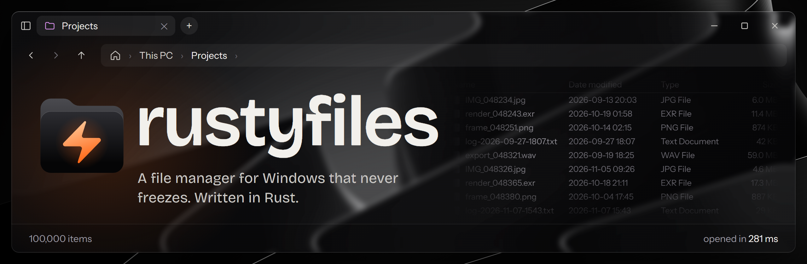

<p align="center">
  <a href="README.md">English</a> ·
  <b>简体中文</b> ·
  <a href="README.zh-TW.md">繁體中文</a> ·
  <a href="README.ja.md">日本語</a> ·
  <a href="README.de.md">Deutsch</a> ·
  <a href="README.es.md">Español</a> ·
  <a href="README.pt-BR.md">Português (Brasil)</a> ·
  <a href="README.ru.md">Русский</a> ·
  <a href="README.tr.md">Türkçe</a>
</p>

<p align="center"><sub>本文为译文，以英文版 <a href="README.md">README</a> 为准。</sub></p>



<p align="center">
  <b>一款永不等待磁盘的文件管理器。</b><br>
  标签页、双窗格、像文件夹一样打开的压缩包，以及按 <kbd>Space</kbd> 即可预览。<br>
  使用 Rust 从零编写，支持 Windows，现已支持 macOS。
</p>

<p align="center">
  <a href="https://github.com/gelenmedya/rustyfiles/releases/latest"></a>
  <a href="https://github.com/gelenmedya/rustyfiles/releases"></a>
  
  
  <a href="https://github.com/gelenmedya/rustyfiles/releases/latest"></a>
  <a href="LICENSE"></a>
</p>

<p align="center">
  <a href="https://github.com/gelenmedya/rustyfiles/releases/latest/download/rustyfiles-win-Setup.exe"></a>
  <a href="https://github.com/gelenmedya/rustyfiles/releases/latest/download/rustyfiles-mac.dmg"></a>
  <br>
  <a href="https://rustyfiles.com"></a>
  <a href="https://discord.gg/K2banZ36zJ"></a>
  <a href="https://www.buymeacoffee.com/ozerguzel"></a>
</p>

<table>
  <tr>
    <td width="33%" valign="top">
      <b>从不等待磁盘</b><br>
      列表、图标、缩略图、右键菜单以及每一次复制，都在窗口线程之外运行。
      慢速的网络共享或含 100,000 个文件的文件夹，都无法让它卡住。
    </td>
    <td width="33%" valign="top">
      <b>资源管理器的工作，做得更快</b><br>
      标签页、双窗格、将压缩包视为文件夹、用于即时搜索的名称索引、批量重命名、撤销，
      以及自研的复制引擎：处理小文件时快 14 倍。
    </td>
    <td width="33%" valign="top">
      <b>免费，而且属于你</b><br>
      无需账户，没有广告，不向任何地方发送数据。MIT 许可证，每一行代码都可以阅读。
      更新会在后台悄悄安装。
    </td>
  </tr>
</table>

<picture>
  <source media="(prefers-color-scheme: dark)" srcset="docs/readme/projects-dark.png">
  
</picture>

<sub>Windows 版，启用实验性的 HyperGlass 背景（设置 › 外观）。默认是 Mica，与资源管理器相同。</sub>

## 速度有多快


打开含 100,000 个文件的文件夹只需 281 毫秒（文件资源管理器：2.3 秒）。这些数字来自应用内置的速度测试，
即 设置 › 速度测试，你可以在自己的电脑上亲自验证。

<details>
<summary><b>每项测量及其测量方法</b></summary>

#### 打开文件夹

从启动应用到文件夹列表完全静止的时间，在新窗口中测得，文件夹已位于操作系统的文件缓存中。
预热后运行三次，取中位数。

| 文件夹 | rustyfiles | 文件资源管理器 | [Files](https://files.community) |
|---|--:|--:|--:|
| 空文件夹 | 281 ms | 1,006 ms | 813 ms |
| 1,000 个文件 | 284 ms | 2,214 ms | 1,893 ms |
| 10,000 个文件 | 286 ms | 2,221 ms | 1,053 ms |
| 100,000 个文件 | 281 ms | 2,318 ms | 4,069 ms |
| 2,000 张图片（缩略图） | 278 ms | 2,177 ms | 1,075 ms |
| 列出 10,000 个文件后的内存占用 | 39 MB | 69 MB | 204 MB |

测量于同一台机器（Ryzen 7 9800X3D，NVMe SSD，Windows 11），时间为 2026-11-16，所用版本为 rustyfiles
0.8.6 与 Files 4.3。rustyfiles 与资源管理器各自启动了新进程。Files 原本已在后台运行，因此其时间并非冷启动的时间；
它还会分步填充列表，计时直到画面不再变化为止。内存为私有工作集，即任务管理器显示的数值。
开启“保持在后台运行”时，新的 rustyfiles 窗口不会启动新进程，显示已列出的文件夹用时 93–168 毫秒（2026-11-06，较早的版本）。

#### 一个不断变化的 100,000 个文件的文件夹

先打开该文件夹并选中一个文件，然后在后台以每秒约 1,000 个文件的速度重命名文件，持续 5 秒：

| | |
|---|--:|
| 从启动到列出文件夹（100,001 个文件） | 315 ms |
| 列表跟随变化 | 每约 750 ms |
| 重新读取文件夹（后台线程） | ~70 ms |
| 每次更新时在 UI 线程上的工作量 | 7–8 ms |
| 选择与光标 | 保持在所选文件上 |

在 200 Hz 显示器上，对同一文件夹进行 7.7 秒的上下滚动，选中项（以及预览窗格）每半秒移动一次，同时后台约以每秒 680 个文件的速度重命名，
期间的帧时间如下：

| | 中位数 | p95 | p99 | 最差 |
|---|--:|--:|--:|--:|
| UI 线程上的帧耗时 | 2.1 ms | 4.6 ms | 7.9 ms | 16.8 ms |
| 帧与帧之间的时间 | 3.3 ms | 5.3 ms | 9.9 ms | 17.3 ms |

7.7 秒内共 2,182 帧；仅有一次间隔超过 60 Hz 的一帧时长。你可以自行测量：使用 `RUSTYFILES_TRACE_LIVE=1` 与 `RUST_LOG=warn,rf_app=info`，
并通过 `GPUI_FRAME_LOG=frames.tsv` 记录帧数据。

#### 在已打开的窗口中新建标签页

| 文件夹 | 列表稳定所需时间 |
|---|--:|
| 1,000 个文件 | ~48 ms |
| 10,000 个文件 | ~46 ms |
| 100,000 个文件 | ~129 ms |

每多一个标签页约占用 3 MB 内存（1 个标签页：约 32 MB，25 个标签页：约 103 MB）。

#### 按文件名搜索

rustyfiles 会为本地驱动器保存一份名称索引，并直接从索引中回答搜索请求。在一个用户文件夹的所有子文件夹中搜索“rapor”，
该文件夹含 360 万个文件和文件夹，计时直到屏幕上的结果不再变化为止：

| | 时间 |
|---|--:|
| rustyfiles 0.4 | **0.38 s** |
| 文件资源管理器 | 1.8 s（其 4 次运行中最快的一次；其余耗时 11–32 秒） |

索引中每个不同的名称只保存一次：一个有 480 万条记录但只有 49 万个不同名称的驱动器，索引占用 61 MB。
rustyfiles 运行期间，文件夹监视器会保持索引为最新；两次运行之间，NTFS 的更改日志（无需管理员权限即可读取）会指明哪些文件夹发生了变化，
因此启动时只需重新列出这些文件夹：在此测试中 C: 盘耗时 0.2 秒，而完整遍历需要 30 秒。应用数据、缓存、
`node_modules` 与 `.git` 不包含在索引中；在其中发起的搜索会遍历磁盘：

| 在 `C:\Windows` 下搜索 `*.dll`（342,492 项，116,851 个文件夹，缓存已预热） | 时间 |
|---|--:|
| rustyfiles | **7.8 s** |
| `dir /s /b` | 53 s |
| PowerShell `Get-ChildItem -Recurse` | 105 s |

它在六个后台优先级线程上搜索，因此计算机其余部分仍能保持响应；它也不会跟随连接点（junction），
这就是它少找到 454 个重复项的原因。

#### 按 Space 预览（DirectLook）

| 文件 | 从按下按键起，内容就绪所需时间 |
|---|--:|
| JPEG，3840 × 2160 | 24–86 ms |
| 源代码，语法高亮 | 23–44 ms |
| 7z 压缩包（列出内容） | 19–31 ms |
| MP3（标签、歌词） | 27–32 ms |
| H.264 视频，1080p | 首帧耗时 146–185 ms |

#### 压缩包

使用 [rarchive](https://github.com/gelenmedya/rarchive)（我们自研的引擎）读取 RAR，与官方 UnRAR 对比（解码并校验每个 CRC，压缩包位于文件缓存中）：

| 压缩包 | UnRAR | rarchive |
|---|--:|--:|
| 1.3 GB，32 MB 字典，195 个文件 | 2.79 s | **0.28 s**（10×） |
| 400 MB 固实压缩 | 0.95 s | **0.21 s**（4.5×） |
| 400 MB，520 个文件 | 1.03 s | **0.063 s**（16×） |

#### 复制与解压

将我们自研的引擎与 Windows 自带的进行对比（rustyfiles 0.8.6，2026-11-16）：

| | Windows | rustyfiles |
|---|--:|--:|
| 复制 100 个文件夹中的 10,000 个小文件（41 MB） | 25.6 s | **1.8 s**（14×） |
| 复制一个 1 GB 的文件 | 0.61 s | 0.44 s |
| 解压含 10,000 个文件的 ZIP | 32.4 s | **3.6 s**（9×） |

复制时会将小文件分散到多个文件夹中，因为多个线程同时写入同一文件夹时会相互等待；单个大文件的速度受限于磁盘，而非引擎。
它自行处理文件名冲突（替换、跳过或两者都保留），支持暂停与继续，可以逐字节校验每次复制，还能限制速度。
复制测试脚本为 `crates/rf-win/examples/copybench.rs`。

所有数字：均来自同一台机器（Ryzen 7 9800X3D，NVMe SSD，Windows 11），2026 年 11 月。

</details>

## 功能概览

- **浏览。** 标签页可拖出为新窗口，可保存会话，支持双窗格、详细信息、网格、列表和分栏视图、分组、预览窗格、颜色标签、Shelf、网络共享与 FTP。
- **文件。** 撤销与重做，批量重命名，按需计算文件夹大小，磁盘占用以树状图显示，完整的资源管理器右键菜单，并可与其他所有应用进行拖放。
- **压缩包。** ZIP、7z、RAR、tar 与 ISO 均可像文件夹一样打开；ZIP、7z 和 tar 可在内部编辑。
- **搜索。** 驱动器的名称索引，以及用于应用、文件、书签和 Windows 设置的快速搜索（<kbd>Alt</kbd>+<kbd>Space</kbd>）。
- **Windows。** 可选择将其设为默认文件管理器，包括 <kbd>Win</kbd>+<kbd>E</kbd> 以及其他应用的“打开”和“保存”对话框。
- **49 种语言**，跟随系统语言。

<details>
<summary><b>各项功能详解</b></summary>

**浏览。** 标签页可拖动以重新排序，或拖出到新窗口。可将窗口的标签页（包括分割窗格）保存为一个命名会话，之后再重新打开。
新建标签页时会打开主页或当前所在的文件夹（设置 › 常规）。双窗格。详细信息、网格、列表和分栏视图（列表可像资源管理器一样逐列填充），
类似资源管理器紧凑视图的紧凑项目，分组，预览窗格，搜索，颜色标签，Shelf，库，网络共享与 FTP。
Git 状态列。按需计算文件夹大小：点击“计算大小”；结果会在重启后保留，并可显示占用的磁盘空间。
在文件夹或驱动器上选择“显示磁盘占用”，会列出占用空间最多的项目，并附带一个可点击进入的树状图。
库和图库等虚拟文件夹会在 rustyfiles 中打开；Windows 在“此电脑”下列出的设备（通过 USB 连接的手机或 Phone Link）会出现在主页的“设备”中。
Windows 已识别的云盘文件夹（OneDrive、Proton Drive、Dropbox、MEGA 等）位于侧边栏中。

**文件。** 对重命名、复制、移动、移到回收站的删除以及文件夹扁平化操作进行撤销与重做。批量重命名。复制或移动到另一个窗格，
以及将复制的文本或图片粘贴为新文件。完整的资源管理器右键菜单（包括“发送到”），可与资源管理器、桌面、浏览器和 Outlook 之间拖放，
并且标签页、固定文件夹、文件夹和程序都可以作为放置目标。
使用 [Ferry](#ferry) 将文件发送到你的其他电脑，使用 [HyperDownload](#hyperdownload) 下载文件。

**压缩包。** ZIP、7z、RAR、tar 系列与 ISO 均可像文件夹一样打开，包括受密码保护的 ZIP、7z 和 RAR。可在 ZIP、7z 和 tar 内部添加、删除和重命名。
可在所有内核上创建 ZIP、7z 和 tar.zst。读取由 [rarchive](https://github.com/gelenmedya/rarchive) 完成，这是我们自研的纯 Rust
引擎（也[发布在 crates.io 上](https://crates.io/crates/rarchive)）：解码一个 1.3 GB 的 WinRAR 压缩包，速度是 UnRAR 的十倍。

**Windows。** 可选择将其设为默认文件管理器：文件夹、<kbd>Win</kbd>+<kbd>E</kbd>、此电脑和回收站都会在 rustyfiles 中打开。
也可以选择让其他应用的“打开”“保存”和“选择文件夹”对话框同样在 rustyfiles 中打开（设置 › 高级），
并且那里的图钉按钮可以为每个应用保留一个起始文件夹。在“照片”或其他 Store 应用中打开的图片和视频会带上其所在文件夹，因此“上一个”和“下一个”可以正常使用。
资源管理器的 `/select,` 与 `shell:` 路径均可使用。支持 Mica、深色模式和系统强调色。当游戏或渲染任务占满 GPU 时，绘制会在 GPU 与 CPU 之间切换，且不会闪烁。

**地址栏中的命令。** 与资源管理器相同：按 <kbd>Ctrl</kbd>+<kbd>L</kbd>，输入 `cmd`、`powershell`、`wt` 或 `code .`，然后按 <kbd>Enter</kbd>。
输入的文本首先会被当作一个位置（路径、驱动器、`%VAR%`、`shell:`）；如果当前文件夹中有同名的文件夹或文件，则始终优先使用它。
只有在没有这样的位置时，才会像“运行”框一样把第一个词当作程序查找，并在当前文件夹中启动。
不会从自动补全中启动任何内容，也不会要求管理员权限。在 设置 › 文件和文件夹 › 行为 中可以关闭此功能。

**整理。** 为文件夹设置规则：可按名称、扩展名、类型、大小和时间设置条件，并执行一个操作（移动、移动到由模板生成的文件夹、重命名，或移到回收站）。
手动运行时会先在预览中显示每一步，点击“应用”之前不会移动任何文件，并且运行结果可以撤销。绝不会永久删除任何内容，也不会覆盖任何文件。
自动运行的规则默认关闭。

**搜索。** 快速搜索（<kbd>Alt</kbd>+<kbd>Space</kbd>）可查找应用、文件和文件夹、浏览器书签以及 Windows 设置页面。
你经常打开的内容会排在前面，而你之前为相同字母所选择的项目会排在第一行。

**语言。** 共 49 种，跟随系统显示语言（也可以在 设置 › 常规 中选择）。界面以土耳其语和英语编写；其他语言以 Files
社区的措辞为起点，此后经机器翻译而来。从右到左书写的名称和文本会从右向左显示（感谢 @ialhabbal）；界面本身尚未镜像。欢迎提出更正：
每种语言都是 `crates/rf-app/locales/` 中的一个 JSON 文件。

</details>


## DirectLook

选中一个文件并按 <kbd>Space</kbd>：视频和音频使用各自的播放器，图片、文本和代码，压缩包的内容，以及其他所有文件的详细信息卡片。
方向键可在文件夹中切换，文件夹保持打开。它作为独立程序运行，因此一个大型视频不会拖慢文件管理器；如果启用它，它也可以在资源管理器和桌面上使用（设置 › DirectLook）。

## Ferry

将文件和文件夹发送到同一网络中你其他电脑上的 rustyfiles，其方式类似 AirDrop：右键 › **用 Ferry 发送**。在 设置 › Ferry 中开启之前，此功能处于关闭状态。


<sub>设置 › Ferry 的示意图，设备为虚构，文字与布局均来自应用本身。</sub>

<details>
<summary><b>Ferry 的工作原理</b></summary>

- 端到端加密（QUIC 配合 TLS 1.3），设备之间直接传输：没有服务器，没有账户，数据不会离开你的网络。
- 像配对蓝牙一样配对你的设备：两端会显示相同的六位数代码。已配对设备的文件可以无需询问直接到达；其他任何设备的文件都会先通过通知询问你。
- 你可以选择谁能看到你的电脑：无人、已配对的设备（默认），或在十分钟内所有人。在 设置 › Ferry 打开期间，所有人都能看到你的电脑，以便新设备能够找到它。
- 中断的传输会从中断处继续，每个文件在使用其文件名之前都会经过校验。接收到的文件会被标记为已下载，因此如果其中某个程序要运行，SmartScreen 会先询问。
- 每台设备都会显示估算速度，**测试速度** 会在几秒内双向测量速度。
- macOS 应用使用相同的协议，协议说明见 [docs/nearby-protocol.md](docs/nearby-protocol.md)。Windows 防火墙可能会询问是否允许 Ferry：请允许其在专用网络中通信。

</details>

## HyperDownload

rustyfiles 自带的下载管理器，是一个附加组件：设置 › 附加组件 › HyperDownload › **安装**。支持多连接同时下载单个文件，暂停后可在中断处继续，
支持种子文件和磁力链接，提供下载页面，并且视频可在视频未下载完成时就在 DirectLook 中播放。它是一个独立程序
（[源代码](https://github.com/gelenmedya/hyperdownload)，MIT 许可证），仅在你点击“安装”时下载，下载后会先核对其 SHA-256，并可随时移除。

## Windows 上的实验功能：HyperGlass、Dock 与桌面

默认关闭，且仍处于早期阶段：仅在一台配有两台显示器的电脑上构建并试用过。可能存在粗糙之处，欢迎反馈你发现的问题。
资源管理器会继续在后台运行；Windows 的任何内容都不会在磁盘上被删除或替换。


<sub>开始菜单、HyperSearch 与控制中心，由同一桌面的三张截图拼合而成（它们不会同时打开）。</sub>

<details>
<summary><b>各部分的作用</b></summary>

- **HyperGlass**（设置 › 外观）是第五种背景：窗口的背景是玻璃，它会折射并使其后的内容变得朦胧。
- **Dock**（设置 › Dock，一个开关）在每台显示器底部放置三个玻璃岛，取代 Windows 的任务栏：拥有自己的开始面板和搜索，运行中和固定的应用（带窗口预览），
  托盘图标，控制中心以及通知面板。开启后，轻触 Windows 键会打开 Dock 的开始面板，<kbd>Alt</kbd>+<kbd>Tab</kbd> 会打开它的切换器。
  关闭 Dock 后，Windows 自带的任务栏和开始菜单会恢复。
- **桌面**由 rustyfiles 绘制，随 Dock 一同提供：保留你的壁纸和图标，并提供圆角选项。
- **每台显示器的亮度。** Windows 只为笔记本电脑自带的屏幕提供滑块；Dock 的控制中心则为每台显示器提供一个。外接显示器通过 DDC/CI 进行设置，过去十五年里几乎所有桌面显示器都支持通过 DisplayPort、HDMI 和 DVI 使用它。
  如果某台显示器没有滑块，请检查其自身菜单中是否已开启 DDC/CI；部分扩展坞、KVM 切换器和转接器不会传递该信号。

</details>

## macOS（测试版）

同一款文件管理器，使用 AppKit 与 Liquid Glass 原生绘制，运行在相同的 Rust 核心之上：标签页、双窗格、所有视图、<kbd>Space</kbd> 快速查看（Quick Look）、
以文件夹形式打开压缩包、批量重命名、磁盘占用、Shelf、颜色标签、Git 状态、连接到服务器、Ferry 以及相同的 49 种语言。
Dock、桌面、HyperSearch 和 DirectLook 目前仍仅在 Windows 上提供，HyperDownload 的 Mac 版本将在其自己的发布版中推出。
支持 Apple 芯片与 Intel 芯片的 Mac，需要 macOS 26（Tahoe）。它与 Windows 版一样自动更新。

## 安装

**Windows。** [下载 rustyfiles-win-Setup.exe](https://github.com/gelenmedya/rustyfiles/releases/latest/download/rustyfiles-win-Setup.exe)
（约 50 MB），然后打开它。如果 Windows 提示“Windows 已保护你的电脑”，请点击 **更多信息**，再点击 **仍要运行**：安装程序尚未进行代码签名，
且每个版本都会在 [VirusTotal](https://www.virustotal.com) 上扫描（报告链接位于其发布说明末尾）。
rustyfiles 会自行打开，并出现在你的开始菜单中。无需管理员密码；更新会在后台悄悄安装。

**macOS（测试版）。** [下载 rustyfiles-mac.dmg](https://github.com/gelenmedya/rustyfiles/releases/latest/download/rustyfiles-mac.dmg)，
打开后将 rustyfiles 拖到“应用程序”中。它已由 Apple 签名并公证，因此和其他 Mac 应用一样可以直接打开。

<details>
<summary><b>Scoop、便携版、ARM64、默认文件管理器、卸载</b></summary>

**使用 [Scoop](https://scoop.sh)：**

```powershell
scoop bucket add rustyfiles https://github.com/gelenmedya/scoop-rustyfiles
scoop install rustyfiles/rustyfiles
```

**便携版或 ARM64：** 便携版 zip 和 ARM64 安装程序（`rustyfiles-win-arm64-Setup.exe`）可在 [Releases](https://github.com/gelenmedya/rustyfiles/releases) 页面下载。
需要 Windows 11（Windows 10 未经测试）。Linux 版已在计划中。

**在 rustyfiles 中打开文件夹和 <kbd>Win</kbd>+<kbd>E</kbd>：** 开启 设置 › 高级 › 设为默认文件管理器。你可以随时关闭它。

**卸载**：与其他应用一样，在 Windows 设置 › 应用 中卸载。rustyfiles 所做的所有更改都会恢复为文件资源管理器。

**卸载后，其他应用的“打开/保存”对话框失败或崩溃**（例如病毒扫描程序或更新失败导致 rustyfiles 的文件被删除而未经过卸载）？再次启动 rustyfiles 即可修复。
如果它已无法启动，可以运行以下 PowerShell 命令，将 Windows 自带的对话框还原给所有应用：

```powershell
Remove-Item -Recurse "HKCU:\Software\Classes\CLSID\{DC1C5A9C-E88A-4dde-A5A1-60F82A20AEF7}", "HKCU:\Software\Classes\CLSID\{C0B4E2F3-BA21-4773-8DBA-335EC946EB8B}"
```

</details>

<details>
<summary><b>从源代码构建</b></summary>

你需要 1.95 或更高版本的 [Rust](https://rustup.rs)，以及带有“使用 C++ 的桌面开发”工作负载的 Visual Studio Build Tools
（其中一个依赖项 zstd 需要编译 C 代码）。

```powershell
git clone https://github.com/gelenmedya/rustyfiles
cd rustyfiles
.\scripts\install.ps1            # 构建，然后为当前用户安装
.\scripts\install.ps1 -Default   # 同时将其设为默认文件管理器
.\scripts\install.ps1 -Uninstall
```

`cargo run --release -p rf-app` 可在不安装的情况下直接启动。macOS 应用位于 `macos/` 与 `crates/rf-mac` 中，
不在 Windows 工作区内。

</details>

**有问题或建议？** 欢迎到 [Discord](https://discord.gg/K2banZ36zJ) 打个招呼，或访问 [rustyfiles.com](https://rustyfiles.com)。

## 底层原理

<details>
<summary><b>键盘</b></summary>

| 按键 | 操作 |
|---|---|
| <kbd>Ctrl</kbd>+<kbd>T</kbd> / <kbd>Ctrl</kbd>+<kbd>W</kbd> / <kbd>Ctrl</kbd>+<kbd>Shift</kbd>+<kbd>T</kbd> | 新建标签页，关闭标签页，重新打开已关闭的标签页 |
| <kbd>Ctrl</kbd>+<kbd>L</kbd> 或 <kbd>Alt</kbd>+<kbd>D</kbd> | 地址栏 |
| <kbd>Ctrl</kbd>+<kbd>F</kbd> | 搜索（<kbd>Enter</kbd> 同时搜索子文件夹） |
| <kbd>Ctrl</kbd>+<kbd>Shift</kbd>+<kbd>P</kbd> 或 <kbd>F1</kbd> | 命令面板 |
| <kbd>Ctrl</kbd>+<kbd>P</kbd> / <kbd>Ctrl</kbd>+<kbd>Shift</kbd>+<kbd>A</kbd> | 查找你访问过的文件夹，查找标签页 |
| <kbd>Ctrl</kbd>+<kbd>Shift</kbd>+<kbd>1</kbd> … <kbd>5</kbd> | 详细信息、网格、分栏、卡片、列表 |
| <kbd>Ctrl</kbd>+<kbd>Shift</kbd>+<kbd>D</kbd>，<kbd>F6</kbd> | 双窗格，切换窗格 |
| <kbd>Shift</kbd>+<kbd>F5</kbd> / <kbd>Shift</kbd>+<kbd>F6</kbd> | 复制、移动到另一个窗格 |
| <kbd>Ctrl</kbd>+<kbd>Alt</kbd>+<kbd>D</kbd> | 复制（创建副本） |
| <kbd>Alt</kbd>+<kbd>P</kbd>，<kbd>Ctrl</kbd>+<kbd>B</kbd> | 预览窗格，侧边栏 |
| <kbd>Space</kbd> | DirectLook |
| <kbd>F2</kbd> | 重命名（选中多个项目时为批量重命名） |
| <kbd>Ctrl</kbd>+<kbd>Z</kbd> / <kbd>Ctrl</kbd>+<kbd>Y</kbd> | 撤销，重做 |
| <kbd>Ctrl</kbd>+<kbd>H</kbd> | 显示隐藏项目 |

每个快捷键都可以在 设置 › 操作 中更改：点击一个命令，然后按下新的按键即可。

</details>

<details>
<summary><b>项目结构</b></summary>

| Crate | 内容 |
|---|---|
| `crates/rf-app` | Windows 界面及其两个程序：`rustyfiles` 与 `directlook`（`src/look/`） |
| `crates/rf-win` | Windows 与 Shell 集成，文件操作引擎 |
| `crates/rf-core` | 两个平台共享的模型：位置、历史记录、条目、格式 |
| `crates/rf-archive` | 压缩包操作：浏览、解压、创建、编辑 |
| `crates/rf-nearby` | Ferry，与 macOS 应用共享 |
| `crates/rf-player` | DirectLook 的视频与音频播放器 |
| `crates/rustdecoder` | 我们自研的视频引擎，仍在开发中：支持 MP4/MOV 与 MKV/WebM；H.264、HEVC、VP9 和 AV1 通过 D3D11 Video 在显卡上解码，在其测试中与 ffmpeg / dav1d 逐位一致；ProRes 与 DNxHR 在 CPU 上解码；音频以及音视频同步（[设计文档](docs/design/rustdecoder.md)） |
| `macos/`，`crates/rf-mac` | macOS 应用（AppKit）及其与 Rust 核心之间的桥接 |

Windows 界面使用 [GPUI](https://gpui.rs) 构建，这是 Zed 编辑器背后的框架。其 Windows 层是一个分支，增加了 GPU/CPU 切换功能：
[gelenmedya/gpui-pre-windows](https://github.com/gelenmedya/gpui-pre-windows)。

</details>

<details>
<summary><b>环境变量</b></summary>

| 变量 | 作用 |
|---|---|
| `RUSTYFILES_RENDERER` = `gpu`、`cpu` 或 `auto` | 强制指定窗口在何处绘制 |
| `RUSTYFILES_CONFIG_DIR` = 文件夹 | 将设置保存到其他文件夹（便携使用） |
| `RUSTYFILES_MULTI_INSTANCE=1` | 允许同时运行多个副本（用于测试） |
| `RUSTYFILES_FRAME_LOG=1` | 记录帧时间 |
| `RUSTYFILES_LOOK_TRACE=1` | 将 DirectLook 的耗时记录到 stderr |
| `RUSTYFILES_MUTE=1` | DirectLook 静音播放（用于测试） |

设置保存在 `%APPDATA%\rustyfiles\settings.toml` 中，DirectLook 的设置保存在其旁边的 `directlook.toml` 中。

</details>

<details>
<summary><b>制作过程</b></summary>

rustyfiles 是使用 AI 编程工具编写的，这一点并不隐瞒。由一位开发者决定要构建什么以及应当如何运行，在真实的电脑上（两台显示器，日常工作）试用每一项更改，
并放弃那些站不住脚的部分。AI 编写了大部分代码；但它并不决定什么会被发布。

为此保持诚实的做法包括：

- **测试。** 每次更改推送之前，会运行超过 4,000 个自动化测试。
- **测量。** 速度数字来自应用内置的测试（设置 › 速度测试），因此任何人都可以在自己的机器上验证。
- **反馈。** 错误报告来自使用它的人。每个 issue 都会得到回复，修复在公开场合进行，并且报告者会被要求在问题关闭之前进行试用。
- **代码。** 全部代码都以 MIT 许可证公开在此，供阅读和评判。

为什么选择 Rust：文件管理器必须在一个含 100,000 个文件的文件夹中依然快速，并且绝不能丢失任何人的数据。Rust 在没有垃圾回收器的情况下提供速度，
并在程序发布之前就排除了整类崩溃问题。rustyfiles 是一个从零编写的新应用，而不是对资源管理器的重写；它与资源管理器并行运行，
并且不会在磁盘上改动 Windows 的任何内容。

</details>

## 状态

rustyfiles 还很年轻，其作者每天都用它来代替资源管理器。macOS 应用是同一核心之上的首个测试版，Linux 版将排在其后。欢迎提交错误报告和 Pull Request。

## 收录情况

- [AlternativeTo](https://alternativeto.net/software/rustyfiles/about/)，作为文件资源管理器的替代品
- [Awesome GPUI](https://github.com/zed-industries/awesome-gpui#productivity)，位于 Productivity 分类中
- [Awesome Rust](https://github.com/rust-unofficial/awesome-rust#file-manager)，位于 File manager 分类中
- [Scoop](https://scoop.sh)，来自其自有的 bucket（参见 [安装](#安装)）

## 致谢

rustyfiles 站在他人的成果之上，一路上借鉴了许多想法。

[Files](https://github.com/files-community/Files) 展示了一款现代 Windows 文件管理器可以是什么样子。它的功能清单成了我们的检查表，
它的设置与布局塑造了我们的版本，而它将资源管理器替换为默认文件管理器的思路也指引了我们。感谢 Files 社区。

[GPUI](https://gpui.rs) 是 [Zed](https://github.com/zed-industries/zed) 编辑器的 UI 框架，它在 Windows 上以 GPU 绘制 rustyfiles 的每一个像素，
使这样快速的窗口成为可能。感谢 Zed 团队构建并分享了它，也感谢 [Longbridge](https://github.com/longbridge/gpui-kit) 提供的 gpui-kit，
即我们所依赖的组件。

DirectLook 沿用了 macOS Quick Look 的理念，还有由 Paddy Xu 开发、率先将其带到 Windows 的 [QuickLook](https://github.com/QL-Win/QuickLook)。
rarchive 的 RAR 格式知识则来自 Alexander Roshal 的 UnRAR 源代码。

使用了 [windows-rs](https://github.com/microsoft/windows-rs)、[Velopack](https://velopack.io)（安装与更新）、[Lucide](https://lucide.dev) 图标、[zip](https://github.com/zip-rs/zip2)、
[sevenz-rust2](https://github.com/hasenbanck/sevenz-rust)、[tar](https://github.com/alexcrichton/tar-rs)、
[notify](https://github.com/notify-rs/notify) 等众多 crate 构建。图片使用了 Atelier Triay 的
[Bricolage Grotesque](https://github.com/ateliertriay/bricolage)、[Instrument Sans](https://fonts.google.com/specimen/Instrument+Sans) 和
[Doto](https://fonts.google.com/specimen/Doto)。

## 许可证

MIT，见 [LICENSE](LICENSE)。GPUI 分支在其自有仓库中保留 Zed 的 Apache-2.0 许可证。
