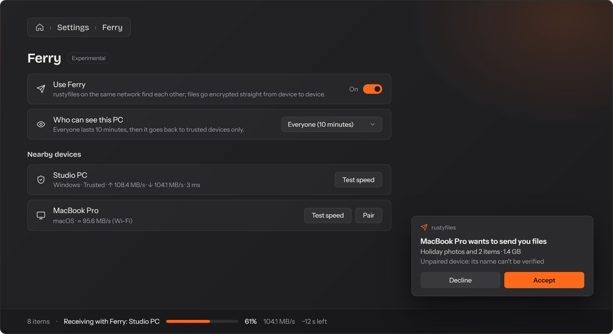

<p align="center">
  <a href="README.md">English</a> ·
  <b>简体中文</b> ·
  <a href="README.zh-TW.md">繁體中文</a> ·
  <a href="README.ja.md">日本語</a> ·
  <a href="README.de.md">Deutsch</a> ·
  <a href="README.es.md">Español</a> ·
  <a href="README.pt-BR.md">Português (Brasil)</a> ·
  <a href="README.ru.md">Русский</a> ·
  <a href="README.tr.md">Türkçe</a>
</p>

<p align="center"><sub>本文为译文，以英文版 <a href="README.md">README</a> 为准。</sub></p>


<p align="center">
  <a href="https://github.com/gelenmedya/rustyfiles/releases/latest"></a>
  
  <a href="LICENSE"></a>
</p>

rustyfiles 是一个用 Rust 从零编写的 Windows 文件管理器。它的目标是在日常工作中取代文件资源管理器：支持标签页、双窗格、可像文件夹一样打开的压缩包，以及类似 Quick Look 的预览工具 DirectLook。

窗口从不等待磁盘。列出文件、图标、缩略图、右键菜单以及每一项文件操作都在 UI 线程之外运行，因此慢速的网络共享或包含 10 万个文件的文件夹都不会让它卡住。

<p align="center">
  <a href="https://github.com/gelenmedya/rustyfiles/releases/latest/download/rustyfiles-win-Setup.exe"></a>
  <a href="https://rustyfiles.com"></a>
  <a href="https://discord.gg/K2banZ36zJ"></a>
</p>

<p align="center">
  <a href="https://www.buymeacoffee.com/ozerguzel"></a>
</p>

<p align="center">
  <a href="https://alternativeto.net/software/rustyfiles/about/?utm_source=badge&utm_medium=referral">
    <picture>
      <source media="(prefers-color-scheme: dark)" srcset="https://alternativeto.net/static/badges/badge-compact-dark.svg">
      
    </picture>
  </a>
</p>

免费、无需账号、无广告。下载，双击，完成：见[安装](#安装)。

<picture>
  <source media="(prefers-color-scheme: dark)" srcset="docs/readme/projects-dark.png">
  
</picture>

<sub>图片展示的是实验性的 HyperGlass 背景（设置 › 外观）。默认背景是 Mica，与文件资源管理器相同。</sub>

## 速度


### 打开文件夹

从启动应用到文件列表稳定显示的时间，在新窗口中测量，文件夹已在系统文件缓存中。预热后取三次运行的中位数，使用 rustyfiles 内置的速度测试（设置 › 速度测试）测量：任何人都可以在自己的电脑上运行它。

| 文件夹 | rustyfiles | 文件资源管理器 | [Files](https://files.community) |
|---|--:|--:|--:|
| 空文件夹 | 281 ms | 1,006 ms | 813 ms |
| 1,000 个文件 | 284 ms | 2,214 ms | 1,893 ms |
| 10,000 个文件 | 286 ms | 2,221 ms | 1,053 ms |
| 100,000 个文件 | 281 ms | 2,318 ms | 4,069 ms |
| 2,000 张图片（缩略图） | 278 ms | 2,177 ms | 1,075 ms |
| 列出 10,000 个文件后的内存 | 39 MB | 69 MB | 204 MB |

测试环境为同一台机器（Ryzen 7 9800X3D，NVMe SSD，Windows 11），时间为 2026-11-16，测试对象为 rustyfiles 0.8.6 与 Files 4.3（在同一测试中，0.8.5 约需 540 毫秒：其第一个标签页会播放一段开场动画，而 0.8.6 启动时已不再播放）。rustyfiles 与文件资源管理器各自启动了一个新进程。Files 已在后台运行，因此它的时间不是冷启动时间；它的列表也是分步填充的，计时一直持续到画面不再变化为止。内存为专用工作集，即任务管理器显示的数值；Files 的内存是其运行进程的数值。

开启“在后台保持运行”后，新建的 rustyfiles 窗口不会启动新进程：在更早的一次测量中（2026-11-06，较早的版本），它显示已列出的文件夹用时 93–168 毫秒。

### 文件持续变化的 10 万文件夹

打开文件夹，选中一个文件，然后在后台以每秒约 1,000 个文件的速度重命名文件，持续 5 秒：

| | |
|---|--:|
| 启动到列出文件夹（100,001 个文件） | 315 ms |
| 列表跟随变化 | 每约 750 ms |
| 重新读取文件夹（后台线程） | 约 70 ms |
| 每次更新在 UI 线程上的耗时 | 7–8 ms |
| 选择与光标 | 保持在所选文件上 |

窗口从不等待文件夹：重新读取在 UI 线程之外进行，而且在 120 Hz 下，单次更新的耗时不到一帧。你可以用 `RUSTYFILES_TRACE_LIVE=1` 和 `RUST_LOG=warn,rf_app=info` 自行测量。

在此期间的帧时间：同一个文件夹用鼠标滚轮向下、再向上滚动 7.7 秒，选中项（以及预览窗格）每半秒移动一次，同时后台约每秒重命名 680 个文件。显示器为 200 Hz。

| | 中位数 | p95 | p99 | 最差 |
|---|--:|--:|--:|--:|
| UI 线程上的帧耗时 | 2.1 ms | 4.6 ms | 7.9 ms | 16.8 ms |
| 帧间隔 | 3.3 ms | 5.3 ms | 9.9 ms | 17.3 ms |

7.7 秒内共 2,182 帧；有一次间隔超过了 60 Hz 下的一帧（16.7 毫秒）。你可以用 `GPUI_FRAME_LOG=frames.tsv` 记录自己的数据（每帧一行：其开始时间及耗时，单位为毫秒）。

### 已打开窗口中的新标签页

| 文件夹 | 列表稳定所需时间 |
|---|--:|
| 1,000 个文件 | 约 48 ms |
| 10,000 个文件 | 约 46 ms |
| 100,000 个文件 | 约 129 ms |

每多一个标签页约占用 3 MB 内存（1 个标签页：约 32 MB，25 个标签页：约 103 MB）。

### 按文件名搜索

rustyfiles 会为本地驱动器建立文件名索引，搜索结果直接从索引中得出。在一个包含 360 万个文件和文件夹的用户文件夹中搜索 "rapor"（搜索其所有子文件夹），计时一直持续到屏幕上的结果不再变化为止：

| | 耗时 |
|---|--:|
| rustyfiles 0.4 | **0.38 s** |
| 文件资源管理器 | 1.8 s（4 次运行中最快的一次；其余用了 11–32 秒） |

索引会为每个不同的名称只存储一次：一个有 480 万条记录但只有 49 万个不同名称的驱动器，仅占用 61 MB。rustyfiles 运行时，文件夹监视器会让索引保持最新。两次运行之间，NTFS 的更改日志（无需管理员权限即可读取）会告诉我们哪些文件夹发生了变化，因此启动时只需重新列出这些文件夹，而不必遍历整个驱动器：在这里，C: 盘耗时 0.2 秒，而完整遍历需要 30 秒。应用数据、缓存、`node_modules` 和 `.git` 文件夹不在索引之内；在这些文件夹中发起的搜索会遍历磁盘：

`C:\Windows` 下的 `*.dll`：共 342,492 项，位于 116,851 个文件夹中，文件缓存已预热。

| 方法 | 耗时 |
|---|--:|
| rustyfiles | **7.8 s** |
| `dir /s /b` | 53 s |
| PowerShell `Get-ChildItem -Recurse` | 105 s |

rustyfiles 在六个低优先级后台线程上搜索，因此机器的其余部分仍保持响应。它不会跟随目录联接（junction），因此少找到了 454 个重复项。

### 用空格键预览（DirectLook）

从按下按键到内容显示在屏幕上的时间，应用已在运行：

| 文件 | 内容就绪 |
|---|--:|
| JPEG，3840 × 2160 | 24–86 ms |
| 源代码，语法高亮 | 23–44 ms |
| 7z 压缩包（列出内容） | 19–31 ms |
| MP3（标签、歌词） | 27–32 ms |
| H.264 视频，1080p | 首帧在 146–185 ms 内出现 |

### 压缩包

使用我们自己的引擎 [rarchive](https://github.com/gelenmedya/rarchive) 读取 RAR，并与官方 UnRAR 对比（解码并校验每个 CRC，压缩包均在文件缓存中）：

| 压缩包 | UnRAR | rarchive |
|---|--:|--:|
| 1.3 GB，32 MB 字典，195 个文件 | 2.79 s | **0.28 s**（10×） |
| 400 MB 固实压缩包（solid） | 0.95 s | **0.21 s**（4.5×） |
| 400 MB，520 个文件 | 1.03 s | **0.063 s**（16×） |

### 复制与解压

同一速度测试，比较我们自己的引擎与 Windows 的表现（rustyfiles 0.8.6，2026-11-16）：

| | Windows | rustyfiles |
|---|--:|--:|
| 复制 100 个文件夹中的 1 万个小文件（41 MB） | 25.6 s | **1.8 s**（14×） |
| 复制一个 1 GB 文件 | 0.61 s | 0.44 s |
| 解压包含 1 万个文件的 ZIP | 32.4 s | **3.6 s**（9×） |

复制使用它自己的并行引擎，它会把小文件分散到多个文件夹中，因为多个线程写入同一个文件夹时会互相等待。单个大文件受限于磁盘而不是引擎（在更早的一次运行中，Windows 比它快了几毫秒）。按名称搜索测试文件夹（123,000 项）耗时 55 毫秒。

它还会自行处理名称冲突（替换、跳过或保留两者，可对全部文件或逐个文件选择），支持暂停与继续，可以逐字节校验每一个副本，并且能够限制速度。

所有数字均来自同一台机器（Ryzen 7 9800X3D，NVMe SSD，Windows 11），测试于 2026 年 11 月进行。打开文件夹、复制和解压的数据来自内置的速度测试（设置 › 速度测试）；其他测试脚本位于代码仓库中（复制测试见 `crates/rf-win/examples/copybench.rs`）。

## 功能概览

**浏览。** 标签页可以拖动重新排序，也可以拖出到新窗口。可以将窗口的标签页（包括分割窗格）保存为一个命名会话，之后再次打开；会话名称会显示在标签页旁边。新标签页会打开主页或你当前所在的文件夹（设置 › 常规）。双窗格。详细信息、网格、列表和分栏视图（列表可像文件资源管理器那样逐列填充）、分组、预览窗格、搜索、颜色标签、Shelf、库、网络共享和 FTP。Git 状态列。按需计算文件夹大小：点击"计算大小"；大小会在重启后保留，并可显示占用的磁盘空间。在文件夹或驱动器上使用"显示磁盘使用情况"，会按占用空间从大到小列出内容，旁边还有一个可点击浏览的树状图（C:\Windows，34.1 万项，占用 26 MB 内存）。库和图库等虚拟文件夹可以在 rustyfiles 中打开；Windows 在"此电脑"下列出的设备（通过 USB 连接的手机或"手机链接"）会出现在主页的"设备"下；这部分尚未用真机手机测试过。

**文件。** 重命名、复制、移动、移到回收站以及文件夹展平操作均可撤销和重做。批量重命名。复制或移动到另一个窗格，也可以把复制的文本或图片粘贴为新文件。完整的文件资源管理器右键菜单，包括"发送到"；可与文件资源管理器、桌面、浏览器和 Outlook 之间拖放，并且可以拖放到标签页、固定的文件夹、文件夹和程序上。使用 [Ferry](#ferry) 将文件发送到你的其他电脑，并通过 [HyperDownload](#hyperdownload) 下载。

**压缩包。** ZIP、7z、RAR、tar 系列和 ISO 都可以像文件夹一样打开，包括有密码保护的 ZIP、7z 和 RAR。可以在 ZIP、7z 和 tar 内部添加、删除和重命名。可以在每个 CPU 核心上创建 ZIP、7z 和 tar.zst。读取工作由 [rarchive](https://github.com/gelenmedya/rarchive) 完成，这是我们自己的纯 Rust 引擎（也已[发布到 crates.io](https://crates.io/crates/rarchive)，供其他 Rust 项目使用）：它解码 1.3 GB 的 WinRAR 压缩包，比 UnRAR 快十倍。

**Windows。** 可以选择将 rustyfiles 设为默认文件管理器：文件夹、<kbd>Win</kbd>+<kbd>E</kbd>、此电脑和回收站都会在 rustyfiles 中打开。也可以选择让其他应用的"打开"、"保存"和"选择文件夹"对话框同样在 rustyfiles 中打开（设置 › 高级），并且那里的固定按钮可以为每个应用保留一个起始文件夹。在照片或其他 Store 应用中打开的图片和视频会连同其所在的文件夹一起打开，因此"上一个"和"下一个"可以正常使用。文件资源管理器的 `/select,` 和 `shell:` 路径可以使用。支持 Mica、深色模式和系统强调色。当游戏或渲染占满 GPU 时，绘制会切换到 CPU，切换回来时也不会闪烁。

**地址栏中的命令。** 与文件资源管理器相同：按 <kbd>Ctrl</kbd>+<kbd>L</kbd>，输入 `cmd`、`powershell`、`wt` 或 `code .`，然后按 <kbd>Enter</kbd>。输入的文字首先被当作一个位置（路径、驱动器、`%VAR%`、`shell:`）；如果当前文件夹中有同名的文件夹或文件，则始终优先。只有在不存在这样的位置时，第一个词才会像"运行"对话框那样被当作程序查找，并在当前文件夹中启动，其余部分作为参数。补全列表中的内容不会被直接启动，也不会请求管理员权限。在"设置 › 文件和文件夹 › 行为"中有一个开关可以关闭此功能。

**整理。** 为文件夹设置规则：可按名称、扩展名、类型、大小和时间设置条件，并执行一个操作（移动、移动到由模板生成的文件夹、重命名，或移到回收站）。手动运行时，预览会显示每一步，点击"应用"之前不会移动任何文件，并且运行结果可以撤销。任何内容都不会被永久删除，也不会被覆盖。自动运行的规则默认关闭。

**搜索。** 快速搜索（<kbd>Alt</kbd>+<kbd>Space</kbd>）可以查找应用、文件和文件夹、浏览器书签以及 Windows 的设置页面。你常打开的项目排在前面，之前为相同字母所选的项目排在第一行。

**语言。** 共 49 种，跟随 Windows 的显示语言（也可以在"设置 › 常规"中选择）。界面以土耳其语和英语编写；其他语言以 Files 社区的用词为起点，之后由机器翻译。阿拉伯语、希伯来语和波斯语已经翻译，从右到左的名称和文本也从右向左显示（感谢 @ialhabbal）；界面本身尚未镜像。欢迎提出更正：每种语言都是 `crates/rf-app/locales/` 中的一个 JSON 文件。


## DirectLook

选中一个文件并按 <kbd>Space</kbd>。DirectLook 会打开一个预览窗口：视频和音频（带有自己的播放器）、图片、文本和代码、压缩包的内容，以及其他所有文件的详细信息卡片。窗口保持打开时，方向键可以在文件夹中切换文件。

它作为独立程序 `directlook.exe` 运行，因此一个很大的视频不会拖慢文件管理器，二者也不会相互拖垮。它在 rustyfiles 中可用；如果你开启它，也可以在文件资源管理器和桌面上使用。设置位于"设置 › DirectLook"中。

## Ferry

像 AirDrop 一样，把文件和文件夹发送到同一网络中你的其他电脑上的 rustyfiles：右键 › **使用 Ferry 发送**。



<sub>设置 › Ferry 的示意图，其中的设备为虚构，文字与布局均取自应用本身。</sub>

- 端到端加密（QUIC 配合 TLS 1.3），文件直接在设备之间传输：没有服务器，没有账号，数据不会离开你的网络。
- 像配对蓝牙那样配对你的设备：两台设备都会显示相同的六位数代码。已配对设备的文件可以无需询问直接到达；其他文件则会先通过通知询问你。
- 你可以选择谁能看到你的电脑：没有人、你已配对的设备（默认），或所有人，持续十分钟。打开"设置 › Ferry"期间，所有人都能看到它，以便新设备能够找到它。
- 中断的传输会从中断处继续，每个文件在使用其最终名称之前都会经过校验。收到的文件会被标记为已从网络下载，因此 SmartScreen 会在其中的程序运行之前进行询问。
- 每台设备都会显示估计速度，**测试速度** 会在几秒内双向测量。
- 即将推出的 macOS 应用使用相同的协议，该协议记录在 [docs/nearby-protocol.md](docs/nearby-protocol.md) 中。

Ferry 默认关闭，直到你在"设置 › Ferry"中将其开启。Windows 防火墙可能会询问是否允许它：请允许其用于专用网络。

## 实验性功能：HyperGlass、Dock 与桌面

这些功能默认关闭，且尚处于早期阶段。它们是在一台配有两台显示器的电脑上构建和试用的，其中部分功能的实际使用非常少。可能会有粗糙之处，欢迎报告你的发现。


<sub>开始菜单、HyperSearch 和控制中心，由同一桌面的三张截图拼合而成（它们不会同时打开）。</sub>

- **HyperGlass**（设置 › 外观）是第五种背景：窗口的背景是玻璃，会弯曲并磨砂化其后方的内容。
- **Dock**（设置 › Dock，一个开关）会在每台显示器的底部放置三个玻璃浮岛，取代 Windows 的任务栏：包括它自己的开始面板和搜索、带有窗口预览的运行中及固定应用、托盘图标、控制中心和通知面板。开启后，Windows 任务栏会被隐藏，轻按 Windows 键会打开 Dock 的开始面板，<kbd>Alt</kbd>+<kbd>Tab</kbd> 则会打开它的切换器。关闭 Dock 后，Windows 自己的任务栏和切换器会恢复。
- **桌面**由 rustyfiles 绘制，随 Dock 一同提供：保留你的壁纸和图标，并可选择圆角。

资源管理器仍在这一切的底层运行；磁盘上的任何 Windows 内容都没有被删除或替换。

### 每台显示器的亮度

Windows 只为笔记本电脑自带的屏幕提供亮度滑块。Dock 的控制中心则为**每台显示器**提供一个：开启"设置 › Dock"，然后点击 Dock 右侧的网络或音量图标即可。外接显示器通过 **DDC/CI** 进行设置，这是过去十五年里几乎所有台式显示器都通过 DisplayPort、HDMI 和 DVI 支持的标准。如果某台显示器没有滑块，请检查该显示器自身菜单中的 DDC/CI 是否已开启；有些扩展坞、KVM 切换器和转接器不会传递这一信号。笔记本电脑自带屏幕的设置方式与 Windows 自己的滑块相同（尚未在笔记本上测试）。

## HyperDownload

rustyfiles 自己的下载管理器，是一个附加组件：设置 › 附加组件 › HyperDownload › **安装**。它是一个独立程序（[源代码](https://github.com/gelenmedya/hyperdownload)，MIT 许可），只有在你点击"安装"时才会下载，下载后会先用其 SHA-256 进行校验，并且随时可以移除。

- **从链接下载**：在文件夹的右键菜单中。一个文件可通过多个连接同时下载，可以暂停，并从中断处继续，即使重启后也可以。把链接粘贴到文件夹中，rustyfiles 会提议在那里下载。
- **种子和磁力链接**，并有一个对话框供你选择要下载种子中的哪些文件。`.torrent` 文件可以通过它自己的菜单下载。
- **下载页面**：列出所有下载项、其分块、进度以及已完成的项目；进度也会显示在状态中心。
- **边下载边观看**：视频可以在 DirectLook 中播放，无需等待下载完成。

## 安装

安装只需三次点击，无需任何技术知识：

1. **[下载 rustyfiles-win-Setup.exe](https://github.com/gelenmedya/rustyfiles/releases/latest/download/rustyfiles-win-Setup.exe)**（约 50 MB）。
2. 打开它。如果 Windows 显示"Windows 已保护你的电脑"，请点击**更多信息**，然后点击**仍要运行**。（安装程序尚未进行代码签名，这是出现该警告的唯一原因。每个版本的安装程序都会在 [VirusTotal](https://www.virustotal.com) 上进行扫描：报告的链接位于其发行说明的末尾。）
3. 完成。rustyfiles 会自动打开，并出现在你的开始菜单中。

无需管理员密码，也无需任何配置。更新会在后台静默下载，并在你下次打开 rustyfiles 时生效。

**通过 [Scoop](https://scoop.sh)：**

```powershell
scoop bucket add rustyfiles https://github.com/gelenmedya/scoop-rustyfiles
scoop install rustyfiles/rustyfiles
```

**想让文件夹和 <kbd>Win</kbd>+<kbd>E</kbd> 都在 rustyfiles 中打开吗？** 开启"设置 › 高级 › 设为默认文件管理器"。随时都可以关闭。

**像卸载其他应用一样卸载**：在 Windows 设置 › 应用中进行即可。rustyfiles 所做的所有更改都会恢复为文件资源管理器。

**在 rustyfiles 的文件未经卸载就被删除之后（例如病毒扫描程序或损坏的更新），其他应用的"打开"/"保存"对话框失败或崩溃？** 重新启动 rustyfiles 即可修复。如果 rustyfiles 无法再启动，下面这条 PowerShell 命令会让所有应用恢复使用 Windows 自带的对话框：

```powershell
Remove-Item -Recurse "HKCU:\Software\Classes\CLSID\{DC1C5A9C-E88A-4dde-A5A1-60F82A20AEF7}", "HKCU:\Software\Classes\CLSID\{C0B4E2F3-BA21-4773-8DBA-335EC946EB8B}"
```

不想使用安装程序？可以在 [Releases](https://github.com/gelenmedya/rustyfiles/releases) 页面获取便携版 zip，也提供 ARM64 安装程序（`rustyfiles-win-arm64-Setup.exe`）。需要 Windows 11（Windows 10 未经测试）。macOS 版即将推出，Linux 版也在计划之中。

**有问题或建议？** 欢迎到 [Discord](https://discord.gg/K2banZ36zJ) 打个招呼，或访问 [rustyfiles.com](https://rustyfiles.com)。

### 从源代码构建

你需要 1.95 或更新版本的 [Rust](https://rustup.rs)，以及带有"使用 C++ 的桌面开发"工作负载的 Visual Studio Build Tools（其中一个依赖项 zstd 会编译 C 代码）。

```powershell
git clone https://github.com/gelenmedya/rustyfiles
cd rustyfiles
.\scripts\install.ps1            # builds, then installs for your user
.\scripts\install.ps1 -Default   # also makes it the default file manager
.\scripts\install.ps1 -Uninstall
```

`cargo run --release -p rf-app` 无需安装即可启动它。

## 快捷键

| 按键 | 操作 |
|---|---|
| <kbd>Ctrl</kbd>+<kbd>T</kbd> / <kbd>Ctrl</kbd>+<kbd>W</kbd> / <kbd>Ctrl</kbd>+<kbd>Shift</kbd>+<kbd>T</kbd> | 新建标签页、关闭标签页、重新打开已关闭的标签页 |
| <kbd>Ctrl</kbd>+<kbd>L</kbd> 或 <kbd>Alt</kbd>+<kbd>D</kbd> | 地址栏 |
| <kbd>Ctrl</kbd>+<kbd>F</kbd> | 搜索（<kbd>Enter</kbd> 同样会搜索子文件夹） |
| <kbd>Ctrl</kbd>+<kbd>Shift</kbd>+<kbd>P</kbd> 或 <kbd>F1</kbd> | 命令面板 |
| <kbd>Ctrl</kbd>+<kbd>P</kbd> / <kbd>Ctrl</kbd>+<kbd>Shift</kbd>+<kbd>A</kbd> | 查找你访问过的文件夹，查找标签页 |
| <kbd>Ctrl</kbd>+<kbd>Shift</kbd>+<kbd>1</kbd> … <kbd>5</kbd> | 详细信息、网格、分栏、卡片、列表 |
| <kbd>Ctrl</kbd>+<kbd>Shift</kbd>+<kbd>D</kbd>、<kbd>F6</kbd> | 双窗格，切换窗格 |
| <kbd>Shift</kbd>+<kbd>F5</kbd> / <kbd>Shift</kbd>+<kbd>F6</kbd> | 复制、移动到另一个窗格 |
| <kbd>Ctrl</kbd>+<kbd>Alt</kbd>+<kbd>D</kbd> | 创建副本 |
| <kbd>Alt</kbd>+<kbd>P</kbd>、<kbd>Ctrl</kbd>+<kbd>B</kbd> | 预览窗格，侧边栏 |
| <kbd>Space</kbd> | DirectLook |
| <kbd>F2</kbd> | 重命名（选中多项时为批量重命名） |
| <kbd>Ctrl</kbd>+<kbd>Z</kbd> / <kbd>Ctrl</kbd>+<kbd>Y</kbd> | 撤销、重做 |
| <kbd>Ctrl</kbd>+<kbd>H</kbd> | 显示隐藏项目 |

每个快捷键都可以在"设置 › 操作"中更改：点击一个命令，然后按下新的按键即可。

## 项目结构

| Crate | 内容 |
|---|---|
| `crates/rf-app` | 界面，以及两个程序：`rustyfiles` 和 `directlook`（`src/look/`） |
| `crates/rf-win` | Windows 与外壳集成，文件操作引擎 |
| `crates/rf-core` | 数据模型：位置、历史记录、条目 |
| `crates/rf-archive` | 压缩包操作：浏览、解压、创建、编辑 |
| `crates/rf-player` | DirectLook 的视频与音频播放器 |
| `crates/rustdecoder` | 我们自己的视频引擎，仍在开发中：支持 MP4/MOV（包括分段式）和 MKV/WebM；H.264、HEVC、VP9 和 AV1 通过 D3D11 Video 在显卡上解码，其测试结果与 ffmpeg / dav1d 逐位一致（bit-exact）；ProRes 和 DNxHR 在 CPU 上解码；支持色彩转换、音频（PCM、AAC、FLAC、Opus、MP3）以及音视频同步。它将接管 DirectLook 的视频播放（[设计文档](docs/design/rustdecoder.md)） |

界面使用 [GPUI](https://gpui.rs) 构建，它是 Zed 编辑器背后的框架。其 Windows 层是一个分支，增加了 GPU/CPU 切换功能：[gelenmedya/gpui-pre-windows](https://github.com/gelenmedya/gpui-pre-windows)。

<details>
<summary>环境变量</summary>

| 变量 | 作用 |
|---|---|
| `RUSTYFILES_RENDERER` = `gpu`、`cpu` 或 `auto` | 强制指定窗口在哪里绘制 |
| `RUSTYFILES_CONFIG_DIR` = 文件夹 | 将设置保存在其他文件夹中（便携使用） |
| `RUSTYFILES_MULTI_INSTANCE=1` | 允许同时运行多个副本（用于测试） |
| `RUSTYFILES_FRAME_LOG=1` | 记录帧时间 |
| `RUSTYFILES_LOOK_TRACE=1` | 将 DirectLook 的计时信息记录到标准错误输出 |
| `RUSTYFILES_MUTE=1` | DirectLook 无声播放（用于测试） |

设置保存在 `%APPDATA%\rustyfiles\settings.toml` 中，DirectLook 的设置则保存在它旁边的 `directlook.toml` 中。

</details>

## 制作方式

rustyfiles 是借助 AI 编程工具编写的，这一点并不是秘密。一位开发者决定要构建什么以及它应有的行为，在真实的电脑上（两台显示器，日常工作）试用每一项更改，并放弃那些站不住脚的部分。AI 编写了大部分代码，但它并不决定什么会发布。

能够保证这一点的做法有：

- **测试。** 每次更改推送之前，都会运行 3,000 多项自动化测试。
- **测量。** 上面的速度数据来自应用内置的测试（设置 › 速度测试），因此任何人都可以在自己的电脑上核实。
- **反馈。** 错误报告来自使用它的人。每个问题都会得到回复，修复在公开场合进行，报告者在问题关闭前会被请求试用修复版本。
- **代码。** 全部代码都在这里，以 MIT 许可证发布，供阅读和评判。

为什么选择 Rust：文件管理器必须在一个文件夹有 10 万个文件时依然保持快速，并且绝不能丢失任何人的数据。Rust 无需垃圾回收器即可提供速度，并且在发布之前就排除了整类崩溃。而且 rustyfiles 是从零编写的全新应用，而不是对文件资源管理器的重写；它与文件资源管理器并行运行，不会改动磁盘上的任何 Windows 内容。

## 项目状态

rustyfiles 还很年轻，它的作者每天都用它来代替文件资源管理器。路线图和测试报告将陆续发布在 `docs/` 中。macOS 版正在路上，基于同一核心构建，Linux 版将在其之后推出。

欢迎提交错误报告和拉取请求（pull request）。

## 收录于

- [AlternativeTo](https://alternativeto.net/software/rustyfiles/about/)，作为文件资源管理器的替代品
- [Scoop](https://scoop.sh)，通过自己的 bucket（见[安装](#安装)）

## 致谢

rustyfiles 建立在他人的成果之上，一路上借鉴了许多想法。

[Files](https://github.com/files-community/Files) 展示了现代 Windows 文件管理器可以是什么样子。它的功能清单是我们的核对表，它的设置和布局塑造了我们，它将 Files 取代文件资源管理器作为默认文件管理器的方法也指引了我们。感谢 Files 社区。

[GPUI](https://gpui.rs)，即 [Zed](https://github.com/zed-industries/zed) 编辑器的 UI 框架，在 GPU 上绘制了 rustyfiles 的每一个像素，使这样快速的窗口成为可能。感谢 Zed 团队构建并分享了它，也感谢 [Longbridge](https://github.com/longbridge/gpui-kit) 提供的 gpui-kit，那是我们所依赖的组件库。

DirectLook 遵循 macOS Quick Look 的理念，并借鉴了 Paddy Xu 的 [QuickLook](https://github.com/QL-Win/QuickLook)，后者率先将其带到了 Windows。rarchive 从 Alexander Roshal 的 UnRAR 源代码中学习了 RAR 格式。

使用 [windows-rs](https://github.com/microsoft/windows-rs)、[Velopack](https://velopack.io)（安装与更新）、[Lucide](https://lucide.dev) 图标、[zip](https://github.com/zip-rs/zip2)、[sevenz-rust2](https://github.com/hasenbanck/sevenz-rust)、[tar](https://github.com/alexcrichton/tar-rs)、[notify](https://github.com/notify-rs/notify) 等 crate 以及许多其他组件构建。图片使用了 Atelier Triay 的 [Bricolage Grotesque](https://github.com/ateliertriay/bricolage)、[Instrument Sans](https://fonts.google.com/specimen/Instrument+Sans) 和 [Doto](https://fonts.google.com/specimen/Doto)。

## 许可证

MIT，见 [LICENSE](LICENSE)。GPUI 分支在其自己的代码仓库中保留 Zed 的 Apache-2.0 许可证。
