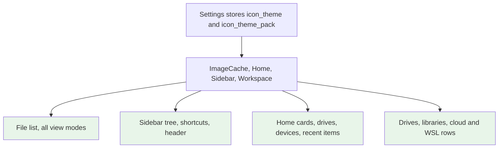
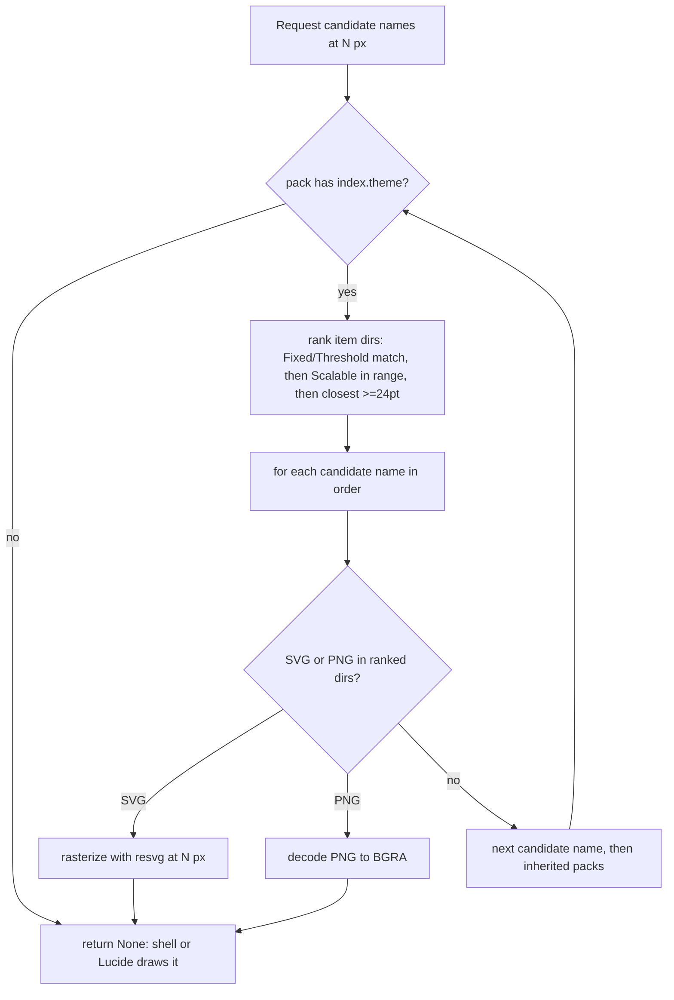

# Freedesktop Icon Themes — Design Document

## Overview

Settings → Appearance → **Icon theme** replaces file and folder icons with a Freedesktop-compliant icon theme installed in `%APPDATA%\rustyfiles\icon-themes`. The default entry, **Native (default)**, leaves every icon to Windows. Installing a pack is manual: copy its folder into `icon-themes`, then pick it in the dropdown. The folder icon button beside the selector opens `icon-themes` in a new RustyFiles tab and leaves Settings open.

> The [Freedesktop Icon Theme Specification](https://specifications.freedesktop.org/icon-theme-spec/icon-theme-spec-latest.html) is the standard on Linux and cross-desktop toolkits. Thousands of packs exist on [gnome-look.org](https://www.gnome-look.org/browse?cat=132&ord=rating), [Pling](https://www.pling.com/), and GitHub. Using the same layout on Windows gives users that ecosystem without converting artwork.

---

## Scope — Where the Pack Applies



| Surface | Applies? | Notes |
|---------|----------|-------|
| File list (all view modes) | Yes | icon name from extension, else category |
| Sidebar tree, shortcuts, header | Yes | drives and known folders use location names |
| Home page (pinned, drives, recent) | Yes | falls back to Lucide when the pack has no icon |
| Tags and usage buttons | No | keep Lucide glyphs |
| Program icons, `.lnk`, `.ico` | No | unique shell picture wins |
| Folder with a real custom `desktop.ini` icon | No | user-chosen picture wins |
| Content thumbnails (pictures, video) | No | preview pipeline untouched |
| Dock, Start menu, Explorer menus | No | native Windows surfaces |

---

## Pack Structure and Installation

A pack is a directory under `%APPDATA%\rustyfiles\icon-themes\` with an `index.theme` file. Copy the unpacked theme folder there; the dropdown lists every such directory each time it opens, so no restart is needed for a new pack.

```
icon-themes/
└── Papirus/
    ├── index.theme
    ├── scalable/
    │   ├── places/
    │   │   ├── folder.svg
    │   │   └── user-home.svg
    │   ├── apps/
    │   └── mimetypes/
    └── 24x24/
        ├── places/
        │   └── folder.png
        └── apps/
```

### `index.theme` — Required Keys

```ini
[Icon Theme]
Name=Papirus
Comment=Papirus icon theme
Inherits=hicolor
Directories=scalable/places,scalable/apps,scalable/mimetypes,24x24/places,24x24/apps

[scalable/places]
Size=64
Context=Places
Type=Scalable

[24x24/places]
Size=24
Context=Places
Type=Fixed
```

| Key | Purpose |
|-----|---------|
| `Name` | Human-readable pack name |
| `Inherits` | Fallback chain, for example `hicolor` or `breeze` |
| `Directories`, `ScaledDirectories` | Comma-separated subdirectories under the pack root |
| `[dirname]` section | `Size` (px), `Scale`, `Context`, `Type` (`Fixed`, `Scalable`, `Threshold`), `MinSize`, `MaxSize`, `Threshold` |

Symbolic subtrees (`*/symbolic*`) and UI-chrome contexts (`Actions`, `Animations`, `Status`, `Emblems`, `Emotes`, `Panel`) are excluded so toolbar glyphs such as `actions/16/directory.svg` never hijack folder icons. Small row icons are requested at `ICON_PX` (32 px) for HiDPI sharpness and so Breeze/Papirus packs resolve full-colour folder artwork instead of 16 pt monochrome panel glyphs.

---

## Resolution Algorithm



Candidate names are tried in order (`FindBestIcon`), each across ranked directories with SVG before PNG. Specific names such as `folder-downloads` in `scalable/places` therefore beat a generic `folder` fallback in an earlier fixed-size directory, and `folder` in `places/` beats `inode-directory` in `mimetypes/`.

A pack is third-party content. Pack names and `Directories` entries stay inside the pack folder; a traversal entry such as `../outside` is ignored. SVG rasterization refuses `<image href>` file references, so a pack cannot read arbitrary local files through `usvg`.

### Which Name Is Requested

| Entry | Names tried |
|-------|-------------|
| Folder | `folder`, `inode-directory`, then `directory` |
| Known folder (Desktop, Downloads, Documents, Pictures, Music, Videos, profile) | exact `KnownFolder` path, then direct children of profile / OneDrive roots by localized leaf name (never nested subfolders), falling back to `FOLDER_NAMES` |
| Drive | `drive-harddisk`, `drive-removable-media`, `drive-optical`, `network-server`, `folder-cloud` by kind |
| File | extension name first, then category fallback |

```rust
// icon_theme.rs
pub const FOLDER_NAMES: &[&str] = &["folder", "inode-directory", "directory"];
```

Known folders come from `rf_win::known::KnownFolder`, so localized folder names still match. OneDrive's root Pictures and Documents use the same type-based names as local folders, while subfolders inside `Downloads` or `Pictures` stay ordinary folders.

When a pack is active, folders in Grid, Cards, Desktop, Properties and Info views use the pack's artwork at tile size; with `Show thumbnails` off, tiles still request icons at full tile resolution (`icon_sized`) rather than upscaling 16 px row icons. Real content thumbnails (photos, video, PDFs, design files) are untouched when `Show thumbnails` is on. In **Native (default)** mode, Explorer folder previews and per-folder `READONLY | SYSTEM` shell caching run unchanged.

`desktop.ini` keeps the shell picture over an active pack only when it points to a real, present, user-chosen icon. Relative paths resolve against the folder that holds `desktop.ini`, and `%VARIABLES%` expand like Explorer does. Built-in Windows folder type icons (`LocalizedResourceName` with `imageres.dll` / `shell32.dll` / `windows.storage.dll`, or default folder resource indices) and OneDrive's automatic `OneDrive.exe` sync stamp yield to the theme, whereas user-chosen icons from Properties → Customize → Change Icon (such as `shell32.dll,127` or a custom `.ico`) win across file lists, sidebar pins, Home and the folder tree.

### Extension → Icon Name Mapping

| Extension | Freedesktop name |
|-----------|------------------|
| `.pdf` | `application-pdf` |
| `.zip` | `application-zip` |
| `.tar.gz`, `.tgz` | `application-x-compressed-tar` |
| `.exe`, `.msi` | `application-x-executable` |
| `.py` | `text-x-python` |
| `.rs` | `text-x-rust` |
| (unknown) | category name, else `text-x-generic` |

Full table: `crates/rf-app/src/icon_theme.rs` → `freedesktop_name()`.

---

## Variants (Dark / Light / Color)

Sibling packs that share a family prefix are variants:

```
Papirus           ← family
├── Papirus       ← base
├── Papirus-Dark  ← dark variant
└── Papirus-Light ← light variant
```

The **Variant** dropdown appears only when more than one sibling is installed. The selected pack folder name is the stored value, so choosing `Papirus-Dark` needs no extra setting. An explicit variant (`Papirus-Dark`, `Papirus-Light`, `Papirus-Blue`) stays put whatever the app appearance. Only the base pack follows Settings → Appearance: dark appearance prefers `*-Dark` or `*-Black`, light prefers `*-Light`, and the base pack is the fallback. Switching the app theme refreshes icons without a restart.

---

## Caching and Performance

| Cache | Key | Lifetime |
|-------|-----|----------|
| Parsed `index.theme` | pack name | until settings, pack list or appearance change |
| Effective pack per appearance | (pack, dark) | until settings, pack list or appearance change |
| Resolved icon path | (pack, names, size) | until settings, pack list or appearance change |
| Decoded picture | (path, size) | until settings, pack list or appearance change |
| Pending pack picture | (pack, dark, names, size) | one repaint after the worker finishes |

`settings::effective_dark()` is an atomic. The OS appearance observer and the settings page update it, so rows never read the registry. Known-folder paths are resolved once by `prewarm_known_folders()` at startup or when a pack is selected, before rows ask for icon names. Pack lookup, `index.theme` parsing, `desktop.ini` parsing and SVG/PNG decoding run on background workers for every size; row rendering only queues the work and repaints on completion. Opening the Settings dropdown scans the pack directory once per change; it does not run per row. With no pack selected, list, Grid, Cards and Desktop keep the native shell icon path from `main`, while Home keeps its Lucide icons.

**Prewarming** (`settings::prewarm_icon_pack`): at startup and on pack, theme or appearance changes, common icons are rasterized on a background executor so the first folder paint does not block the UI thread.

A pack added while the app runs appears when the Settings dropdown opens. Picking a pack, a variant or a new appearance clears both the resolved paths and the picture cache. Settings changes that do not touch appearance or packs leave those caches alone. Every pack file, including `index.theme`, is capped at 4 MiB; SVG file references are refused too.

**SVG → BGRA pipeline** (`crates/rf-app/src/icon_theme.rs`):

1. `resvg` renders SVG → `tiny_skia::Pixmap` (premultiplied RGBA).
2. Premultiplied → straight alpha.
3. RGBA → BGRA byte swap (GPUI expects BGRA).
4. `RenderImage` goes into the decode cache.

Skipping step 3 would swap red and blue channels.

---

## Example Themes to Try

| Theme | License | Download | Notes |
|-------|---------|----------|-------|
| **Papirus** | GPL-3.0 | [gnome-look.org](https://www.gnome-look.org/p/1166289/) / [GitHub](https://github.com/PapirusDevelopmentTeam/papirus-icon-theme) | Large coverage, Dark/Light/color variants |
| **Tela** | GPL-3.0 | [gnome-look.org](https://www.gnome-look.org/p/1279924/) / [GitHub](https://github.com/vinceliuice/Tela-icon-theme) | Flat, colorful, multiple accents |
| **Numix** | GPL-3.0 | [gnome-look.org](https://www.gnome-look.org/p/1016984/) / [GitHub](https://github.com/numixproject/numix-icon-theme) | Circle folders, vibrant |
| **Breeze** | LGPL-3.0 | [KDE Store](https://store.kde.org/p/1169519/) | KDE default, clean |
| **WhiteSur** | GPL-3.0 | [gnome-look.org](https://www.gnome-look.org/p/1403328/) / [GitHub](https://github.com/vinceliuice/WhiteSur-icon-theme) | macOS Big Sur style |
| **Colloid** | GPL-3.0 | [gnome-look.org](https://www.gnome-look.org/p/1491369/) / [GitHub](https://github.com/vinceliuice/Colloid-icon-theme) | Rounded, Material-like |

On gnome-look.org, filter by *Icon Themes* and sort by rating or downloads.

---

## Limits

- No pack is bundled and the app never downloads one. `hicolor` is not bundled either; without an icon in the pack and its `Inherits` chain, the shell or Lucide draws it.
- Replacing a pack's files on disk needs an app restart. Adding a new pack does not.
- Windows `.ico`, `.dll` and `.icl` theme formats are not read.
- Dock, Start menu and toolbar icons stay with Windows.

---

## Compatibility

### Theme folders

`Settings → Appearance → Theme folder` is a separate, simpler override: a folder with `icons\folder`, extension pictures and `icons\file`. The two settings can be used together. Pictures from the selected theme folder win; the Freedesktop pack supplies every icon the theme folder does not define. An empty `theme_folder` (the default) leaves the pack behavior unchanged.

- Settings files without `icon_theme` or `icon_theme_pack` keep native icons.
- Unknown `icon_theme` values deserialize to `Legacy`, which behaves like `Windows`; existing settings keep loading.
- Updating the app does not change the appearance of existing installations.

---

## References

- [Freedesktop Icon Theme Specification](https://specifications.freedesktop.org/icon-theme-spec/icon-theme-spec-latest.html)
- [Icon Naming Specification](https://specifications.freedesktop.org/icon-naming-spec/icon-naming-spec-latest.html)
- [gnome-look.org — Icon Themes](https://www.gnome-look.org/browse?cat=132)
- [Pling — Icon Themes](https://www.pling.com/browse?cat=132)
- `crates/rf-app/src/icon_theme.rs` — pack loader, name resolution, SVG rasterization
- `crates/rf-app/src/image_cache.rs` — list icons, custom-folder rule
- `crates/rf-app/src/icons.rs` — file category mapping
- `crates/rf-app/src/settings_view.rs` — icon-theme controls
